# 图层系统设计与使用指南

## 概述

本文是图层系统的**唯一入口文档**，覆盖：图层数据模型、图层与图元/位图/填充色块的关系、
文件导入时的图层还原规则、图层管理（服务层、对话框、通知、撤销）与持久化。

阅读顺序建议：先看第 1、2 节建立模型，再按需查阅导入（第 3 节）、位图（第 4 节）、
填充（第 5 节）、管理与持久化（第 6、7 节）。

---

## 1. 数据模型

### 1.1 三层结构

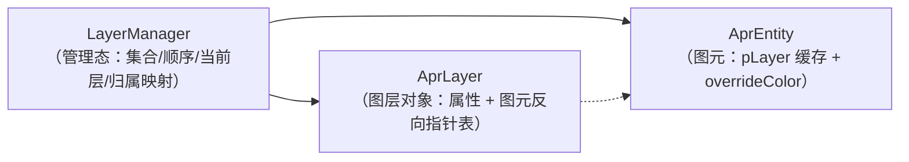

| 角色 | 类型 | 位置 | 职责 |
|------|------|------|------|
| 管理态 | `LayerManager` | `Engine/2D/Include/Engine2D/Interaction/LayerManager.h` | 图层集合、顺序、当前图层、`图元 id → 图层 id` 归属表、事件广播 |
| 图层属性 | `Eg::LayerProps` | `Engine/Common/Include/Engine/Layer/LayerProps.h` | 一个图层全部属性的**唯一定义处**（管理态、视图副本、撤销快照共用） |
| 图层对象 | `Eg::AprLayer` | `Engine/Common/Include/Engine/Layer/AprLayer.h` | 持有一份 `LayerProps`；持有该层图元的**非拥有**指针列表 |
| 只读查询 | `ILayerQuery` | `Engine/2D/Include/Engine2D/Interaction/ILayerQuery.h` | 加工链路（作业规格、`MotionPlanCompiler`、CAM 桥接）只依赖它，改不了图层 |
| 图元 | `Eg::AprEntity` | `Engine/Common/Include/Engine/AprEntity/AprEntity.h` | `pLayer` 是派生缓存，`m_overrideColor` 是可选的显式颜色 |

`LayerManager` 是唯一真值源；`AprLayer` 与 `AprEntity::pLayer` 都是派生视图。

### 1.2 图层属性：`Eg::LayerProps`（唯一数据来源，2026-11-23）

字段：`name`、`color`、`visible`、`locked`、`fill`、`fillColor`、`layerType`、
`hardwareProfileId`、`fillHardwareProfileId`、`output`、`defaultProcessId`、
`hasProcessParams`、`processParams`。

- `LayerManager::LayerInfo` 是 `Eg::LayerProps` 的别名；
- `AprLayer` 持有一份 `LayerProps`，`LayerManager` 每次修改后用 `syncAprLayer()` → `AprLayer::setProps()` **整体覆盖**；
- 撤销快照 `LayerPropertiesSnapshot` 直接继承 `LayerProps`，`captureDocument` / `restoreDocument` 整体拷贝。

以前这组字段手抄了 7 处（`LayerInfo`、`AprLayer` 成员、`syncAprLayerFromInfo`、快照结构、
capture、restore、proto），`hardwareProfileId` / `processParams` 等还只存在于 `LayerInfo`。
现在新增字段只需改 `LayerProps`（以及 `.apr` 的 proto 读写）。
`LayerProps::operator==` 依赖 `ProcessParams::operator==`，`ProcessParams` 新增字段时须同步补进相等比较。

**工艺参数解析**只写在 `LayerManager::effectiveProcessParams()`：带文档参数用它，否则轮廓
Profile 经 `toProcessParams()`（`HardwareProfileManager.h`）换算。`fillHardwareProfileId` 目前不参与加工取参。

**加工顺序**（与显示顺序独立，2026-11-23）：加工消费方一律用 `ILayerQuery::machiningLayerOrder()`。
未自定义时等于显示顺序；在图层管理器「加工顺序」分组里调整一次后两者脱钩（`LayerManager::m_machiningOrder`），
「跟随显示顺序」可恢复。自定义列表里没有的图层（后来新建的）排在末尾；删除图层同时移出列表。
撤销：`LayerEditService::moveLayerInMachiningOrder / setMachiningLayerOrder / resetMachiningOrder` 只记录前后两份列表；
整文档快照（`LayerDocumentSnapshot::machiningOrder`）也带它。落盘：`.apr` 根消息 `machining_layer_order = 10`
（图层 id 列表，空 = 跟随显示顺序，未调整过的文档保存字节不变）；打开文档时经 `sourceToLayerId` 换成运行时 id，
追加导入不改当前顺序，打开不带该字段的文件会清掉上一份文档的自定义顺序。

### 1.2.1 图层类型约束：矢量 / 填充 / 位图（2026-11-23）

| 类型 | 判定 | 可放的图元 |
|------|------|-----------|
| 矢量层 | `layerType == VECTOR && !fill` | 除位图外的所有图元 |
| 填充层 | `layerType == VECTOR && fill` | 同矢量层；层上图元参与色块剖分，色块（`FILL_REGION`）用 `fillColor` |
| 位图层 | `layerType == BITMAP` | 只放位图（`EType::IMAGE`） |

规则全部在 `LayerManager`（`isEntityCompatible` / `canHoldEntity` / `resolveLayerForEntity`）：

- 位图只进位图层、其余图元只进矢量层；群组不受限。`assignEntityToLayer` 类型不符直接拒绝，
  `LayerEditService::assignEntitiesToLayer` 整批拒绝。
- 新图元落层只有一个入口 `assignEntityToCurrentLayer` → `resolveLayerForEntity`：当前层能放就放当前层；
  不能放则改投同类型、未锁定、可见优先（矢量优先非填充层）的图层；一个都没有就新建。
  导入/粘贴/拖放图片原来各自抄了一份「找位图层」的代码，已全部改为调用它。
- 导入映射（`applyEntityLayerMap`）与场景回绑（`rebindEntityLayer`）遇到类型不符时同样改投，不会把图片放进矢量层。
- 0 号默认层恒为矢量层；位图层不能设为填充层；填充层不能改成位图层；层上已有另一类图元时不能改类型。
- 删除图层：矢量图元转到 0 号层；位图转到另一个位图层（优先未锁定），没有就新建一个；随删除一起撤销。
- 自动新建的图层（位图层、填充层）颜色与现有图层区分；填充层自动模式不复用锁定的填充层。
- 双向索引自检：`LayerManager::verifyConsistency()` 检查「图层 → 图元列表」与「图元 → 归属表 / layerId / layer()」
  两个方向一致且类型匹配，`LayerTypeRulesTests` 在每步编辑与撤销后调用。

> 早期还有 `lineWidth` / `lineStyle` 两个字段（以及 `setLayerLineWidth` / `setLayerLineStyle`
> 接口）。它们既不进 `AprLayer`、也不进 proto 与数据库，全工程没有任何调用方，
> 属于"看起来能改其实是空操作"的假能力，已连同字段一起删除。图层线宽如需支持，
> 必须一次打通 `LayerInfo → AprLayer → 渲染管线 → 持久化` 四处。

> **不变量：`LayerInfo` 与 `AprLayer` 必须一致。** 两者是同一份 `LayerProps` 的两个副本——
> 管理态读 `LayerInfo`，视图侧（渲染判定、序列化）读 `AprLayer`。现在由整体覆盖保证
> （`syncAprLayer` / `syncAprLayerFromInfo` → `setProps`），不再存在「漏同步某个字段」的可能；
> 历史上 `duplicateLayer` 与 `findOrCreateFillLayer` 漏同步 `layerType` / `fill` / `fillColor`
> 就是逐字段抄写的后果。回归测试：`LayerPropsTest.AprLayerMirrorsEveryFieldAfterMutations`。

### 1.3 `AprLayer` 字段与「集合」语义

字段：`nId`、`nIndex`、`m_props`（`LayerProps`），以及 `m_entities`（非拥有指针）与 `m_indexOf`。
逐字段 getter/setter 保留（渲染、序列化、DXF 导出在用），读写的都是 `m_props`。

`nIndex` 是图层在 `m_layerOrder` 中的位置（由 `syncLayerOrderIndices()` 统一写入），
即**图层面板里的行号**；它同时决定绘制次序，**0 = 面板首行 = 绘制在最上层**（见 2.5）。

`m_indexOf` 是 `AprEntity* → 下标` 的索引，因此：

- `hasEntity` / `removeEntity` 是 **O(1)**；`removeEntity` 用「与末尾交换后弹出」实现。
- **`getEntities()` 的顺序不保证**：任何一次移除都会打乱剩余元素的相对顺序。
  需要稳定顺序请按 id 或场景顺序自行排序，不要依赖图层内的排列。

为什么要这张索引：导入一个大文件时 `LayerManager::applyEntityLayerMap` 会对每个图元各调
一次 `removeEntity`（旧图层）+ `addEntity`（新图层）。原来两者都是线性 `std::find`，
在「全部图元同色同层」的 SVG 上实测是 O(N²)——2 万图元图层还原 29 ms、4 万图元 111 ms
（4 倍于 2 万，二次增长）。换索引后同样样本降到 10 ms / 24 ms。

### 1.4 默认图层表

`LayerManager` 构造时由 `ensureDefaultLayer()` 建立初始集合（仅在集合为空时执行）：

| 图层 id | 名称 | 颜色 | 类型 |
|---------|------|------|------|
| 0 | `Layer 0` | 黑 (0,0,0) | VECTOR |
| 1 | `Layer 1` | 红 (255,0,0) | VECTOR |
| 2 | `Layer 2` | 绿 (0,255,0) | VECTOR |
| 3 | `Layer 3` | 蓝 (0,0,255) | VECTOR |
| 4 | `Layer 4` | 橙 (255,165,0) | VECTOR |
| 5 | `Layer 5` | 紫 (128,0,128) | VECTOR |
| 6 | `Layer 6` | 青 (0,255,255) | VECTOR |
| 7 | `Layer 7` | 粉 (255,192,203) | VECTOR |
| 8 | `Bitmap 1` | 灰 (100,100,100) | BITMAP |

初始 `currentLayerId = 0`，`nextLayerId = 9`。图层数量上限 `kMaxLayerCount = 1024`，
达到上限后所有「创建图层」的接口一律拒绝并返回 `-1` / `0`，调用方需自行兜底。

> ⚠️ 默认 8 个矢量层的颜色恰好覆盖黑/红/绿/蓝等 CAD 最常见的图层色。
> 任何「按颜色查找或创建图层」的逻辑都必须先按**名称**匹配，否则源文件图层会被
> 整体吸进默认层（历史上导入丢图层就是这么发生的，见 3.6）。

### 1.5 归属的权威来源

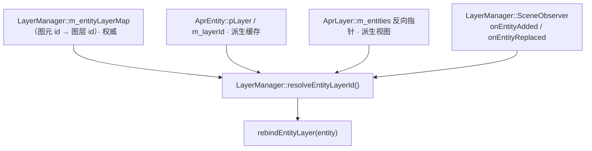

`m_entityLayerMap` 是权威来源，`AprEntity::pLayer` 只是缓存，两者不一致时以映射表为准。
`SceneObserver` 在**图元入场 / 同 id 换对象**时调用 `rebindEntityLayer()` 重新解析归属。

`m_entityLayerMap` 与 `AprLayer::m_entities` 的维护方式**刻意不同**：

- 映射表**保留已删除图元的条目**（每条约 16 字节），只在 `clearEntityMappings()`
  （新建 / 关闭文档）时整表清空。
- `AprLayer` 的反向指针表由 `SceneManager` 的离场 / 替换钩子维护。

早先的实现里有 `onSceneChanged → pruneStaleEntityMappings()`，图元一删就抹掉映射，
这与撤销直接冲突：撤销把图元插回来时映射已不存在，只能回落到图元自带的 `AprLayer*`，
而 `restoreDocument()` 会重建全部 `AprLayer`，那个指针可能已经悬空。现在不再 prune。

---

## 2. 图层与图元的关系

### 2.1 归属规则

- 一个图元**同时只属于一个图层**（`m_entityLayerMap` 是 `id → 单个 layerId`）。
- `assignEntityToLayer(entity, layerId)` 是唯一改归属的入口：从旧 `AprLayer` 移除 →
   写映射表 → 写 `pLayer` / `m_layerId` → 加入新 `AprLayer` → 标记 `setModified()` →
   调用 `markEntityLayerChanged()` 登记变更事件。**`markEntityLayerChanged` 是强制性的**：
   增量渲染依赖变更流重新 clone 图元快照，缺少它会导致「颜色不对、z-order 恢复」
   等渲染漂移（历史上导入还原图层、图层删改都曾因此表现异常）。
 - 撤销 / 重做恢复归属走 `LayerEditService::pushEntityLayerChange` →
   `LayerManager::applyEntityLayerMap`（批量模式，只发一次场景变更通知）。
 - `rebindEntityLayer(entity)` 在实体入场 / 同 id 换对象时调用：先查 `m_entityLayerMap`
   （权威来源），缺失则与存活 `AprLayer` 做指针比对兜底，都不中则视为图层 0。
   **关键**：先从旧 `AprLayer` 移除实体，再添加到新 `AprLayer`，避免实体同时存在于两个图层。
 - `getEntityLayer()` → `resolveEntityLayerId()`，映射缺失时做**指针比对**兜底
   （不解引用，因为可能悬空），命中存活 `AprLayer` 才算数；都不命中则视为图层 0。
 - `hasExplicitLayerAssignment()` 可判断映射表中是否存在显式条目。
 - 图层删改（`deleteLayer` / `setLayerColor` / `setLayerFillColor`）同样调用
   `markEntityLayerChanged` 登记受影响的实体，确保增量渲染正确更新。

### 2.2 颜色解析链

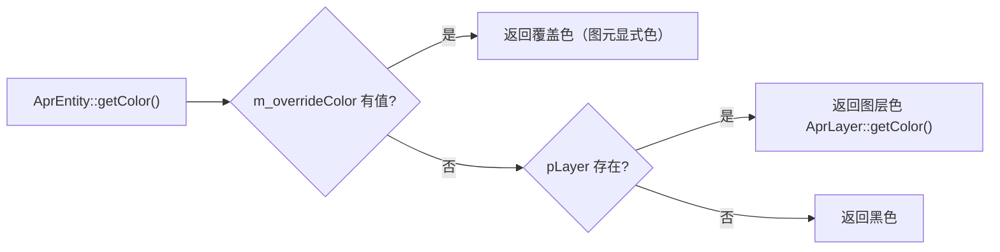

因此「改图层颜色，图元跟着变色」只在图元**没有覆盖色**时成立。导入时是否写覆盖色由
IR 的颜色来源策略决定，见 3.5。

> **无图层实体的防御性处理**：`EntityGeometryEmitter::emitEntityGeometry`、
> `SelectionOutlineBuilder::collectEntityPolyline`、`BezierAlgorithms::discretizeEntity`
> 在 `entity.layer()` 为 null 时直接跳过处理（不再渲染/离散化），防止访问空指针导致崩溃。
> `SceneManager::gatherGeometry` 也会在遍历时跳过 `layer == nullptr` 的实体。

### 2.3 新图元进入哪个图层

绘制 / 粘贴等常规新增走 `SceneEditService`，末尾调用
`LayerManager::assignEntityToCurrentLayer()`，它会按类型做**自动切换**：

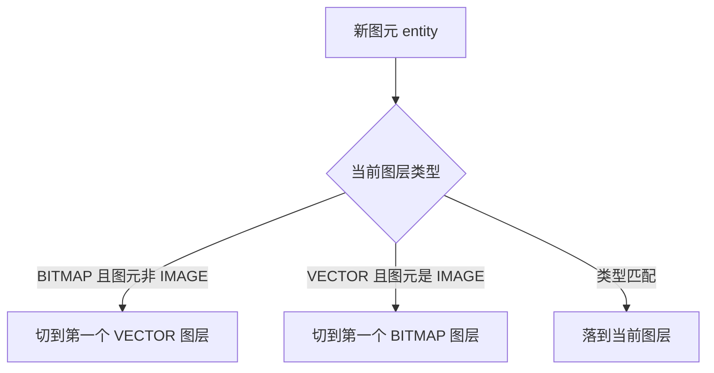

换句话说：矢量图形不会被放进位图图层，位图也不会被放进矢量图层。

### 2.4 图元入场与回绑

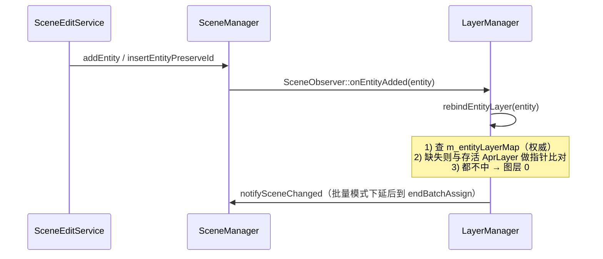

> 归属解析刻意不做「按颜色归层」的猜测：颜色是图元的显示属性，不是归属依据。

### 2.5 图层顺序决定绘制次序（z-order）

**约定：图层面板里越靠上的行，绘制越靠上（后画）。** 面板首行是 `m_layerOrder[0]`，
所以 `Eg::AprLayer::getIndex() == 0` 的图层画在最后。

链路（2D 场景图元）：

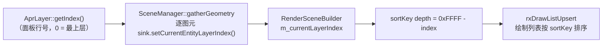

要点：

- 排序键布局是 `layer(8) | transparent(8) | depth(16) | seq(16)`，高位优先
  （`Render::RT::rxMakeSortKey`）。场景图元统一用 `layer = kSceneLayer(100)`——
  **不能**把图层序号塞进 `layer`：8 位装不下 1024 个图层，且该字段已被约定值占用
  （场景 100 / 覆盖层 200 / 环境层）。因此图层序号进 `depth`(16 位)，取反后
  序号越小 depth 越大、越晚绘制。
- 同一图层内部的先后仍由 `RenderSceneBuilder` 的 `sequence` 决定（首次出现的顺序，
  跨轮次保持稳定），因此同层图元的绘制次序不会随刷新抖动。
- **增量路径必须显式带上图层序号**：`RenderWidget::addRenderEntity /
  modifyRenderEntity` 有 `layerIndex` 参数，由 `SceneRefreshCoordinator` 在**主线程**
  从活图元解析（图元快照 clone 不复制图层指针，且工作线程不允许访问 `SceneManager`）。
  漏传会让新图元拿到更大的 `sequence`，永远画在最上面。
- **图层换序后必须触发一次全量装配**：换序只改 `LayerManager` 的图层顺序，图元本身没变、
  不会进脏集合，存量 sortKey 因此不会重算。触发点在 `UiStateBridge2D`：
  `QtLayerManagerBridge::sigLayerOrderChanged → RenderViewport2D::requestFullRefresh()`。
- `ISceneGeometrySink::setCurrentEntityLayerIndex()` 是**默认空实现**：不区分图层
  z-order 的渲染器（3D 网格、软件渲染）忽略它即退化为「按提交顺序绘制」。
- 性能取舍：按 sortKey 排序后，不同图层的相邻段不再落到一起，
  `DrawList` 的「相邻同伴合并」会因此少合一些批，draw call 数上升。
  这是"图层 z-order 正确"必然要付的代价。

---

## 3. 文件导入与图层

### 3.1 导入总链路

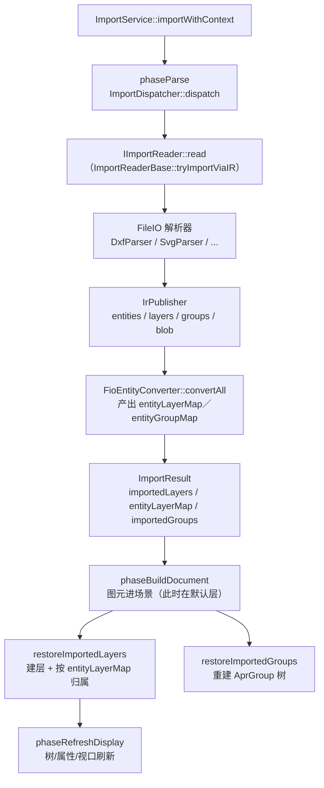

关键时序约束：**必须先让图元进场景拿到运行时 `EntityId`，才能按映射表反查归属**。
所以「建层 + 归属」放在 `phaseBuildDocument` 末尾，而不是解析阶段。

### 3.2 IR 层的图层契约

跨 DLL 的中立结构定义在 `FileIO/FileIO/Include/FileIO/FioTypes.h`：

| 结构 | 关键字段 | 说明 |
|------|----------|------|
| `IrLayerInfo` | `sourceId`（1-based）、`name[256]`、`color`（0xAARRGGBB）、`visible`、`locked` | 源文件图层表 |
| `EntityInfo` | `layerSourceId`（指向 `IrLayerInfo::sourceId`，0 = 未分配）、`groupSourceId` | 图元的单向归属 |
| `EntityInfo` | `color` + `colorPolicy`（`Explicit` / `ByLayer`） | 颜色值与其**来源语义** |

归属刻意只做**单向表达**（图元侧记 `layerSourceId`），图层侧不存成员列表——双向存储一旦
不一致就没有裁决依据，畸形文件很容易触发。

`IrPublisher` 侧还有两个上限：图层 `kMaxLayers = 1024`（与 `LayerManager::kMaxLayerCount`
对齐），超限时 `addLayer` 返回 0，图元落到下游默认层并记一条 warning；同名图层只登记一次。

### 3.3 DXF

- **图层表**：`TABLES/LAYER` 一定在 `BLOCKS` / `ENTITIES` 之前，所以 `addLayer()` 回调里
  就地登记图层并解析颜色，图元产出当场即可拿到 `layerSourceId`，不需要「先记名、读完回填」。
- **颜色**：`真彩色(420/color24)` > `ACI 索引(62)` > `BYLAYER/BYBLOCK`。
  ACI 走 libdxfrw 的 `dxfColors` 调色板；注意 **ACI 7 = 纯黑**（不是白），而许多 DXF 的
  图层默认色就是 7。
- **可见性 / 锁定**：`flags` 位 0 = 冻结、`color < 0` = 图层关闭 → `IrLayerInfo::visible`；
  `flags` 位 2 = locked → `IrLayerInfo::locked`。
- **图层名 `"0"`**：DXF 约定 `"0"` 是默认图层，导入时直接映射到软件的 `Layer 0`。
- **块（INSERT）**：块内图元若位于图层 `"0"`，实例化时改随 INSERT 所在图层；颜色为
  `BYBLOCK(0)` 时改随 INSERT 的颜色。这两条是「块能套用样式」的关键规则。
- **未声明的图层**：实体引用了 `TABLES` 里没有的图层时补登记一个默认色图层，
  而不是返回 0 让图元静默塌到默认层。
- **暂不支持**：`DIMENSION`、`LEADER`、`HATCH` 填充图案、`RAY`/`XLINE`、外部 `IMAGE` 引用
  等会发 warning 后跳过（不静默丢弃，便于排查"少东西"）。

### 3.4 SVG

SVG 没有标准图层概念，解析器**按颜色分层**：

- 颜色 → `IrLayerInfo`，图层名取 `#RRGGBB`（导入后在图层面板里能直接看出这层是什么颜色）。
- 上限 `kMaxSvgLayers = 256`，超出部分并入第一个图层并记 warning（按颜色分层时
  256 种已远超真实激光工艺需求；不返回 0 是为了避免图元「图层归属凭空消失」）。
- **不按 `shape id` 分层**：nanosvg 只把 `<g id>` 继承给无 id 的子 shape，Figma / SVGO
  导出的文件每个元素都带唯一 id，按 id 分层会变成「1 个图形 = 1 个图层」，1000 个 shape
  直接撞穿图层上限。原始 id 降级写入 `EntityInfo::name`，源对象仍可追溯。
- 解析前会把内联 `<style>` 里的 class 样式展开成元素属性，否则 nanosvg 看不到颜色 → 整图变黑。
- **图元颜色策略为 `ByLayer`**（见 3.5）：层是按颜色建的，层色就等于该 shape 的原色，所以
  「随层色」在导入后的观感与源文件完全一致；好处是图元被移到别的图层、或图层颜色被修改时
  显示色会跟着变（若写成显式覆盖色，颜色会永远钉死在源文件的颜色上）。

> **取色陷阱**：nanosvg 的颜色打包宏是 `NSVG_RGB(r,g,b) = r | (g<<8) | (b<<16)`——**低位是 R、
> 高位是 B**，既不是 ARGB 也不是 ABGR。按 ABGR 解读会把 R/B 读反，红色 `#FF0000` 会变成
> 蓝色、图层名也跟着变成 `#0000FF`（已修复，`extractSvgColor` 是唯一读 `paint.color` 的地方）。

> 具名图层（Inkscape 的 `inkscape:label`、Illustrator 的 `Layer_N` `<g>`）目前**未**还原，
> 属于后续能力，不在当前实现范围内。

### 3.5 颜色保真策略（`colorPolicy`）

同一次导入必须区分「实体自身的显式色」和「随层色」，否则无法同时满足颜色一致与
图层色语义：

| 来源 | `colorPolicy` | 转换层行为 | 结果 |
|------|---------------|------------|------|
| DXF 真彩色 / ACI 1-255 | `Explicit` | 写 `setOverrideColor` | 图元固定显示自身颜色，改图层色不影响它 |
| DXF `BYLAYER(256)` / `BYBLOCK(0)` | `ByLayer` | **不写**覆盖色 | 显示色取所属图层颜色，改图层色图元跟着变（与 AutoCAD 一致） |
| SVG 描边/填充色 | `ByLayer` | **不写**覆盖色 | SVG 按颜色分层、层色即该 shape 的原色：导入后显示色与源文件一致，移动到别的图层或改图层色时图元跟着变 |
| 未区分来源的旧解析器 | 默认 `Explicit` | 同 `Explicit` | 行为保持不变 |

转换实现在 `Engine/3D/Src/Import/FioEntityConverter.cpp`：仅 `Explicit` 且颜色非 0 时才
调用 `setOverrideColor`。

### 3.6 落层规则：图层 = 颜色（2026-11-23）

图层的身份是颜色（与 LightBurn 一致）：一种颜色一个图层，图层上的图元显示该图层的颜色。

**外来格式（DXF / SVG / PLT …）→ `ImportService::restoreLayersByColor`**

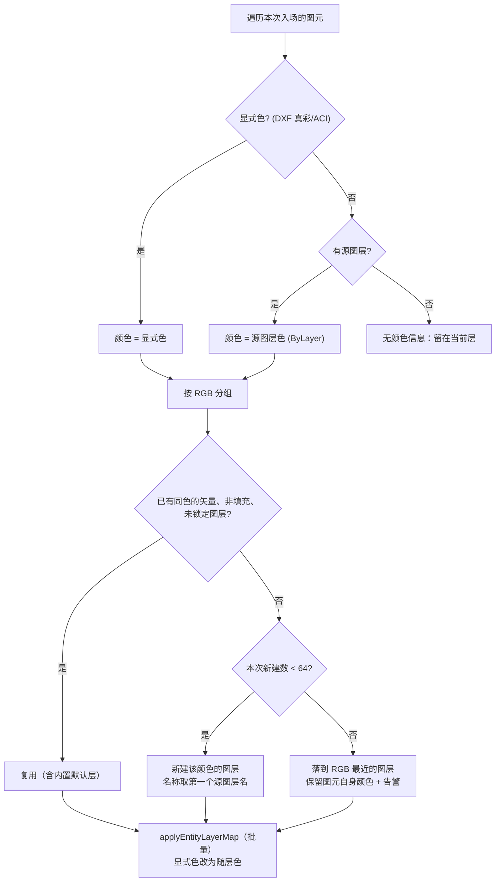

规则：

1. **按颜色合层，源图层名不保留。** 同色的源图层合并成一个图层；DXF 图层 "0" 不再特殊对待。
   内置默认层（黑/红/绿/蓝/…）就是对应颜色的图层，导入常见色不会新建图层。
2. **显式色决定图层**，落层后清掉显式色、改为随层色（层色就是它原来的颜色，显示不变；之后改图层色图元跟着变）。
3. **同色层不能接收图元**（锁定 / 填充 / 位图层）：同色只能有一个图层，不另建；图元落到 RGB 最近的可用图层、保留自身显示色并告警。
4. **每次导入最多新建 64 个颜色层**，其余颜色就近合并并保留自身显示色、告警——避免真彩色文件刷出上千个图层。
5. 新建图层的可见性取合并的源图层是否有任一可见；不导入锁定状态。

**打开原生 `.apr` → 图层文档按文件原样重建**（`ImportService::restoreNativeDocument`）：
打开前图层文档先 `resetToDefaultDocument()`，再用文件内容拼一份 `LayerDocumentSnapshot` 交给
`LayerManager::restoreDocument()` 整体替换——图层 id / 顺序 / 显示属性 / 加工语义 / Profile 绑定、
ProcessData 回灌的图层工艺参数、加工顺序、作业级工艺模型一律以文件为准，不与当前图层按名或按色合并；
硬件 Profile 值集整体替换（文件为空则重置为默认）。指向不存在 Profile 的绑定回落默认并告警；
类型不符的图元归属（位图放进矢量层等）恢复后改投同类型图层。
**追加导入 `.apr`** 与外来格式一样按颜色落层，文件里的图层加工参数不带入当前文档。

**撞色**：`LayerManager::setLayerColor` 拒绝别的图层在用的颜色（按 RGB 比较，不比 alpha），
`LayerEditService::setLayerColor` 在压撤销命令前同样拒绝，图层管理对话框提示；`findLayerByColor` 按 RGB 查；
`createLayer` / `duplicateLayer` / 自动建的位图层与填充层都分配互不相同的颜色。

其余必须遵守的规则：

- **归属只认本次导入的图元**（入场 ID + `entityLayerMap`），不做全场景扫描。全场景扫描会误改文档里
   已有的其他图元（合并导入时尤其明显）。
- **解析失败/映射缺失的图元留在落层时分到的当前层**，并统计告警，不阻断导入。
- **映射表的键必须是「入库后的最终 ID」**。`entityLayerMap` 由 `FioEntityConverter`
   在解析期产出，而 `SceneEditService::addEntities` 会在入库前把「ID 为 0 / 临时 ID /
   与场景已有图元冲突」的图元换成新持久 ID —— 键一旦对不上，`applyEntityLayerMap`
   会一条都查不到（日志表现为 `assigned 0 entities`），整批图元落回默认图层。
   两道防线：转换期显式取 `getNextPersistentId()`；入库时按 `addEntities` 返回的
   最终 ID 建 `idRemap` 修正表。**导入必须走同步路径（主线程）**，此时若有工具处于
   激活状态，`ToolManager` 已压入临时 ID 作用域，构造函数拿到的就是负数 ID。
6. **每个来源图层输出一条 INFO 日志（每层只记一次）**，格式为
   `Source layer '<源层名>' #RRGGBB -> runtime id=N ('<运行时层名>') <created|reused|回退>，N 个图元`。
   汇总行（`Layer restore: N total, ...`）看不出某层是被新建、被复用还是回退到了默认层，
   也核对不了图层名与颜色，多图层文件排查分层问题时要靠这一组逐层日志。
   最后一列是**本次导入**落在该层的图元数，不是场景总数。

> 版本提示：早期实现曾在此处「遍历全场景实体、按 `getColor()` 找或建同色图层」，
> 已移除。不要再引入任何基于颜色的图层归属推断。

### 3.7 群组 ≠ 图层

导入时**群组结构与图层结构是两套独立体系**，不要混淆：

| | 图层 | 群组 |
|---|---|---|
| IR 结构 | `IrLayerInfo` + `EntityInfo::layerSourceId` | `IrGroupInfo` + `EntityInfo::groupSourceId` |
| 运行时对象 | `AprLayer`（由 `LayerManager` 管） | `AprGroup`（由 `SceneManager::groupManager()` 管） |
| 来源 | DXF 的 `LAYER` 表、SVG 的颜色 | DXF 的 `INSERT` 块引用、SVG 的 `<g>`、OBJ 的 `o/g/usemtl` |
| 基数关系 | 一个图元属于**一个**图层 | 一个图元最多属于**一个**群组；群组可嵌套 |
| 3D 网格 | 不参与 | 不参与 |

DXF 的一次 `INSERT = 一个群组`（名字形如 `Block:<块名>`），嵌套引用递归成子群组。
群组重建带环检测（`wouldCreateCycle` 兜底），避免畸形文件把场景挂成环导致遍历无限递归。

### 3.8 与旧路径的关系

Main 侧所有导入读取器（含 DXF）都只走 IR 主链 `ImportReaderBase::readViaIR`。
原先 DXF 在 IR 失败时回退的 `ImportReaderBase::readViaLegacy` 已于 2026-11-22 删除：
它**不还原图层与群组**，其 IR 重试分支还漏掉了单位换算（见 `Docs/09-框架审查/数据流审查.md` I-2）。
现在 IR 失败时导入直接报错，不再静默降级；日志里也不会再出现 `falling back to legacy`。
FileIO 层的旧接口（`ILegacyParser::parse`、`FileIOManager::importFile`、`Fio::FileImporter`）也已于同日删除，导入只剩 `importToIR` 一条链路（见 `FileIO/README.md` §5.9）。

DXF 图层还原的两条规则（2026-11-22 补齐）：

- 图层名**大小写不敏感**：图元写 `cut`、LAYER 表里是 `CUT` 时归到同一层，沿用表里的颜色与关闭/冻结状态；
  旧实现会补登记一个默认黑色、可见的 `cut` 新层。
- 块内图层 `0` / 颜色 BYBLOCK 随引用方，**对嵌套引用逐层成立**：块里图层 `0` 上的 INSERT 展开出的
  图层 `0` 图元落到最外层 INSERT 的图层；旧实现只处理了一层，嵌套块的内容会停在图层 `0`。

---

## 4. 位图与图层

位图与矢量在图层语义上**强制分离**：位图图元（`Eg::EType::IMAGE`，`AprImage`）应落在
`LayerType::BITMAP` 图层上。

### 4.1 导入调用链

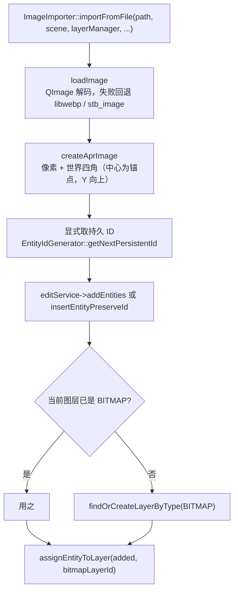

要点：

- **必须显式分配持久 ID 再插入**。若让 `insertEntityPreserveId` 替换掉临时 ID，
  随后 `findAprEntityById` 就查不到，位图不会被分层（早先的 bug）。
- 世界尺寸由 DPI 换算（`Fio::pixelsToUnit` + `readImageInfo`），默认单位为毫米。
- 粘贴路径同理：`ImagePasteService` 走 `findOrCreateLayerByType(BITMAP)` + `assignEntityToLayer`。

### 4.2 位图图层的查找语义

`findOrCreateLayerByType(BITMAP)` 按 `m_layerOrder` **创建顺序**返回**第一个**同类型图层。
因此默认的 `Bitmap 1`（id 8）会被优先命中；用户手工新建的位图图层只有在它被删除后才会被使用。

---

## 5. 填充色块与图层

### 5.1 填充图层标志

「填充图层」是**矢量图层上的一个布尔标记** `fill`，不是一个独立类型：

- `LayerManager::setLayerFill(id, true)` / `isLayerFill(id)`（带撤销版本在 `LayerEditService`）。
- 配套的 `fillColor`（`setLayerFillColor` / `layerFillColor`）是**该层色块填充使用的颜色**。
- `findOrCreateFillLayer()` 返回**第一个** `fill == true` 的图层；不存在则新建
  `Fill Layer`（`layerType = VECTOR`、`fill = true`）。
- 语义：该图层上的图元**参与色块填充剖分**。`EntityColorFiller::fillLayers()` 就是遍历
  所有 `isLayerFill()` 的图层逐个填。

### 5.2 两种填充入口

| 入口 | 触发 | 目标图层 | 颜色真值来源 |
|------|------|----------|--------------|
| 整层填充 `fillLayers` / `fillLayer` | 对已标记为填充图层的图层 | 该图层自身 | 图层 `fillColor` |
| 选中图元填充 `fillSelectedEntities` | 算法任务 `FillStyle::ColorFill` | `findOrCreateFillLayer()` | 对话框参数 `colorParams.fillColor`，随后回写图层 `fillColor` + `fill = true` |

### 5.3 填充流程

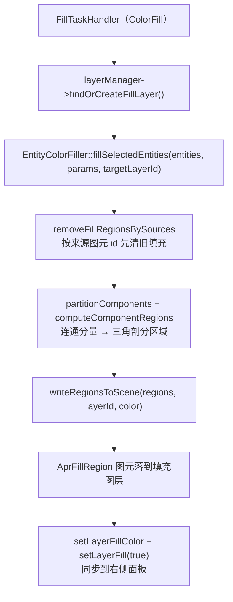

整层填充的差异只有两点：收集的是**该图层上所有**可填充图元（排除 `FILL_REGION` 自身），
且清理旧填充按**图层**（`removeFillRegionsOfLayer`）；颜色直接取 `layerFillColor(layerId)`。

### 5.4 色块与来源图元的关联

- 色块图元类型是 `Eg::EType::FILL_REGION`（`Engine/Common/Include/Engine/AprEntity/EType.h`），
  实现为 `Eg::AprFillRegion`，实心渲染。
- `AprFillRegion::vSourceIds`（`EntityId` 列表）= 该色块由哪些**来源图元**剖分而来。
  增量更新与「按来源删除旧色块」都靠它定位，因此**改图元后重填**能精确替换而不是堆叠。
- 色块自身也是普通图元，遵循第 2 节的归属规则：属于填充图层、可被隐藏/锁定/撤销。

---

## 6. 图层管理

### 6.1 接口分层

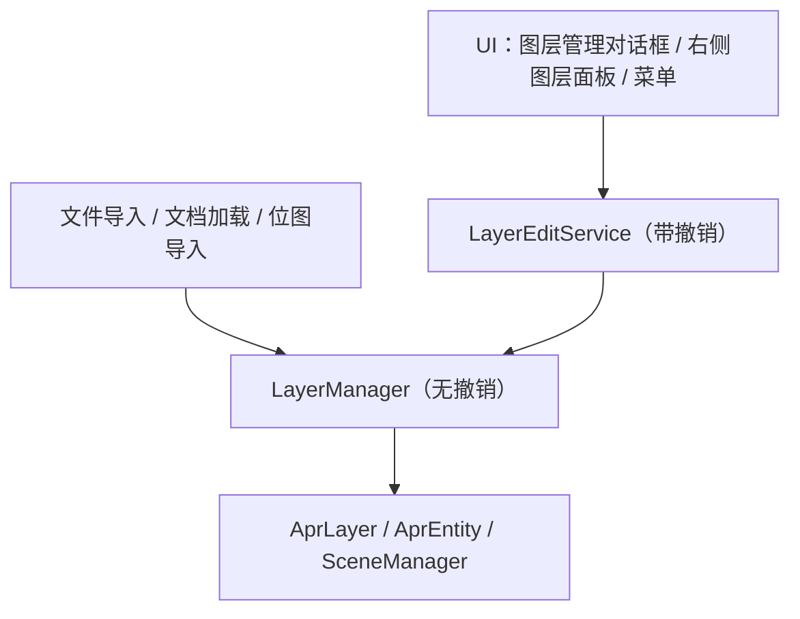

| 层 | 位置 | 规则 |
|----|------|------|
| `LayerManager` | `Engine/2D/Include/Engine2D/Interaction/LayerManager.h` | 纯运行态，无撤销 |
| `LayerEditService` | `Engine/2D/Include/Engine2D/Edit/LayerEditService.h` | **UI 与菜单的唯一入口**；全部操作进撤销栈 |
| `LayerManagerDialog` | `UI/2D/Include/UI2D/Dlg/LayerManagerDialog.h` | 只读真值 + 调服务层写 |

**UI 不是真值源**：所有写操作一律经 `LayerEditService`，写完调 `rebuildLayerList()` 把
**真实态**刷回控件。锁定图层会被服务层拒绝（`rejectIfLockedLayer` /
`rejectIfLockedEntities`），UI 不能自己假设成功。

文件加载等**批量初始化**仍可直接用 `LayerManager`（不需要逐条撤销）。

### 6.2 通知机制

`LayerManager` 通过 `ILayerManagerObserver` 广播 6 类事件，派生观察者只有一个：

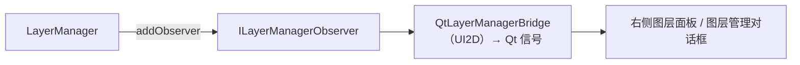

| 观察者 | 位置 | 用途 |
|--------|------|------|
| `QtLayerManagerBridge` | `UI/2D/Include/UI2D/Edit/QtLayerManagerBridge.h` | 把 C++ 回调转成 Qt 信号：`sigLayerAdded/sigLayerRemoved/sigLayerChanged/sigCurrentLayerChanged/sigLayerVisibilityChanged/sigLayerOrderChanged` |

广播函数先拷快照再遍历，每次调用前校验观察者仍在册——允许观察者在回调里
`addObserver` / `removeObserver` 自己。

### 6.3 图层管理对话框（`LayerManagerDialog`）

三条硬约束：

1. **UI 不是真值源。** 所有写操作一律经 `LayerEditService`（因此都进撤销栈），
   写完调 `rebuildLayerList()` 把**真实态**刷回控件。锁定图层会被服务层拒绝，UI 不能自己假设成功。
2. **刷新不得改变选中与既有数据。** `rebuildLayerList()` 先记住 `prevCurrentId`，
   用 `QSignalBlocker` 屏蔽列表信号，`setCurrentRow(row, QItemSelectionModel::NoUpdate)`
   恢复选中，末尾再 `loadLayerDetails(selectedLayerId())`。
   同理 `loadLayerDetails()` 里对 `m_profileCombo` 加 `QSignalBlocker` —— 否则
   `setCurrentIndex` 触发的 `currentIndexChanged` 会把刚读出来的 profileId **回写一遍**，
   表现为"点一下图层，工艺参数被悄悄改成第一项"。
3. **多选是批量语义。** 统一走 `applyToSelectedLayers(op)`，返回成功计数；
   任一项失败弹一次 `QMessageBox` 汇总，不逐项弹。原先 visible / locked / fill /
   color / fillColor 五处各写一份单选逻辑，行为互不一致。

其余整理：

- 无有效图层时置灰两个 GroupBox，不留幽灵数据；锁定图层置灰 name / color / fill / rename，
  但 **Locked 复选框本身保持可用**，否则锁上就解不开。
- 尺寸用字体度量而非像素常量：`em = fm.horizontalAdvance('0')`，
  `setMinimumSize(em * 78, fm.height() * 26)`。高 DPI 与不同系统字号下才不会截断。
- 列表标签用 `QStringList tags` + `" [%1]"` 拼接，替换原先 `tr(" [BMP]")` 这类
  带前导空格的可译串（译者无从知道空格是有意义的）。
- 排序按钮改 2×2 `QGridLayout`；三个复选框并排一行；Close 与动作按钮同行。
- `showDialog` 返回值由 `bool` 改 `void`：对话框只有 Close / reject，永远返回 false。
- `m_nameEdit` 的 `returnPressed` 直接触发重命名。

### 6.4 图层动态刷新机制（2026-09-12）

填充操作会动态创建"填充图层"（`findOrCreateFillLayer`），两个消费方行为一度不一致：

| 消费方 | 状态 |
|--------|------|
| 右侧图层面板（`RightToolBar`） | 已连接 `QtLayerManagerBridge`，能自动刷新 |
| 图层管理对话框（`LayerManagerDialog`） | 仅在构造函数刷新，打开后不响应动态创建的图层 |

修法是给对话框补上同一组信号连接：

```cpp
// LayerManagerDialog.h
explicit LayerManagerDialog(LayerEditService* layerEditService,
                            QtLayerManagerBridge* bridge = nullptr,
                            QWidget* parent = nullptr);
static void showDialog(LayerEditService* layerEditService,
                       QWidget* parent,
                       QtLayerManagerBridge* bridge = nullptr);

// 构造函数中连接信号
if (m_layerBridge)
{
    connect(m_layerBridge, &QtLayerManagerBridge::sigLayerAdded, this, &LayerManagerDialog::onLayerChanged);
    connect(m_layerBridge, &QtLayerManagerBridge::sigLayerRemoved, this, &LayerManagerDialog::onLayerChanged);
    connect(m_layerBridge, &QtLayerManagerBridge::sigLayerChanged, this, &LayerManagerDialog::onLayerChanged);
    connect(m_layerBridge, &QtLayerManagerBridge::sigLayerOrderChanged, this, &LayerManagerDialog::onLayerChanged);
}
```

相关调试日志：

- `[LayerManager] findOrCreateFillLayer: found existing fill layer id=X name='...'`
- `[LayerManager] findOrCreateFillLayer: created new fill layer id=X name='...'`
- `[EntityColorFiller] writeRegionsToScene: layerId=X regions=Y color=(R,G,B)`

### 6.5 工艺参数进撤销栈（2026-08-31）

图层只存 `hardwareProfileId`，参数值本身（功率、速度、频率、焦点偏移、次数）在
`HardwareProfileManager` 里。这带来一个不对称：改图层颜色可以撤销，改功率不行 ——
`LayerDocumentSnapshot` 里没有参数值，撤销"改功率"无从恢复。

修法是**把参数组并入同一份图层文档快照**，而不是给参数另开一套撤销数据：

- `LayerSnapshot.h` 的 `LayerDocumentSnapshot` 增加
  `std::unordered_map<int, HardwareProfile> hardwareProfiles;`
- `LayerManager::captureDocument()` 顺带抄一份 profiles；
  `restoreDocument()` 在 `syncLayerOrderIndices()` 之后逐个 `setProfile(pid, profile)`，
  **只覆盖快照里存在的 profile**（快照之后新建的 profile 不被撤销删掉）。
- `LayerEditService` 新增 5 个带撤销的 setter：`setProfilePower / setProfileSpeed /
  setProfileFrequency / setProfileFocusOffset / setProfilePasses`，共用一个私有外壳
  `applyProfileChange(mutate, description)` —— 流程固定为
  captureDocument → mutate → `pushDocumentChange`。

为什么合并而不是分开：图层与参数是一个事务单位。"改图层的 profileId + 改那个 profile 的功率"
若落在两个撤销栈上，撤一次得到的是两者交叉的中间态。

---

## 7. 持久化

### 7.1 原生 `.apr` 格式（Protobuf）

`FileIO/FileIO/Proto/AprDocument.proto`：

```proto
message LayerData {
    uint32 id           = 1;  // 图层唯一标识
    string name         = 2;  // 图层名称 (UTF-8)
    uint32 color        = 3;  // ARGB
    bool   visible      = 4;
    bool   locked       = 5;
    repeated PropertyEntry custom_properties = 6;
    uint32 layer_type   = 7;  // 0=VECTOR, 1=BITMAP
    bool   fill         = 8;  // 是否填充图层
    uint32 fill_color   = 9;  // 填充色 ARGB
}

message EntityData {
    // ...
    uint32 layer_id = 3;      // 所属图层 ID
}
```

- 写：`aprSetupCaptureMachiningSnapshot` 从 `LayerManager` 采集完整图层表（含空图层）、Profile 值集、
  ProcessData、加工顺序与作业级工艺模型，`NativeExportWriter` 写进 `AprDocument`；
  图元侧 `layer_id` 取 `e->layerId()`（权威 ID）。
- 读：见上文「打开原生 `.apr`」。不做旧文件兼容：文件头版本号不一致直接拒绝打开，
  LayerData 各字段直接读写（没有 optional 回退、没有 alpha=0 当不透明的兜底）。

### 7.2 数据库（SQLite）—— 已删除（2026-11-23）

图层**不再**写入 SQLite，图层状态只以 `.apr` 文档为准。

原来的 `LayerPersistenceBridge` → `LayerRepository` → `layers` 表是一条**只写不读**的影子链路：
全仓没有任何生产代码读取它（`loadByDocument()` 只有测试调用），表里也缺 `output` /
`defaultProcessId` / Profile 绑定等加工语义，给人「已经持久化」的错觉；
每次图层变更还要在主线程同步写库。整条链路已删除；数据库不做迁移，
表结构版本不一致的库由 `DatabaseBootstrapper` 整库重建（见 `数据库架构.md`）。
原来混在 `LayerPersistenceBridgeTests.cpp` 里、与数据库无关的用例迁到了
`Engine/2D/Test/LayerManagerBasicsTests.cpp`。

### 7.3 已知缺口

- **空图层不写进 DXF 导出**：`DxfFileWriter` 只拿得到图元列表、拿不到 `LayerManager`，
  因此只导出「有图元在用」的图层，导出后没有任何图元的图层会消失（实体的层名与图层
  颜色已按组码 `8` / `62` / `420` 正常写出，导入 → 导出往返的图层与颜色是一致的）。
  要保空图层需扩展写出器接口，让它同时接收图层表。
- **SVG 具名图层不还原**（见 3.4）。

---

## 8. 维护原则

- 图层类型由 `LayerManager` 统一管理；位图图层保持独立语义。
- 图层视觉规则尽量集中在 UI 层生成，不写进引擎。
- 持久化字段新增时：改 `Eg::LayerProps`（含 `operator==`）+ `.apr` 的 proto 读写两处即可；
  `LayerInfo`、`AprLayer`、撤销快照自动跟上。
- **外来格式按颜色落层**（图层 = 颜色，见 3.6）；原生 `.apr` 按文件图层表还原，不按颜色推断。
- 改动图层顺序相关代码后，必须同时保证两件事：`syncLayerOrderIndices()` 被调用
  （否则 `getIndex()` 与面板行号脱节，z-order 跟着错），以及换序后触发一次渲染全量装配
  （见 2.5，否则存量 sortKey 不会重算）。
- 新增导入格式时：解析器负责填 `EntityInfo::layerSourceId` 与 `colorPolicy`，
  落层复用 `restoreImportedLayers`，不要在解析器里操作系统图层。
- 修改导入 / 位图 / 填充相关代码后，至少回归：
  - DXF 多图层文件导入 → 图层面板应出现**源图层名**，颜色与源文件一致；
  - SVG 彩色文件导入 → 出现 `#RRGGBB` 图层，颜色一致；
  - 改图层颜色 → 未设覆盖色的图元跟随变色（BYLAYER 生效）；
  - 位图导入 / 粘贴 → 落在 `Bitmap 1` 而非当前矢量层；
  - 色块填充 → 新建/复用填充图层，重复填充不堆叠旧色块；
  - 图层置顶 / 上移 → 重叠图元的覆盖关系跟着变；**新建或修改图元**也要落在它所属
    图层对应的层级上，不能一律压在最上面（这是增量路径漏传图层序号的典型症状）；
   - 导出 DXF → 重新导入 → 图层名与颜色与导出前一致；
   - 撤销 / 重做图层增删改、移层、改填充色 → 与操作前一致。

---

## 9. 防御性崩溃修复（2026-09-22）

### 9.1 崩溃根因

`EXC_BAD_ACCESS` 在 `BezierAlgorithms::discretizeEntity` 的 `default` 分支调用
`entity->value(t)` 时崩溃。触发路径为：

```
SceneEditService::cancelInteractive
→ applyEntitySnapshots（撤销/重做还原实体快照）
→ SceneNotifier::flushDeferred
→ SceneRefreshCoordinator::onSceneChanged
→ SelectTool::syncSelectionFromScene
→ SelectionGizmo::repaint
→ SelectionOutlineBuilder::buildFromEntities（330 个实体）
→ collectEntityPolyline → BezierAlgorithms::discretizeEntity → CRASH
```

根因：撤销/重做操作后，部分实体的 `pLayer` 指针变为 null 或悬空。这些实体
通过了 `isValid()` 检查（仅验证 `basePoint` 有限），但内部数据不完整。
`SelectionOutlineBuilder::buildFromEntities` 遍历全部实体时，无图层实体进入
`discretizeEntity` 的 `default` 分支，调用 `entity->value(t)` 访问空指针导致崩溃。

### 9.2 防御性修复

| 文件 | 修复 | 作用 |
|------|------|------|
| `EntityGeometryEmitter.cpp` | 无图层实体 `return false` | 渲染路径跳过，防止黑块和崩溃 |
| `SelectionOutlineBuilder.cpp` | `collectEntityPolyline` 增加 `!entity->layer()` 检查 | 阻止崩溃主路径 |
| `BezierAlgorithms.cpp` | `discretizeEntity` default 分支增加 `!entity->layer()` 检查 | 防御性兜底 |
| `SceneManager.cpp` | `gatherGeometry` 跳过 `layer == nullptr` 实体 | 渲染管线源头过滤 |
| `AprEntitySerializer.cpp` | 写 `layer_id` 使用 `layerId()` 替代 `layer()->getId()` | 防止序列化时悬空指针 |

### 9.3 图层管理 `markEntityLayerChanged` 补充

`LayerManager` 的三个操作缺少 `markEntityLayerChanged` 调用，导致增量渲染
依赖的变更流不完整：

- `deleteLayer`：实体转移到 layer 0 后未登记变更 → 修复
- `setLayerColor`：只调 `setModified()` 未登记变更 → 修复
- `setLayerFillColor`：只调 `setOverrideColor()` 未登记变更且未 `notifySceneChanged()` → 修复

### 9.4 `rebindEntityLayer` 重复实体修复

`rebindEntityLayer` 在实体入场/换对象时调用，原先未从旧 `AprLayer` 移除实体。
若 `m_entityLayerMap` 中有旧图层记录，实体可能同时存在于两个图层的 `m_entities`
中。修复：先 `oldAprLayer->removeEntity(entity)` 再添加到新图层。


---

