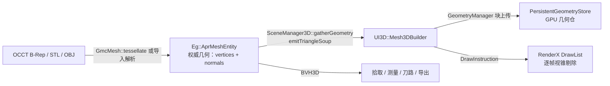

# 3D LOD 与分块：显示数据层设计（方案与取舍）

> 状态说明（2026-11-12）　状态：**设计分析（未实施）**　维护：渲染主链
>
> 定位：回答「3D 的 LOD / 分块数据层该放在哪一层、长什么样、值不值得现在做」。
> 本文只给方案与取舍，**不改代码**。文中的量为估算，凡标注「待基准」的都还没有实测数据支撑。

---

## 0. 结论摘要（先给立场）

1. **现有 `DisplayCache3D` 不是 LOD 数据层**：它没有几何、从不选级、零引用。
   把「3D 已经有 LOD」当成事实的地方（包括 [LOD多级细节跨层设计.md](LOD多级细节跨层设计.md) 第 6 节）需要更正。
2. **数据所有权建议放渲染侧（UI3D 视口域），算法放 Engine3D 纯函数**。
   不放 Engine 对象里、不做构建期离线预生成；理由见 §3。
3. **分级单位建议「实体级」，分块只作为逐出/预取的单位**，不做 meshlet：
   当前渲染管线是「一实体一连续 P3N3 缓冲 + 一条 DrawItem」，合并成块会直接破坏材质、高亮、显隐、拾取。
4. **对 3D LOD 的立场：现在只做「薄数据层」，不做「全量 LOD + 瓦片流式 + 离线缓存」。**
   先阶段 0 建立基准；只有在基准证明「三角形量/显存已经撞墙」时才推进阶段 1。
   唯一现在就确定要做的结论性收益是：**把「预算耗尽 → 整个模型不上传、视口里消失」改成「降级到低级别」**，这是现有代码里已经存在的悬崖。
5. **正确性红线靠类型与通道隔离**：显示网格是独立类型、独立容器、**不走 `ISceneGeometrySink`**；
   拾取/测量/刀路/导出继续只读 `AprMeshEntity`（今天就是这样，LOD 不得改变这一点）。

---

## 1. 现状核对（以代码为准）

### 1.1 3D 显示主链



关键事实：

* **权威几何只有一份**：`Eg::AprMeshEntity::vertices / normals`（[AprMeshEntity.h](../../Engine/3D/Include/Engine3D/AprEntity/AprMeshEntity.h)）。
  网格来自 `GmcMesh::tessellate()`（OCCT `BRepMesh_IncrementalMesh`，[GmcMesh.cpp](../../GeoModelCore/GeoModelCore/Source/GmcMesh.cpp)），
  默认 `linearDeflection = 0.1`、`angularDeflection = 0.5 rad`、绝对偏差（[GmcTypes.h](../../GeoModelCore/GeoModelCore/Include/GeoModelCore/GmcTypes.h)）。
  STL/OBJ 导入则直接是既有网格，没有 B-Rep 可重新离散。
* **CPU 与 GPU 各存一份同精度顶点**：`Ut::Vec3f` 位置 + 法线 = 24 B/顶点（CPU），
  GPU 交织 `VertexP3N3` 也是 24 B/顶点 → **约 144 B/三角形**（CPU 72 + GPU 72）。
* **相机变化不触发几何同步**：`requestSceneUpdate()` 只请求 `Repaint`
  （[RenderWidget3D.cpp](../../UI/3D/Src/Render/RenderWidget3D.cpp)），
  帧内只把绘制列表按新视锥重新提交。**今天没有任何「按视距改变几何」的通道**。
* **视锥剔除只省 draw call，不省显存**：剔除在 RenderX 的 DrawList 内完成
  （`submitDrawList(..., viewPtr)`，同上文件），几何仍常驻。
* **全量刷新是 O(总顶点)**：`syncMeshGeometry()` → `gatherGeometry()` → `emitTriangleSoup()`，
  每个实体都要算一遍内容哈希（[Mesh3DBuilder.cpp](../../UI/3D/Src/Render/Mesh3DBuilder.cpp) 的 `hashTriangleSoup`）。

### 1.2 `DisplayCache3D` 的真实状态

[DisplayCache3D.h](../../Engine/3D/Include/Engine3D/Render/DisplayCache3D.h) / [DisplayCache3D.cpp](../../Engine/3D/Src/Render/DisplayCache3D.cpp)：

| 观察 | 证据 | 含义 |
| --- | --- | --- |
| 只有定义，没有任何引用 | 全仓搜索仅命中自身 `.h/.cpp` | 死代码，未接入视口 |
| `updateScene()` 先 `clear()` 再重建分块 | `.cpp` 的 `updateScene` 首行 `clear()` | 每次全量重扫，无增量 |
| 级别恒为 0 | `updateScene` 内 `uint8_t lod = 0;` | 从不选级 |
| `selectLOD()` 无调用方 | 全仓搜索零命中 | 分级判据形同虚设 |
| `Chunk` 只存 `entityIds + triangleCount + bbox` | `.h` 的 `struct Chunk` | **没有几何**，无法驱动渲染 |
| `invalidateAll()` 只置 `dirty` 位 | `.cpp` | 没有消费者处理 `dirty` |

结论：它是一个「按包围盒中心做分块统计」的半成品，**不能作为 LOD 数据层的既有基础**。
保留它的唯一后果是继续误导后续设计（2D 的 LOD 文档已经把它当成了「3D 已有 LOD」的证据）。
建议在阶段 0 直接删除，或按本文方案重写为 `DisplayLodCache3D`——不要在原类上打补丁。

### 1.3 `Mesh3DBuilder` 的预算语义是「容量上限」，不是 LOD

* 默认预算 `kDefaultGeometryBudgetBytes = 2 GiB`，实际取 `min(几何仓推荐上限, 2 GiB)`；
  推荐上限 = 物理内存的 1/4，钳在 [512 MB, 4 GB)（[PersistentGeometryStore.h](../../RenderBridge/Include/RenderBridge/PersistentGeometryStore.h)）。
* 超限行为（[Mesh3DBuilder.cpp](../../UI/3D/Src/Render/Mesh3DBuilder.cpp) `emitTriangleSoup`）：
  * 已有实体：**保留上一帧几何**，拒绝本次重分配；
  * 新实体：`m_entities.erase(owner)` + `droppedEntityCount++` → **该模型这一轮根本不进绘制列表**。
* 即：预算是「全有或全无」的闸门。2 GiB ≈ 2 980 万三角形（72 B/tri），
  超过这个量级的大装配会出现「部分模型不显示」——这是当前最接近 LOD 需求的实际问题。

### 1.4 现有可复用的基建

| 能力 | 位置 | 对 LOD 的用处 |
| --- | --- | --- |
| 块级分配/释放/写入 | `IGeometryManager`（RenderAbstraction） | 级别切换时整块换几何，不需要新后端能力 |
| 绘制命令包围盒 + 视锥剔除 | RenderX DrawList | 切换级别后必须更新命令包围盒 |
| 实体 BVH | `AprMeshEntity::getBVH()` | 全分辨率拾取，与显示级别解耦 |
| 线程池依赖 | `bshoshany-thread-pool`（vcpkg） | 后台简化，无需新增并发框架 |
| 质量开关/预算/统计 | `Mesh3DBuilder` 公开接口 | 降级策略与诊断指标有现成落点 |

---

## 2. 先区分三件事，避免概念混用

| 概念 | 定义 | 今天 | 本文建议 |
| --- | --- | --- | --- |
| **容量上限** | 显存装不下就不上传（全有或全无） | 有 | 保留，但改成「先降级、再丢弃」 |
| **LOD** | 同一实体有多个精度的**派生网格**，按屏幕误差择一显示 | 无 | 阶段 1 做实体级 3 级 |
| **分块流式** | 按空间瓦片驻留/逐出，远景可完全不驻留 | 无 | 阶段 2；只做逐出单位，不做绘制单位 |
| **离线预生成** | 导入/保存时把各级写进磁盘或文档 | 无 | 阶段 3 视基准决定；默认不做 |

---

## 3. 数据层该放在哪一层

### 3.1 方案 A：Engine 几何侧产出多级派生物

Engine3D 在 `AprMeshEntity` 之外再持有一份（或一份 map）`LOD0/1/2 + 簇化`。

* **数据所有权**：Engine 场景（`SceneManager3D`）。
* **生命周期**：随实体创建/删除；编辑后由 Engine 负责重建。
* **内存归属**：Engine 进程内常驻，CPU 侧 **+比值×权威几何**。
* **失效重建**：Engine 在 `markDirty()` / 布尔运算后重建；Engine 不知道相机，只能全量预生成或按外部提示懒生成。
* **风险**：Engine 是**加工几何的唯一 owner**。让同一个对象同时持有显示副本，
  等于把「加工用几何」和「显示用几何」放进同一个生命周期，红线（§6）从类型上就守不住。
  另外 Engine 没有视口，不知道「何时需要哪一级」，只能猜或全量算。

### 3.2 方案 B：渲染侧在首次上传时自建缓存（推荐）

派生算法是 Engine3D 的**纯函数**（输入 `const AprMeshEntity` + 级别配方，输出显示专用 POD）；
缓存、驻留、逐出、失效、线程调度都归 UI3D 视口（`DisplayLodCache3D`），GPU 侧仍走既有 `IGeometryManager`。

* **数据所有权**：UI3D 视口（与相机、刷新调度同域）。
* **生命周期**：与视口/相机同域；实体 `generation` 变化即整条目失效；可整块丢弃，随时可重建。
* **内存归属**：UI3D 进程内，**可丢弃缓存**（非权威），有独立预算与 LRU。
* **失效重建**：`AprMeshEntity::generation` 做唯一失效键；实体删除即释放；
  相机变化由视口判定需要哪一级，按需派生。
* **代价**：UI3D 多一个缓存管理器与一个后台任务队列；多视口时每视口各一份（当前只有一个 3D 视口）。

### 3.3 方案 C：构建期/导入期离线预生成

导入 STEP/STL 时把 LOD0/1/2 一起算好，写进 `.apr3d` 或旁车缓存文件。

* **数据所有权**：文档（Persistence / FileIO）。
* **生命周期**：跟随文档保存/加载；比实体更长寿，因此**必须解决「编辑后缓存变旧」**。
* **内存归属**：磁盘 + 反序列化进 `AprMeshEntity` 或独立显示容器。
* **失效重建**：需要内容哈希 + 配方版本号；布尔/修复/撤销都会让旧数据失效。
  实体级编辑（平移/缩放）其实只改顶点，可以复用，但无法从文件层面判断。
* **风险**：文档格式/版本迁移成本、文件体积膨胀（1.75× 顶点量级）、
  CI 兼容历史文件、跨平台字节序/精度一致性。收益只是「省一次派生」，而派生可以放到空闲时做。

### 3.4 对比表

| 维度 | A：Engine 派生 | **B：渲染侧缓存（推荐）** | C：离线预生成 |
| --- | --- | --- | --- |
| 数据所有权 | 场景（Engine） | 视口（UI3D） | 文档（FileIO/Persistence） |
| 生命周期 | 随实体 | 随视口，可丢弃 | 随文件，跨会话 |
| CPU 内存归属 | Engine 常驻 | UI3D 可回收缓存 | 反序列化后进内存（另一份） |
| GPU 内存归属 | 仍需 UI 上传 | UI3D 统一预算 | 仍需 UI 上传 |
| 失效键 | `generation` | `generation`（简单） | 内容哈希 + 配方版本 + 文档版本 |
| 谁知道相机 | **不知道** | 知道 | 不知道 |
| 加工几何污染风险 | **高**（同对象/同容器） | 低（不同类型、不同容器） | 中（同一文档格式） |
| 编辑后重建成本 | 全量或盲算 | 只重算脏实体 | 需判定缓存是否过期 |
| 导入时长 | 可能显著增加 | 不变（懒派生） | 显著增加 |
| 首帧 | 可能变慢 | 不变或略慢（派生延后） | 最好（直接可用） |
| 工程面 | 中 | 中 | 高（格式/兼容/迁移） |
| 跨平台 | 一致 | 一致 | 需保证数值一致 |

### 3.5 推荐与理由

**推荐 B：算法在 Engine3D（纯函数），数据在 UI3D（缓存与预算），GPU 仍在 RenderBridge。**

理由按重要性排序：

1. **红色边界优先**：权威几何必须单一来源。显示派生物是可丢弃缓存，天然应该待在「会随视口销毁」的域里；
   放进 Engine 或文档都会让「加工用几何」和「显示用几何」共享生命周期，后面必然有人误用。
2. **相机只在视口侧**：LOD 的判据是屏幕投影误差，只有视口知道视口高度、视场角、相机位置。
   Engine 侧做要么全量预生成（浪费），要么再发明一套「外部提示」协议（重复造视口）。
3. **失效最简单**：`AprMeshEntity::generation` 已经是几何变更的唯一戳（平移/缩放/布尔都会推进）。
   视口侧用 `(entityId, generation, 级别配方哈希)` 做键，天然正确，不需要文件格式参与。
4. **离线缓存是可以后置的优化**：它只解决「重复打开同一文件的派生时间」。
   在阶段 0 基准证明这是瓶颈之前，引入文档格式变更不划算（见 §8 的维护成本）。

不建议「直接接上 `DisplayCache3D`」：它没有几何、没有级别选择，接上去等于重写。

---

## 4. 分级与分块的具体形态

### 4.1 切割维度：实体级 LOD + 空间瓦片仅作逐出单位

| 维度 | 是否采用 | 理由 |
| --- | --- | --- |
| **实体级**（一个 `AprMeshEntity` 一份几何、一条绘制命令） | **采用，作为 LOD 决策与上传单位** | 与现有数据模型、材质、显隐、高亮、拖拽预览、拾取完全对齐；改动面最小 |
| **空间瓦片**（3D 网格） | 采用，但**只用于驻留/逐出/预取** | 逐出可以按组做，避免逐实体抖动；不做绘制单位 |
| **网格簇 / meshlet** | 不采用 | 当前 3D 显示通道是「非索引 P3N3 三角汤 + 每实体一条 DrawItem（后端可合并相邻块）」，没有簇级剔除/簇级索引。做 meshlet 需要新建索引缓冲、簇剔除与逐簇绘制记录，属于独立技术路线，不是加个简化库就能到位 |
| **图元级（单三角形）** | 不采用 | 粒度太细，收益是连续 LOD，但会打散当前「一实体一缓冲」的假设，拾取/高亮全部要重做 |

瓦片参数建议：`tile = max(sceneDiag / 8, 1mm)`（8³ 桶，实际非空桶通常 < 100）；
实体按**包围盒中心**归桶；**包围盒跨度大于一个瓦片的实体标记为 pinned**（进入视锥余量即常驻，不参与逐出）。
`pinned` 是必要的兜底：地面、基座、长条形工件在瓦片体系里会横跨多块，按中心归属会导致「走近才发现没驻留」。

### 4.2 层级数

建议 **3 级 + 1 个可选的极端代理**：

| 级别 | 三角比（相对 L0） | 用途 | 备注 |
| --- | --- | --- | --- |
| L0 | 100% | 近景/编辑态 | 直接复用 `AprMeshEntity` 顶点，**不额外存 CPU 副本** |
| L1 | ≈ 40%–50% | 中景 | QEM 简化，保留边界与硬边 |
| L2 | ≈ 12%–15% | 远景 | 同上；单实体上限建议 2 万三角形 |
| L3（可选，默认关） | 包围盒/外壳 | 极远/超大装配 | 只做「有个东西在那儿」的占位，必须可配置关闭 |

层级数不建议更多：收益在 3 级之后迅速变小，而缓存条目、切换状态机和测试矩阵线性增长。

### 4.3 误差度量

用**屏幕投影误差（像素）**作为唯一判据，输入是世界空间误差上界，来自简化过程本身的误差（QEM 折叠代价），而不是「三角形比例」：

```
f_px      = 0.5 * viewportHeightPx / tan(fovY / 2)        // 焦距（像素）
e_px(L)   = e_world(L) * f_px / z                          // z = 相机到实体包围盒最近点的距离
```

* `e_world(L)`：该级相对 L0 的最大几何偏差（QEM 折叠误差的累计上界，派生时一并算出并缓存）。
* 阈值建议：`e_max(L1) = 1.0 px`、`e_max(L2) = 3.0 px`。
  取级规则：选**最粗**的级别，使 `e_px(L) ≤ e_max(L)`；都不满足则 L0。
* 三角形预算（第二道闸）：`N(L) ≤ min(ratio_L * N0, cap_L)`，`cap_L1 = 30 万`、`cap_L2 = 2 万`。
  没有这道闸，一个 500 万三角形的单体在远景仍会被简到 75 万，属于无效开销。
* 微小实体：投影包围盒 < 24 px 时直接取最低级（甚至 L3 代理），不要再算误差。

**为什么不直接用「距离档位」**（`DisplayCache3D` 的做法）：不同实体的世界尺寸差 3 个数量级，
同一距离下大零件已经该降级、小零件还该用 L0。距离档位会把两者绑死，必然一边糊一边浪费。

### 4.4 切换判据与防抖

三层防抖，全部收敛为**纯函数**（可直测，不依赖 Qt/GL）：

1. **误差死区（滞回）**：
   * 升级（变细）：`e_px(current) > 1.25 * e_max(current)`
   * 降级（变粗）：`e_px(candidate) < 0.8 * e_max(candidate)`
   * 中间区间不动作。比例沿用 2D LOD 的「升级阈值 < 降级阈值」思路（1.3× / 2.0× 是缩放比例域，这里是误差域，语义一致）。
2. **最短驻留**：同一条目切换后 `≥ 250 ms` 且 `≥ 8 帧` 才允许再次切换。
3. **调度节流与预算**：
   * 相机运动时按 `≤ 10 Hz` 评估，避免每帧 O(N) 扫描；
   * **降级立即做**（省显存、省带宽），**升级受预算约束**：每帧最多上传 `2 MB` 或 `3 个实体`，其余排队；
   * 相机静止 `≥ 200 ms` 后放开预算清空队列（用户停下来看的时候才允许变清晰）。

这样即使误差在阈值附近来回跳，也只会表现为「几条实体在死区里不动」，不会整屏闪。

### 4.5 分块/瓦片的生命周期

* **进入**：瓦片进入「视锥 + 1.25× 余量」，按屏幕尺寸决定实体级别并排队派生。余量常量与 2D 的 `kCollectBoxMargin = 1.25` 取同一口径，便于横向比较。
* **离开**：瓦片连续 `≥ 30 帧` 在余量外，整块释放 GPU 块与 CPU 派生副本（L0 不需要释放，因为就是权威几何）。
* **预取**：沿相机朝向预取下一瓦片（可选，阶段 2 之后）。预取失败不影响正确性，只影响「走近时是否短暂低清」。
* **不做**：跨块合并、跨块索引重排——那会破坏一实体一缓冲。

---

## 5. 内存与流式

### 5.1 三层预算（互不打架的前提）

| 预算 | 归属 | 默认量级 | 是否可丢弃 | 说明 |
| --- | --- | --- | --- | --- |
| 权威几何（CPU） | `AprMeshEntity` | 72 B/tri × 全部实体 | **不可**（除非做文档级流式） | LOD 不减少它，这是天花板 |
| 显示几何（GPU） | `Mesh3DBuilder` 现有预算 | `min(推荐上限, 2 GiB)` | 可（降级/逐出） | **LOD 的目标是让它在预算内表达更多场景，不是另开一份预算** |
| 派生缓存（CPU） | `DisplayLodCache3D` | 建议 `≤ 512 MiB` 且 `≤ 显示预算 25%` | 可（LRU） | 只缓存 L1/L2；L0 直接读权威几何 |

**不变量**（必须可断言、可在测试里验证）：

1. `Σ GPU 几何 ≤ 显示预算`（沿用现有裁决点，只是裁决对象从「整个实体」变成「实体×级别」）；
2. `Σ 派生缓存 ≤ 派生预算`；
3. 任一实体的显示级别 ≥ 其「预算允许的最低级别」——不允许出现「预算够但显示更糊」；
4. 派生缓存条目必须能由 `(entityId, generation, 配方)` 完全重建；
5. **权威几何永不被显示层修改**。

### 5.2 峰值估算

设总三角形 `T`，近景（L0）占比 `f`，远景为 L2（15%）：

```
GPU 峰值 ≈ T × 72 B × [f + 0.15 × (1 - f)]
切换瞬时 ≈ + (被切换实体的 L2 大小) × 同时在切换的实体数（由每帧预算封顶）
派生 CPU 峰值 ≈ T × 24 B × [L1 或 L2 中实际缓存的部分，≤ 0.65 × 远景占比]
```

| 场景 `T` | L0 全驻留 GPU | 远景全 L2 | `f = 30%` 混合 | 权威 CPU |
| --- | --- | --- | --- | --- |
| 100 万 | 72 MB | 11 MB | 29 MB | 72 MB |
| 1000 万 | 720 MB | 108 MB | 291 MB | 720 MB |
| 3000 万 | 2.16 GB（**超 2 GiB 预算 → 今天会丢模型**） | 324 MB | 874 MB | 2.16 GB |

读法：

* **拉远能救 GPU，救不了 CPU**。权威几何仍在内存里；3000 万三角形场景的 2.16 GB CPU 常驻是硬成本。
  真要再往上，需要「文档级按需加载」，那是另一个量级的改造（Persistence + 场景生命周期），不在本文范围。
* 缩放回到近景时，峰值回到 `L0 全驻留`——LOD 不改变近景峰值，只降低远景与混合态。
* 派生缓存增长可被 LRU 截断，属于可控项。

### 5.3 与现有几何预算的关系

**不改预算数值，改裁决语义**：

```
对每个实体：请求 L0
  → 放得下？上传，结束
  → 放不下？依次尝试 L1、L2
      → 放得下？上传并标记 degraded
      → 连 L2 都放不下？保持「未上传」并计入 dropped（保留现有可见提示）
```

* 保留 `geometryBudgetExhausted()` / `droppedEntityCount()` 的对外语义（宿主提示不能失效），
  新增 `degradedEntityCount()` 与 `residentLevel(entityId)` 供状态栏/诊断使用。
* **已有实体的重分配失败**仍保留旧块（现有行为正确，不动）。
* 这样「预算耗尽 → 模型消失」变成「预算耗尽 → 远景变糊」，同一份预算表达更大的场景。

### 5.4 流式与首帧

* **首帧**：不等待派生。先按今天的路径上传 L0（用户看到的是完整精度），
  再在随后的若干帧内把远景降级。降级是「变糊 ≤ 3 px」，不是空白。
* **绝对避免**：为了等 L2 而让远景先空着。那会把「首帧慢」换成「画面缺块」，更难解释。
* **上传节奏**：GUI 线程内完成 GL 上传，单帧字节数封顶（见 §4.4），派生在后台线程完成；
  结果带 `(entityId, generation, 配方哈希)`，过期即丢弃。

---

## 6. 正确性红线

### 6.1 四条禁止路径（今天的事实，必须保持）

| 路径 | 今天读什么 | 证据 |
| --- | --- | --- |
| 刀路生成 | `AprMeshEntity::vertices` | [EngravingCAPI.cpp](../../Engraving/Engraving/Src/EngravingCAPI.cpp)（`mesh->vertices`） |
| 测量/几何查询 | `AprMeshEntity` + `GeometryContext3D` | `MeshAlgorithms` → `Geo3DAnalysis / Geo3DQuery` |
| 导出/序列化 | `AprMeshEntity::vertices` | [AprEntitySerializer.cpp](../../FileIO/FileIO/Src/AprEntitySerializer.cpp) |
| 拾取/选中判定 | 全分辨率 BVH | [RenderWidget3D.Picking.cpp](../../UI/3D/Src/Render/RenderWidget3D.Picking.cpp) → `raycastHitFirst` → `AprMeshEntity::getBVH()` |

**LOD 只允许出现在第五条路径：显示上传。** 以上四条一行都不改。

### 6.2 类型与接口怎么强制

1. **不同类型**：新增 `Eg::Display::DisplayMesh`（显示专用 POD：顶点/法线/包围盒/级别/误差/来源 `generation`），
   **不继承、不隐式转换、不提供 `toAprMeshEntity()`**。反向也禁止：没有任何 API 接受 `DisplayMesh` 建实体。
2. **不同容器**：`DisplayMesh` 只存在于 `DisplayLodCache3D`；
   `SceneManager3D` 的入参只接受 `AprMeshEntity*`，从类型上就塞不进显示网格。
3. **不同通道**：**显示网格不走 `ISceneGeometrySink`**。
   `emitTriangleSoup()` 是场景→渲染的公共契约，2D/3D 多个 sink 共享；
   一旦让 LOD 走它，任何未来的 sink 都可能收到「低精度几何」。
   `Mesh3DBuilder` 上新增**非虚、非接口**的方法（如 `setEntityDisplayMesh(...)`）承载 LOD 上传，
   sink 路径保持「全分辨率」语义不变（LOD 关闭时就是今天的路径）。
4. **依赖方向门禁**：`Eg::Display` 头文件只允许被 `UI/3D` 与 `Engine/3D` 自身的测试引用；
   在 `CMake/CheckDependencies.cmake` 或 CI 的 grep 门禁里加一条：
   `CAM / Engraving / Nesting / Main/Export / FileIO/Writers` 出现 `Display::DisplayMesh` 即失败。
   注意不能只靠链接方向：`Engraving` 已经链接 `Engine3D`（网格切片），链接级隔离不成立。
5. **运行期断言（Debug）**：`DisplayLodCache3D` 条目数不得超过场景实体数；任何 `DisplayMesh` 的 `sourceGeneration` 必须与当前实体一致，否则视为失效。

### 6.3 拾取精度在低级别下怎么不被感知为 bug

原则：**拾取永远用全分辨率几何，显示级别不参与拾取。** 剩下的只是「看到的轮廓」与「点得到的轮廓」之间的偏差：

* 偏差上界就是 `e_world(L)`（L2 时约为实体包围盒对角线的 0.5%–1%），在屏幕上 ≤ 3 px。
* 缓解一：**轮廓保持简化**。QEM 折叠时给边界边与硬边（二面角 > 60°）更高权重或直接锁定，
  避免「远景时零件边缘被削掉一块，点上去却命中」。
* 缓解二：**拾取孔径**。射线与全分辨率网格求交失败时，用屏幕空间 `2–3 px` 的扩展重试一次
  （等价于「点得不够准也不算空点」）。只在 LOD < L0 的实体上启用，避免影响 L0 的精确点选。
* 缓解三：**选中反馈用同一份几何**。高亮线框、拖拽预览都复用当前显示级别的那份常驻几何
  （`residentGeometry()` 已经这么设计），因此「高亮轮廓」与「模型轮廓」永远一致，不会出现错位。
* **明确不做**：用低级别几何做拾取（会改变命中结果，属于红线），或用低级别几何做包围盒/尺寸显示（包围盒来自实体，不受影响）。

### 6.4 其他一致性

* 半透明排序按实体包围盒中心（`setViewPosition`），级别切换不改变中心 → 排序稳定。
* 线框模式只切管线，不换几何 → 与级别无关。
* 撤销/重做走 `generation` 失效 → 不需要额外通道。
* 场景树/属性面板读实体元数据 → 与显示级别无关。

---

## 7. 落地代价

### 7.1 需要新增的结构/接口

| 名称 | 层 | 职责 | 跨 DLL |
| --- | --- | --- | --- |
| `Eg::Display::LodRecipe` | Engine3D | 级别配方（目标误差、比例上限、边界权重），纯数据 | 是（POD） |
| `Eg::Display::DisplayMesh` | Engine3D | 显示专用网格 + 误差 + 来源 generation，**明确禁止加工用途** | 是（POD） |
| `Eg::Display::deriveDisplayMesh()` | Engine3D | 纯函数：权威网格 → 指定级别显示网格（QEM） | 是（纯函数） |
| `UI3D::DisplayLodCache3D` | UI3D | 级别决策、滞回、派生任务、LRU、预算、统计 | 否（UI 内部） |
| `Mesh3DBuilder::setEntityDisplayMesh()` | UI3D | 非虚、非 sink 的上传通道；按级别记账 | 否 |
| `Mesh3DBuilder::residentLevel()` / `degradedEntityCount()` | UI3D | 诊断与宿主提示 | 否 |
| 相机参数喂入点 | UI3D | `paintGL` 已算好 view/proj/eye，直接传入缓存 | 否 |

### 7.2 线程

* 派生在后台线程（现有 `bshoshany-thread-pool`），**默认单线程**：
  简化是 CPU 密集且与导入/布尔可能冲突，单线程更容易保证帧时间可预测。
* GUI 线程只做：级别决策（纯计算）、队列消费、GL 上传。
* 任务取消：`(entityId, generation)` 变化即丢弃结果；实体删除立即从队列剔除。
* 不引入新的渲染线程：RenderX/GL 上下文仍只在 GUI 线程。

### 7.3 对现有管线改动面

| 文件/模块 | 改动 |
| --- | --- |
| `Engine/3D`（新增 `Display/`） | 新增纯函数与 POD；**不动** `AprMeshEntity`、`SceneManager3D` |
| `UI/3D/Src/Render/DisplayLodCache3D.*` | 新增，约 600–900 行（含状态机、预算、队列） |
| `UI/3D/Src/Render/Mesh3DBuilder.*` | 中等：`Entry` 增加级别/误差字段；预算裁决改为「逐级降级」；新增上传通道 |
| `UI/3D/Src/Render/RenderWidget3D.cpp` | 小：帧内喂相机、调用 pump；相机变化时触发评估（仍走 `requestRepaint`，不新增刷新级别） |
| `RenderBridge` / `RenderAbstraction` | **无改动**（块分配/释放/写入已够用） |
| `Renderx` | **无改动** |
| `DisplayCache3D.*` | 删除（阶段 0） |
| `Docs` 索引 | 登记本文，更正 2D LOD 文档的错误陈述 |

### 7.4 工具链

| 选项 | 评价 |
| --- | --- |
| **meshoptimizer**（MIT，C/C++，无依赖，`meshopt_simplify`） | 首选：成熟、快、可控制误差与边界；按仓库约定**以原样 vendored/包管理引入，不改其源码** |
| 自研 QEM | 可行（`MeshTopologyUtils` 已有焊接与边拓扑），预计 500–900 行 + 测试；好处是不新增依赖，坏处是要自己处理边界锁定、非流形、退化三角形 |
| OCCT 现有能力 | `BRepMesh` 只能按 deflection 重新离散，**没有网格简化**；且 STL/OBJ 导入没有 B-Rep 可用 → 不能作为简化器 |

建议：先按 meshoptimizer 评估；若引入第三方不可接受，再自研 QEM。两条路都要满足「除显示层外零引用」。

### 7.5 构建与加载时长（估算，待基准）

| 项 | 估算 | 说明 |
| --- | --- | --- |
| 构建 | +0～10 s | meshoptimizer 是小型 C/C++ 库；自研则只是多几个编译单元 |
| 导入/加载 | **不变** | L0 不预计算；派生延后 |
| 首帧 | 基本不变 | 先上 L0；派生在后续帧完成 |
| 稳态 CPU | +0.5～2 M tri/s 的单核占用（派生期） | QEM 吞吐需实测；只在相机移动/场景变化后发生 |
| 单次切换延迟 | 每实体 0.5～2 ms（1 万三角形级），量级待基准 | 由每帧预算封顶，不阻塞帧 |

---

## 8. 好处与坏处（逐项）

| 维度 | 预期影响 | 量级 / 判断依据 | 需要什么才能定 |
| --- | --- | --- | --- |
| **帧率** | 远景 GPU 三角形吞吐下降；近景不变 | 远景三角形降到 15% → 顶点/填充相关耗时近似同比例下降；但只在「三角形量已是瓶颈」时体现。若当前场景 < 100 万三角形，收益接近 0 | 需要 `triangles vs frameMs` 曲线（RenderBenchmark 目前只有 2D 线段口径，需补 3D 网格基准） |
| **内存峰值** | 远景 GPU 显著下降；CPU 权威几何不变 | 3000 万三角形：2.16 GB → 324 MB（远景）；混合态 874 MB | 需要真实装配的三角形分布（近/远占比） |
| **首帧时间** | 基本不变（策略：先 L0 后降级） | 派生不阻塞首帧 | 需要导入 + 首帧的分解计时 |
| **大模型可交互性** | **最大收益**：预算耗尽不再「模型消失」，改为降级；2 GiB 预算可表达约 6.7× 的场景（按远景 15%） | 现有 `droppedEntityCount` 就是悬崖的证据 | 需要大装配实测：当前有多少实体被丢 |
| **视觉稳定性** | 有跳变风险，需滞回 + 轮廓保持 | 目标 ≤ 1 px / ≤ 3 px；死区 1.25×/0.8×；最短驻留 250 ms | 需要截图对比/几何误差回归 |
| **拾取精度** | **不退化**（全分辨率拾取）；仅轮廓处 ≤ 3 px 的「看得见点不中」 | 由 `e_world` 上界决定 | 需要轮廓保持率与误点率统计 |
| **代码复杂度** | 中高：多一个缓存层、一个后台任务队列、一套预算裁决 | 约 +1.5k～2.5k 行（含测试） | — |
| **测试难度** | 中高：需要状态机单测、误差单调性、预算不变量、截图/几何回归 | 像素级回归受 GL/Metal 差异影响，优先用几何误差与状态断言 | 需要基准场景集（小/中/大/超大） |
| **长期维护成本** | 中：多一份显示几何的失效路径；但边界清晰（只读权威几何） | 若不做，`DisplayCache3D` 死代码与「3D 已有 LOD」的错误认知会持续产生返工 | — |

**明确不给量级的项**：帧率提升倍数、派生吞吐、首帧毫秒数。
这三项没有基准就无法负责地回答，任何具体数字都是编的。

---

## 9. 分阶段路径

### 阶段 0：基准 + 清死代码（必做）

* 删除 `DisplayCache3D.h/.cpp`（零引用、语义错误）。
* 建 3D 网格基准：至少 4 个场景（1 万 / 100 万 / 1000 万 / 3000 万三角形，含 STEP 装配与浮雕网格），
  记录：`triangles / frameMs / fps / gpuMem / uploadB / fullRefreshMs / firstFrameMs / droppedEntityCount`。
* 更正 [LOD多级细节跨层设计.md](LOD多级细节跨层设计.md) 第 6 节「3D 已有 DisplayCache3D」。

**Go/No-Go**：若 95 分位场景 < 200 万三角形且 `frameMs < 8 ms`、`droppedEntityCount == 0`，
**停在阶段 0**（只保留删死代码）。否则进入阶段 1。

### 阶段 1：实体级 3 级 LOD + 预算降级（最小闭环）

* Engine 纯函数 + `DisplayLodCache3D` 的级别决策/滞回/派生队列。
* `Mesh3DBuilder` 预算裁决改为「逐级降级」；新增 `degradedEntityCount()`。
* 拾取/刀路/导出零改动；显示网格不走 sink。
* **不做**逐出、不做瓦片、不做预取、不做离线缓存。

**指标**：1000 万三角形场景 `frameMs` 下降 ≥ 30%；`droppedEntityCount` 归零；
远景几何误差 ≤ 3 px；拾取命中率与 L0 基线无统计差异。

### 阶段 2：瓦片驻留与流式（按需）

* 瓦片逐出/预取、pinned 实体、相机静止清队列。
* 首帧先 L0 后降级的节奏调优。

**指标**：GPU 峰值再降 ≥ 40%（远景）；无空白帧；瓦片切换导致的单帧耗时增量 ≤ 2 ms。

### 阶段 3：条件性优化

* 内容哈希离线缓存（仅当实测「重复打开大文件」的派生时间成为用户可感知瓶颈）；
* L3 代理级别（仅当超大装配在远景仍超预算）；
* meshlet / 连续 LOD（需要 RenderX 支持索引与间接绘制，属于独立立项）。

**每阶段的继续判据**：上一阶段的核心指标没有达成，或达成后用户可感知收益（帧率/可打开的文件规模）没有变化，就停。

---

## 10. 待补的基准数据（决定量的前提）

1. 目标客户真实 STEP 装配的三角形分布（P50/P95/最大），以及当前被 `droppedEntityCount` 丢弃的比例。
2. 当前场景的 `triangles → frameMs` 曲线（GL 与 Metal 各一条）。
3. 全量刷新耗时（`gatherGeometry` + 哈希）在 1000 万三角形下的实测值。
4. QEM 简化吞吐（单核实测）与边界锁定后的误差分布。
5. 拾取在 L2 显示下的「看得到点不中」比例（需要交互日志或自动化射线采样）。

---

## 附录 A：建议的常量单一来源

与 2D 的做法一致（常量收敛到一处，测试与文档引用同一份），3D 建议放在 `DisplayLodCache3D` 的 `public static constexpr`：

| 常量 | 建议值 | 说明 |
| --- | --- | --- |
| `kMaxLevels` | 3 | L0/L1/L2；L3 代理单独开关 |
| `kLevelTriangleRatio[3]` | `{1.0, 0.5, 0.15}` | 目标比例 |
| `kLevelMaxTriangles[3]` | `{∞, 300k, 20k}` | 第二道闸 |
| `kMaxErrorPixels[3]` | `{0, 1.0, 3.0}` | 屏幕误差阈值 |
| `kUpgradeErrorRatio` | `1.25` | 升级（变细）触发 |
| `kDowngradeErrorRatio` | `0.8` | 降级触发（死区） |
| `kMinDwellMs` | `250` | 最短驻留 |
| `kEvaluateIntervalMs` | `100` | 相机运动时的评估频率 |
| `kIdleBeforeUpgradeMs` | `200` | 静止后才放开升级预算 |
| `kUploadBudgetBytesPerFrame` | `2 MiB` | 单帧上传上限 |
| `kUploadBudgetEntitiesPerFrame` | `3` | 单帧切换实体上限 |
| `kTileDivisions` | `8` | 瓦片 = 场景对角 / 8 |
| `kEvictAfterFrames` | `30` | 离开余量后逐出延迟 |
| `kCollectMarginRatio` | `1.25` | 与 2D `kCollectBoxMargin` 同口径 |
| `kDerivedCacheBudgetBytes` | `512 MiB` | 派生 CPU 缓存上限 |

---

## 附录 B：与既有文档的关系

* [LOD多级细节跨层设计.md](LOD多级细节跨层设计.md)：2D 的「连续自适应离散 + 滞后重建」，**与本文不是同一机制**。
  它没有多级几何缓存；本文才是真正的多级数据层。该文第 6 节「不做 3D LOD（3D 已有 `DisplayCache3D`）」需更正。
* [3D 架构现状与约束.md](3D%20架构现状与约束.md)：本文不改变其任何主链约束
  （`Renderer3DFactory` 唯一入口、`Viewport3D` 只做宿主、刷新必须经 `scheduleDispatch`）。
  LOD 只发生在 `RenderWidget3D` 内部与 `Mesh3DBuilder` 的上传通道，不新增第二条渲染链。
* [渲染管线.md](渲染管线.md)：`RenderBridge` / `RenderX` 零改动，LOD 复用块分配与绘制列表。
