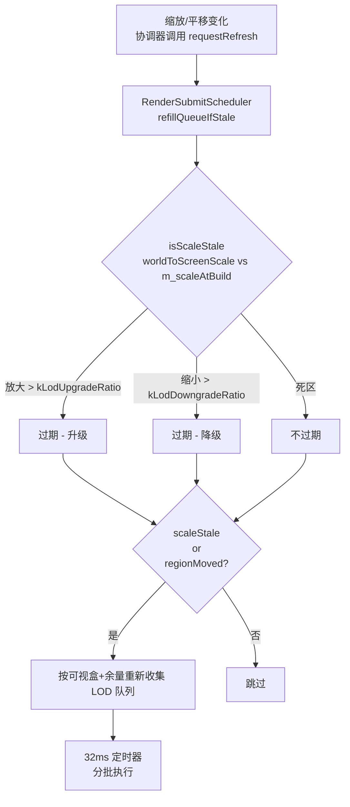
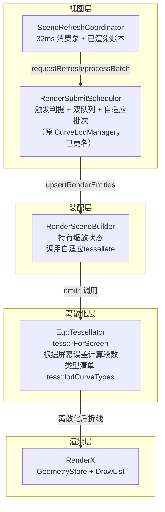

# LOD 多级细节：跨层设计

> 定位：几何离散化的精度策略，根据屏幕缩放比例动态调整曲线图元的细分程度。
> 这是**应用层主导**的改动——几何离散化本就在应用层，RenderX 基本不需要动。

***

## 1. 数据流

```mermaid
flowchart LR
    A[SyEntity<br/>圆/弧/椭圆/折线] -->|gatherGeometry()| B[ISceneGeometrySink]
    B -->|emitCircle/Arc/Ellipse| C[RenderSceneBuilder]
    C -->|自适应tessellate<br/>段位哈希增量| D[PersistentGeometryStore]
    D --> E[RenderX<br/>GeometryStore + DrawList]
    C -.->|setWorldToScreenScale()| C
```

关键事实：

1. **离散化在应用层**（`RenderSceneBuilder`），tessellate 精度由它决定。
2. **自适应段数**：使用 `tess::*ForScreen` 函数，根据屏幕弦高误差动态计算段数。
3. **缩放状态通过接口传入**：`setWorldToScreenScale()` 和 `setLodChordErrorPixels()`。

***

## 2. 设计决策

### D1 LOD 度量：屏幕空间误差

圆/弧/椭圆的段数由「曲线在屏幕上的投影大小」决定，目标是**屏幕弦高误差 ≤ 1 像素**。

* 段数 = f(世界尺寸, 缩放比例)。世界尺寸在 emit 参数里（radius），缩放比例通过接口传入。

**弦高误差公式**：

```
段数 n = π · √( screenRadius / (2 · ε) )
其中 screenRadius = worldRadius × worldToScreenScale，ε = 目标弦高误差（像素）
```

### D2 滞后机制

zoom 是连续高频操作，做法：

* **连续缩放比例 + 滞后阈值**（判据收敛为纯函数 `RenderSubmitScheduler::isScaleStale`，可直测）：
  * 记录 `m_scaleAtBuild` = 上次收集队列时的 `worldToScreenScale`
  * **升级阈值**：`worldToScreenScale > m_scaleAtBuild * kLodUpgradeRatio`（放大 1.3 倍以上）
  * **降级阈值**：`worldToScreenScale * kLodDowngradeRatio < m_scaleAtBuild`（缩小 2 倍以上）
  * 死区：1.3x ~ 2.0x 之间不触发，避免抖动
* 阈值常量（`kLodUpgradeRatio = 1.3`、`kLodDowngradeRatio = 2.0`）与收集余量
  `kCollectBoxMargin = 1.25`、批次预算 `kBatchBudgetMs` 等调参值**全部收敛在
  `RenderSubmitScheduler` 的 public static constexpr**，测试与文档引用同一份。

### D3 状态管理

`RenderSceneBuilder` 持有视口缩放状态：

```cpp
class RenderSceneBuilder {
    void setWorldToScreenScale(double scale);  // 世界单位 → 屏幕像素
    double worldToScreenScale() const;

    void setLodChordErrorPixels(double pixels);  // 用户可调，默认 1.0 像素
    double lodChordErrorPixels() const;
};
```

关键：内容哈希要把 `worldToScreenScale` 算进去，确保缩放变化时曲线图元触发重建。

### D4 触发通道

触发判据**整体位于 `RenderSubmitScheduler`**（`requestRefresh` → `refillQueueIfStale`）。
`SceneRefreshCoordinator` 只持有 32ms 消费泵（`kPumpIntervalMs`）与已渲染账本，
相机变化时调用 `requestRefresh()`，判据与收集都在调度器内部完成：



* 缩放连续变化时不重置队列（队列未消费完只记 `m_recollectPending`，排空后重新评估），继续用最新比例重建
* 跨越阈值时由协调器持有的独立定时器（32ms，`kPumpIntervalMs`）分批执行

### D5 代价管理

* **只重建曲线类图元**：类型清单的单一来源是 `Eg::tess::lodCurveTypes()`（[TessParams.h](../../Engine/Common/Include/Engine/Render/TessParams.h)），
  当前为 CIRCLE, ARC, ELLIPSE, BEZIER2, BEZIER, SPLINE, NURBS, SMARTLINE, POLYGON；
  队列收集的谓词 `Eg::tess::isLodCurveType()` 由该清单派生。POLYGON 仅在
  `hasBulges() || 顶点数 > kPolygonSimplifyMinVertices` 时入队（其余多边形离散结果与缩放无关）。
* **按预算分批（自适应）**：单批目标耗时 `kBatchBudgetMs = 6ms`，
  批量在 `kMinBatchSize = 128 ~ kMaxBatchSize = 8192` 间按上一批实测耗时反馈调节
  （超预算减半、余量充足 ×1.5），跨多帧完成
* **视口裁剪**：只重建视口内（+ `kCollectBoxMargin = 1.25` 倍余量）曲线图元
* **双队列**：LOD 精度队列之外还有**视口扩展队列**（相机移出已装配范围时，
  新进视野但从未上 GPU 的图元增量补传，替代「可视盒越界 → 整场景全量重建」）。
  消费时**扩展优先**（画面缺块比精度更新紧急），两条队列共用批次预算与提交链路；
  `markViewportReconciled` 在对账完成后清掉已作废的 LOD 队列，
  但**不动缩放基准 `m_scaleAtBuild`**（扩展只补新图元，不重刷已在 GPU 上的曲线精度）。

***

## 3. 分层与接口



***

## 4. 关键难点与对策

| 难点 | 对策 |
| --- | --- |
| zoom 不改业务图元 | `isScaleStale` 比较 `worldToScreenScale` vs `m_scaleAtBuild` 比例判断 |
| 大量曲线重建 | 分批限流（`kBatchBudgetMs = 6ms` 预算自适应批量，32ms 定时器） |
| 阈值抖动 | 滞后区间：升级 `kLodUpgradeRatio = 1.3x` < 降级 `kLodDowngradeRatio = 2.0x` |
| 连续缩放 | 不重置队列，用最新比例继续重建 |
| 视口外图元 | 只重建视口内（+ `kCollectBoxMargin = 1.25x` 余量） |
| 相机移出已装配范围 | 视口扩展队列增量补传/回收，替代整场景全量重建 |

***

## 5. 验收标准

* **正确性**：同一图元在各级 LOD 下视觉形状一致（屏幕误差 ≤ 1px）
* **性能**：百万级场景 zoom out 全图，单帧耗时 < 10ms
* **无回归**：增量渲染路径不受影响
* **交互无感**：LOD 切换分批完成，无单帧卡顿

***

## 6. 范围外

* 不做 3D LOD（3D 已有 `DisplayCache3D`）
* 不改 RenderX 公共 ABI

> 注：「不做折线 Douglas-Peucker 抽稀」已不成立 —— POLYGON 在 zoom out 时
> 走 Douglas-Peucker 简化、带 bulge 的多段线按弦高容差展开（见 D5 的 POLYGON 入队判据）。
