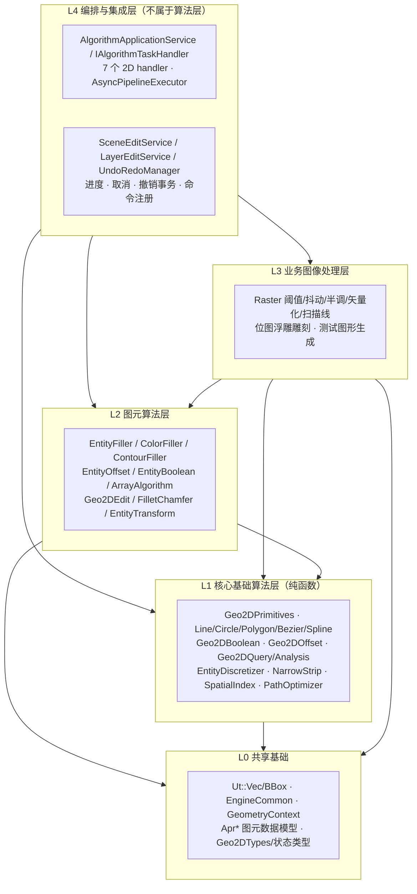

# 2D 算法框架分层设计（架构方案）

> 状态说明（2026-11-27）　状态：设计（待分阶段落地）　维护：架构组
>
> **本轮交付边界**：只交付架构设计与测试矩阵/缺口清单，**未修改任何源码、未改子模块、未改构建配置**。
> 文中「目标态」是建议，「现状」是 2026-11-27 只读核对到的事实；两者严格分开写。
>
> 事实来源：当前工作区源码 + 既有文档。既有审查文档的行号与部分数值已随提交漂移，
> 凡涉及具体数值/依赖方向，以本文件标注的源码位置为准，并在 §7 列出已知漂移。
>
> 配套阅读：[2D 各算法专题](01-填充算法.md) 等 01–09、[CAM](CAM.md)、
> [测试架构](../../04-测试与日志/测试架构.md)、
> [算法框架审查](../../09-框架审查/算法框架审查.md)、
> [算法耦合与功能裁剪分析](../算法耦合与功能裁剪分析-2026-11-12.md)、
> [算法稳定性问题清单](../算法稳定性问题清单-2026-11-12.md)。

---

## 0. 为什么要分层：目标与设计原则

当前 2D 算法并不是「一个可插拔的算法模块」，而是三层不同的东西共用「算法」这个词：
命令/任务入口、`AlgorithmTaskId` + handler、引擎里的几何实现。
`Docs/06-算法/算法耦合与功能裁剪分析-2026-11-12.md` §0 已给出这个口径。
本设计要做的，是把「计算能力」从「UI 编排」「场景写入」「工艺业务」中剥出来，形成稳定的可复用底座。

| 目标 | 在本设计中的落法 |
|---|---|
| 复用性更高 | 上层只依赖下层的**纯计算接口**；布尔/偏移/离散化等内核被填充、位图矢量化、CAM 共同复用，不再各写一份 |
| 耦合性更低 | 依赖只能向下；算法层不得 include `SceneManager`/`LayerManager`/`Qt`/`UI`；写场景统一由编排层注入 |
| 可二次开发 | 稳定面用**纯 C ABI + header-only C++ 门面**（照 Raster 的样板）；算法扩展点用版本化接口，用户自定义算法只接门面，不碰内部实现 |
| 长期稳定 | 稳定面/内部面分离；数值口径、单位、极性、错误码写进契约；语义版本 + ABI 版本 + 导出基线；弃用有流程 |
| 测试覆盖全面 | 每一层有明确的测试职责与断言口径；按算法入口登记覆盖矩阵，新增入口必须补行；覆盖率先建基线再提门槛 |

五条不可让步的约束：

1. **算法层不碰 UI**。`Engine/` 里无 `Qt*`/`UI/` include（现状已成立，见 §2.3）。
2. **核心基础算法层不碰场景**。输入输出为 POD / 几何容器，不出现 `SceneManager`、`LayerEditService`、图元 ID。
3. **图元算法层只产出结果，不直接写场景**。现状的 `write*` 重载迁移到编排层后，算法函数保持纯计算。
4. **稳定面只增不改**。已导出的符号、参数结构体布局、单位/极性语义变更走弃用流程，不走「顺手改一下」。
5. **任何分层改动都必须可回滚**。分阶段推进，每阶段独立验收，禁止「大爆炸式」全量搬迁。

---

## 1. 目标态分层模型

> 消费者（不在算法层内）：`CAM/CAM`（`Cam::compile`）、`Engraving`（网格切片/体加工）、
> `Nesting`（排样内核）、`Main/Src/Hardware/MotionPlanCompiler`。它们从 L0–L3 取结果，算法层不反向依赖它们。

### 1.1 依赖规则表

| 层 | 可以依赖 | 禁止依赖 | 现有守卫 |
|---|---|---|---|
| L0 | 无（第三方数学库除外） | 以上任何层 | `CMake/CheckDependencies.cmake` 规则 1 |
| L1 | L0 | `SceneManager`/`Layer*`/`Qt`/`UI`/`CAM`/`Engraving`/`SceneEditService` | 目前靠人工；建议新增 include 白名单（§6） |
| L2 | L0、L1 | `UI`/`Qt`；**新代码不得直接写场景**（保留存量 `write*` 直到 Phase 2 迁移） | `CMake/SceneWriteSurface.cmake` 约束场景写入口 |
| L3 | L0–L2 | `UI`/`Qt`/`SceneManager`；直接依赖 `Vision`（阈值算子应下沉复用或明确语义边界） | `CMake/CheckDependencies.cmake` 规则 1（Engine/Raster 不得依赖上层） |
| L4 | 全部 | 被下层依赖 | `CheckDependencies` 规则 3（UI 不得直接**链接** Engine）、`UiEngineAccessRatchet.cmake` |

补充规则：**算法层之间不允许「同层互调形成环」**。当前 `Engine/2D/Src/Algorithm/` 下算法实现之间几乎没有互相 include（耦合分析实测只有 `FillGeometryUpdater.cpp → EntityColorFiller.h` 一条算法→算法边），这个好习惯要冻结住。

### 1.2 各层的职责边界（判定一个函数该放哪层）

| 判据 | L1 | L2 | L3 | L4 |
|---|---|---|---|---|
| 输入 | 点/线/环/多边形等几何值 | `Apr*` 图元 / 图元快照 | 图像像素 + 标定参数 | 用户参数（`QVariantMap`）、场景 ID |
| 输出 | 几何值、`std::vector` 结果 | 几何结果 + 统计（不写场景） | 位图 / 扫描段 / 轮廓点列 | 场景变更 + 撤销命令 + UI 反馈 |
| 是否读场景 | 否 | 否（只读传入的图元数据） | 否 | 是 |
| 是否写场景 | 否 | 否 | 否 | 是（唯一允许层） |
| 取消/进度 | 可选回调，默认无 | 可选回调，默认无 | 阶段级可中断 | 统一 `ProgressDialog` / handler 状态 |
| 典型不变量 | 确定性、幂等（除偏移类） | 不改源图元 | 单位/极性显式 | 单撤销事务、线程切换正确 |

---

## 2. 现状映射：现有算法落在哪一层

> 表内「纯度」：`纯` = 不改场景且输出确定；`半纯` = 有可选回调/内部缓存/读图元 ID；
> `有副作用` = 存在直接写场景/图层的入口。行号以 2026-11-27 工作区为准。

### 2.1 L0 / L1 核心基础算法层

| 算法入口 | 当前落点 | 纯度 | 备注 |
|---|---|---|---|
| `Ut::Vec2d` / `BBox2d`、容差上下文 | `Utility/Utility/...`、`Engine/2D/Include/Engine2D/Geo/GeometryContext.h:28-85`、`Geometry/Geo2DTypes.h` | 纯 | L0 的地基；`GeometryContext` 是既有容差源 |
| 基础几何原语 | `Engine/2D/Include/Engine2D/Geometry/Geo2DPrimitives.h:34-324`（全静态，如 `convexHull:278`、`minimumEnclosingCircle:284`） | 纯 | 权威实现；`Line/Circle/PolygonAlgorithms.h` 多处自注「薄包装，权威实现见 Geo2DPrimitives」 |
| 曲线算法 | `LineAlgorithms.h:40-124`、`CircleAlgorithms.h:16-85`、`BezierAlgorithms.h:18-176`、`SplineAlgorithms.h:14-185` | 纯 | split/merge/discretize/evaluate/derivative |
| 布尔内核 | `Geometry/Geo2DBoolean.h:22-44`（`entityToContours`/`booleanContours`/`Entities`/`uniteContours`/`contourToPolygon`），实现 `Src/Geometry/Geo2DBoolean.cpp` | 纯 | Clipper2；当前 `ClipperD(kClipperDecimalPrecision)`，`Geo2DTypes.h:17` = 4 |
| 偏移内核 | `Geometry/Geo2DOffset.h:97-235`（`offsetContours`/`ByRole`/`insetRings`/`Layers`/`SpiralPaths`/`fillet`/`chamfer`），实现 `Src/Geometry/Geo2DOffset.cpp` | 纯 | `Geo2DOffset.cpp:7-12` include Boolean/Path/Query + Clipper2；**方向为 Offset → Boolean**（见 §7 漂移） |
| 只读查询/分析/采样 | `Geo2DQuery.h:26-163`、`Geo2DAnalysis.h:31-100`（`Geo2DAnalysis.cpp:11-25` 无 Scene）、`Geo2DSampling.h` | 纯 | 面积、长度、winding、凸性、自交、最近点 |
| 曲线离散化 | `Algorithm/Discretizer/EntityDiscretizer.h:18-48`（`doDiscretize` 单/批/弦高），实现 `EntityDiscretizer.cpp` | 半纯 | `EntityDiscretizer.cpp:16-21` 含曲线算法与 `SceneManager.h`，是 L1 纯度例外，Phase 2 处理 |
| 窄条中心线 / 路径分解缓存 | `Geometry/NarrowStripCenterline.h:66-73`、`PathDecomposeCache.h:34-74` | 半纯 | 后者 pImpl + `EntityId`，带缓存语义 |
| 空间索引 / 路径优化 | `Core/EntitySpatialIndex.h`、`Algorithm/PathOptimizer.h`、`PathOptimizerV2.h` | 纯/半纯 | 加速结构与后处理，复用面良好 |

### 2.2 L2 图元算法层

| 算法入口 | 当前落点 | 纯度 | 备注 |
|---|---|---|---|
| 线填充 | `Algorithm/EntityFiller.h:22,49`（`computeFill` 静态纯）、`:58`（`write*`） | 半纯 | 计算与写入同头；写入搬到 L4 后即为纯函数 |
| 色块填充 | `Algorithm/EntityColorFiller.h:42,71`（`computeRegions`）、`:113`（`write*`） | 半纯 | 内部用 BBox 索引/包含判定/三角剖分 |
| 同心环 / 螺旋填充 | `Algorithm/EntityContourFiller.h:52/88`（静态纯计算）、`:76/105/119/133`（写场景），实现 `Src/Algorithm/EntityContourFiller.cpp:6-7,234,306,395` | 半纯 | 同文件组装 Boolean/Offset/Discretizer；是「共享内核」的实际调用者 |
| 偏移图元化 | `Algorithm/Offset/EntityOffset.h:18,34` | 半纯 | 薄封装 + 场景写入 |
| 布尔图元化 | `Algorithm/Boolean/EntityBoolean.h:19,33` | 半纯 | 同上 |
| 阵列 | `Algorithm/ArrayAlgorithm.h:43,58`（`generate` 纯）/`:51`（`execute` 改 `GroupManager`） | 有副作用 | 纯计算与副作用共存，是 L2→L4 拆分的样板 |
| 图元编辑 | `Algorithm/Geo2DEdit.h:32-158`（全静态、返回克隆）；实现 `Geo2DEdit.cpp` 无 `SceneManager` | 纯 | 裁剪/打断/克隆等原语，复用价值高但无 UI 命令 |
| 变换 / 圆角倒角 | `Algorithm/EntityTransform.h:22,28-95`（直接改场景）；`Edit/FilletChamfer.h:22,26`（经 `SceneEditService`） | 有副作用 | 属于编辑服务，长期应归 L4 或拆出纯计算 |
| 统一算法接口 | `Algorithm/IGeometryAlgorithm.h:163-180` | — | `execute(sourceEntities, params)` 纯计算契约已写得很清楚；但目前不是版本化的插件 ABI（§3.4） |

### 2.3 L3 业务图像处理层

| 算法入口 | 当前落点 | 纯度 | 备注 |
|---|---|---|---|
| 阈值 / 灰度 / 反相 | `Raster/Raster/Src/Algo/RasterPreprocess.cpp:222-276`（Otsu 在 `:244`）、`Include/Raster/RasterApi.h:222-224` | 纯（像素域） | C ABI 暴露 92 个导出函数；`RasterStatus` 11 码，`Raster_StatusText`/`GetLastErrorMessage` 永非空 |
| 抖动 / 半调 / 蓝噪 / Bayer | `Raster/Raster/Src/Algo/RasterLaser.cpp:284-341`（11 种方法，`RasterTypes.h:400-414`） | 纯（像素域） | 输出 1bit 位图；`method=NONE` 走 Otsu（`:301`） |
| 矢量化 / 轮廓追踪 | `Raster/Raster/Src/Vector/RasterVector.cpp:458-542`（固定 `THRESH_BINARY_INV+OTSU`，暗=加工）、`Src/Algo/RasterContour.cpp:83-126`（亮=保留） | 纯（像素域） | **两份实现、极性相反**，见 `算法框架审查.md` P1-6；生产只用 `Raster_Vectorize` |
| 位图扫描线 | `Raster/Raster/Src/Engrave/RasterScanline.cpp:72`（`Raster_ScanlineJobs`） | 纯（像素域） | 仅由 CAM 桥接消费；无取消 |
| 自定义算子注册 | `RasterApi.h:532-558`（`Raster_RegisterCustomOp`/`Apply`/`PipelineAddCustom`），实现 `Src/Core/RasterFramework.cpp:232-328` | 进程级扩展点 | 这是仓库里**唯一已落地的算法二次开发机制**，Engine2D 应借鉴 |
| 位图浮雕雕刻 | `UI/3D/Src/Relief/ReliefEngravingService3D.cpp`、`Docs/06-算法/2D/06-位图浮雕雕刻.md` | 有副作用 | 业务编排在 UI 侧；计算核心在 Engraving，跨 L3/L4 |
| 测试图形生成 | `UI/2D` 的 `TestGenerate2D` handler（同步 handler） | 有副作用 | 业务工具，归 L4 编排 + L2 几何生成 |
| 排样 Nesting | `Nesting/Nesting/Src/Core/*`（独立 DLL） | 纯（内部）/ 半纯（watchdog 取消） | 启发式优化，属于「图元业务算法」，独立于 L1/L2 存在，不强行并入 |

> Raster 的 C ABI 已经具备二次开发的全部要素：POD + 不透明句柄 + 状态码 +
> `structSize` 前向扩展 + 纯 C 头 + header-only C++ 门面
> （`Raster/Raster/Include/Raster/RasterApi.h` 文件头、`RasterCpp.h`），
> `RASTER_ABI_VERSION=3`、版本 1.3.0（`RasterTypes.h:39-43`），
> `cmake/RasterAbiGuard.cmake:100-117` 在配置期禁止跨边界出现 STL/OpenCV/Qt/throw，
> `c_api_compat.c` 用纯 C99 编译验证。
> **这是 Engine2D 算法层目前最缺、也最值得照抄的一层。**

### 2.4 L4 编排与集成层（明确不属于算法层）

| 设施 | 当前落点 | 说明 |
|---|---|---|
| 三段式处理器契约 | `UI/Common/Include/UI/Algorithm/IAlgorithmTaskHandler.h:26-88`、`BackgroundAlgorithmTaskHandler.h:39-109` | `prepareBackgroundRun`（主）/ `computeBackgroundRun`（工）/ `applyBackgroundRun`（主），`final` 包装 + 派生 `do*` |
| 服务与注册 | `AlgorithmApplicationService.h:27-75`、`AlgorithmTaskTypes.h:46-128`、`AlgorithmTaskId.h:15-33` | 7 个 2D 任务在 `UI/2D/Src/Algorithm/AlgorithmTaskRegistration2D.cpp:1366-1385` 注册（Nesting 受 `ENABLE_NESTING` 保护） |
| 命令链 | `Main/Src/UI/ClientConfig/configs/base.json:207-213,222-231` → `CommandCatalog.cpp:1155-1208` → `OperationId` → `AlgorithmOperationMapping.cpp:7-50` → `AlgorithmRunner.cpp:81-143` | Bitmap/Vectorize/Relief 在映射中落 default `None`，走 Raster/Engraving 旁路 |
| 场景写入 | `Engine/2D/Include/Engine2D/Edit/SceneEditService.h`、`LayerEditService.h`、`UndoRedoManager.h` | 服务类虽在 Engine2D 目录，但职责是 L4；由 `CMake/SceneWriteSurface.cmake` 守卫唯一入口 |
| 第二条异步管线 | `UI/2D/Include/UI2D/AsyncPipelineExecutor.h:113-176`、`Src/AsyncPipelineExecutor.cpp:59` | 自带线程/取消/收尾，Raster route 专用；与 handler 体系并存（§7）。三条 route 在 `ProcessRouteRegistry.cpp:663-675` 注册：BitmapProcess、VectorizeBitmap、RasterizeVector（桩，`match` 恒 false / 返回 Error，`:612-637`） |
| Raster 进度回调 | `Raster/Raster/Include/Raster/RasterApi.h:508-513` | 库本身提供 `Raster_SetProgressCallback`（返回非 0 → `RASTER_E_CANCELLED`），但 UI 侧**未调用**，只用宿主的 `atomic<bool>` 与 `checkCancel/reportProgress` 在阶段之间检查 |

**结论**：现状的「紧耦合」并不在算法之间，而在两处：①三个共享内核被多条业务链复用
（`Geo2DOffset` / `Geo2DBoolean` / `EntityDiscretizer`）；②写场景的 `write*` 重载与算法计算同header。
分层要解决的正是这两处，而不是把已有文件机械地搬目录。

---

## 3. 稳定契约与二次开发设计

### 3.1 数据契约（必须先冻结）

| 契约项 | 当前事实 | 建议冻结口径 |
|---|---|---|
| 长度单位 | 全链路 mm（`Engine/2D/Geo/GeometryContext.h`） | 算法层公开 API 一律 mm，`double` |
| 内部精度 | Engine2D `kClipperDecimalPrecision = 4` → 1e-4 mm（`Geo2DTypes.h:17`）；Engraving `kDefaultScale=1000` → 1e-3 mm（`Src/PolygonOffset.cpp:13`）；Nesting `scale=1/tolerance`（`Types.h:57`）；Raster 像素域 | 每个算法入口在文档与头注释里标注**内部量化单位**；跨模块传递时必须显式换算，禁止隐式信任 |
| 环方向 | 外环 CCW、孔 CW（`Geo2DOffset.h:31-35` 已有约定） | 写入所有 L1/L2 输出契约，测试断言带符号面积 |
| 图像极性 | Raster 矢量化固定反相（暗=加工），`Raster_TraceContours` 假设亮=保留 | **统一为「前景=加工区」显式命名**，两个入口合并或其一标弃用（P1，需 golden 对照） |
| 容差 | `GeometryContext` 为既有唯一源；但 Clipper 量化与之不等效 | 区分「建模容差」与「数值量化精度」两个字段，不再互相冒充 |
| 点序稳定性 | `Geo2DOffset.h:31-35` 已声明同层内环顺序不保证 | 契约写明「可依赖/不可依赖的下标语义」，避免二次开发踩坑 |

### 3.2 函数契约

1. **纯计算**：L1/L2 的计算入口不得写场景、不得改输入图元、不得读全局可变状态。
2. **取消/进度**：采用可选回调（`std::function<bool()>` 取消 + 进度回调），默认空；
   L1/L2 只做「按层/按 64 行」的粗粒度检查。现状偏移/线填充没有取消钩子
   （`算法框架审查.md` P1-5），补钩子时**不得改变默认行为**。
3. **参数校验**：在 handler 的 `doPrepare` 统一 clamp + 错误码；算法层只接受已校验参数，
   但自身对越界输入仍要有确定行为（不崩溃、不写出半成品）。
4. **错误语义**：失败时输出参数必须处于「确定可读」状态（对齐 Raster C ABI 的出参约定）；
   禁止「返回成功但结果是空的」。
5. **幂等性标注**：并/交幂等、差/偏移/阵列/抖动不幂等，写进函数注释与测试矩阵。

### 3.3 ABI 与版本治理

- **事实**：`Engine2DAPI.h:3-21` 明示公共头大量使用 STL，**不承诺跨编译器稳定 ABI**；
  全模块无 `extern "C"` C API，导出面由 `Tools/Abi/baseline/Engine2D.txt`（约 1127 行 / 1122 符号）钉住，
  `check_exports.py` 比对；`Abi/ConsumerSmoke.cpp` 验证公开头可链接。
- **目标**：把算法层的「稳定面」限定为两层：
  1. **纯 C 门面**（新增，不替换现有 C++ API）：POD + 不透明句柄 + 状态码 + `structSize` 追加式扩展；
  2. **header-only C++ 门面**（照 `RasterCpp.h`）：`std::string`/`std::vector`/RAII 只在调用方 TU，
     不让 STL 跨 DLL 边界。
- **版本**：`GetVersion()` 语义版本 + `GetAbiVersion()` ABI 主版本；结构体首字段 `structSize`；
  新增成员只能追加；删除/改名走「先弃用一版、再移除」。
- **导出基线**：稳定面新增符号必须同步更新基线并写变更说明；内部面符号变化不视为破坏，但需在 PR 里标注分类。可复用 `Raster/Raster/cmake/RasterAbiGuard.cmake` 的做法：配置期扫描公开头，禁止 STL/OpenCV/Qt/throw 跨边界，并断言 header-only 门面无导出符号。

### 3.4 二次开发扩展点（含已有样板）

| 场景 | 接什么 | 不接什么 | 稳定性保障 |
|---|---|---|---|
| **已有样板**：Raster 自定义算子 | `Raster_RegisterCustomOp`/`Apply`/`PipelineAddCustom`（`RasterApi.h:532-558`） | Raster 内部句柄结构 | 纯 C 签名 + 进程级注册表 + ABI 版本 guard |
| 脚本/批量/跨语言调用 | L3 风格的纯 C 门面（Engine2D 待建）+ Raster 现有 C ABI | handler、场景指针 | 版本号 + `structSize` + 状态码 |
| 自定义几何算法 | `IGeometryAlgorithm` 式纯虚接口（`execute` 返回新图元，不改场景），由 L4 注册 | `SceneManager`/`UndoRedoManager` | 接口带版本字段；默认实现提供空进度/取消 |
| 自定义位图工艺 | 仿 `ProcessRouteRegistry` 的 route 注册（输入快照 → 输出位图/线段），统一状态码 | UI 对话框、`ProgressDialog` | route 契约测试 + golden 图 |

> 注意：`IGeometryAlgorithm`（`IGeometryAlgorithm.h:163-180`）目前只是抽象接口，不是插件 ABI；
> 不要对外宣称「已有插件机制」。真正支持第三方 DLL 插件需要先完成 §3.3 的稳定面。

---

## 4. 迁移路线（每阶段可独立回滚）

| 阶段 | 目标 | 关键动作 | 验收 | 风险 |
|---|---|---|---|---|
| **P0 冻结** | 先不碰代码，把边界钉死 | 本文件定稿；把 §1.1 依赖规则写入 CI 守卫；导出基线冻结；新算法入口必须登记 §5.2 矩阵 | 文档评审通过；守卫脚本跑通 | 低 |
| **P1 统一口径** | 消除默认行为变化下的口径漂移 | 精度/极性/容差注释补齐；取消/进度回调以**默认空参数**追加；参数 clamp 收进 `doPrepare` | 现有全部数值测试不回归；A/B 对照无差异 | 中（公开头新增参数需 ABI 评估） |
| **P2 抽稳定面** | 纯新增门面，不动实现 | L1/L2 计算入口的纯函数转发头；把 `write*` 调用迁到 handler；`EntityDiscretizer` 去掉 `SceneManager.h` 依赖 | 新门面有独立单测；导出符号只增不减 | 中 |
| **P3 收敛重复** | 一份能力一个实现 | 矢量化/轮廓追踪极性合并；两份 offset 对齐；两套刀路编译收敛；两套异步管线统一 | golden A/B + 真实入口复现（按稳定性清单口径） | **高**，必须逐项实测后再动 |
| **P4 构建边界** | 目录/目标反映分层 | 按 L0/L1/L2/L3 拆 OBJECT/STATIC 接口目标；`GLOB_RECURSE` 改显式清单（可选）；保持导出符号不变 | 消费者无需改代码；ABI 基线无破坏性 diff | 中 |
| **P5 SDK 化** | 对外可二次开发 | C ABI 门面 + C++ header-only 包装 + 示例 + 版本治理 + Python 绑定复用 | 跨语言 smoke（仿 `c_api_compat.c`）；文档示例可编译 | 中 |

**推进纪律**：P1–P2 可以在不破坏现有调用方的前提下做；P3/P4 必须先有 golden 基线与 A/B 数据，
`算法稳定性问题清单` 里「未实测」的项目不得当作结论使用。

### 4.1 落地状态（2026-11-27）

| 阶段 | 状态 | 已落地内容 |
|---|---|---|
| P0 | **已落地** | `Tools/check_2d_layer_deps.py` + `CMake/Check2DLayerDeps.cmake` + 根 `CMakeLists.txt` + CI 步骤；存量 15 处违规登记为棘轮例外，新违规 configure 失败 |
| P1 | **部分落地** | `Geo/GeometryPrecision.h` 冻结 1e-4mm 量化口径（静态断言 + 换算函数）；C ABI 增加 `Eg2d_*WithCancel` 与 `EG2D_E_CANCELLED`，**粗粒度**（进入内核前检查一次，逐层取消仍需 P2 内核分段） |
| P2 | **部分落地** | L1 C ABI 门面 + header-only C++ 门面；`Algorithms/` 聚合头让 L0–L3 在工程里可见；`EntityFiller` 的 4 个场景写入方法移到 `Src/Algorithm/Writers/`，计算 TU 去掉场景 include，调用方签名不变；其余 filler 待同样处理 |
| P3 | **部分落地** | Raster 新增语义明确的 `Raster_FindProcessContours`（固定暗=加工），以 golden 对照冻结旧行为；旧入口未删除，两份 offset/两套编译器未动 |
| P4 | **部分落地** | `Engine2DStableCAPI` OBJECT 目标把稳定门面源码从内核 `GLOB` 中独立，DLL 导出面与消费者不变 |
| P5 | **部分落地** | Engine2D C ABI 具备版本/ABI 号、`structSize`、状态码、错误文本、纯 C 头与 C++ 门面；Python 绑定未接 |

验证：`Engine2DTests` **1445 例**全绿（新增 7 例 C ABI 契约、2 例可取消、2 例精度契约、2 例分层门面）；
`RasterTests` 157 例（新增 3 例极性 golden）全绿；纯 C 头编译检查已并入 `Engine2DTests` 目标。

> ABI 基线 `check_exports.py` 当前报 57 个符号消失，来自工作区并行的导出收敛改动
> （`FillAlgorithm`/`OffsetAlgorithm`/`BooleanAlgorithm` 等旧导出被删除），**不是本轮门面改动造成**；
> 本轮未改基线，待并行分支合入后统一刷新。

---

## 5. 测试矩阵与缺口清单

### 5.1 分层测试职责

| 层 | 测试类型 | 断言口径 | 代表位置 |
|---|---|---|---|
| L0 | 单元 | 构造、边界、容差往返 | `Utility/Utility/Test/*`、`Engine/2D/Test/GeometryContextTests.cpp` |
| L1 | 数值/性质测试 | 面积、周长、条数、闭合性、坐标、带符号面积、退化输入 | `Engine/2D/Test/Geo2DBooleanTests.cpp`、`Geo2DOffsetTests.cpp`、`Geo2DPrimitivesTests.cpp`、`*Algorithms*Tests.cpp` |
| L2 | 图元流水线 | 图元→离散→计算；纯计算不改源图元；失败语义 | `Engine/2D/Test/EntityAlgorithmPipelineTests.cpp`、`ColorFillTests.cpp`、`EntityContourFillerLayerTests.cpp`、`ArrayAlgorithmTests.cpp` |
| L3 | golden / 契约 | 固定图像 → 固定位图/轮廓/扫描段；单位与极性；状态码 | `Raster/Raster/Test/*`（12 个 `.cpp`，154 TEST）、`UI/2D/Test/RasterVectorizeTests.cpp`、`RasterBitmapProcessTests.cpp` |
| L4 | 生命周期/接线/契约 | prepare→compute→apply 顺序、取消、撤销事务、对话框销毁竞态、命令目录一致性 | `UI/Common/Test/AlgorithmAsyncLifecycleTests.cpp`、`UI/2D/Test/BooleanRoutingTests.cpp`、`AsyncPipelineExecutorTests.cpp`、`CommandCatalogContractTests.cpp` |
| 跨层 | ABI / 集成 / 性能 | 导出符号基线、消费者编译、真实入口复现、基准不倒退 | `Engine/2D/Abi/ConsumerSmoke.cpp`、`Tools/Abi/baseline/Engine2D.txt`、`Engine2DOffsetBenchmark`、`Tools/PerfBenchmark` |

框架事实：全仓统一 **GTest + gmock**（无 Catch2/自研框架）；`Engine2DTests` 单目标 GLOB（61 个 `.cpp` + `TestUtils2D.h`，5 文件 `SKIP_UNITY_BUILD_INCLUSION`），
`gtest_discover_tests` PRE_TEST，LABELS `core engine2d`；`RasterTests` 12 个 `.cpp` 共 **154 个 TEST**（Preprocess 20 / Laser 13 / Contour 10 / Scanline 15 等），
另有纯 C99 目标 `RasterCApiCompatTest`；UI 侧 bridge/vectorize/bitmap 三个目标分别 8 / 2 / 12 例。

### 5.2 覆盖矩阵（按算法入口登记；新增入口必须补行）

> 「现有」列为当前实际存在的测试文件；「缺口」列为本轮识别出的覆盖空缺，不代表已有测试写得不好。

| 层 | 算法入口 | 现有测试 | 断言口径现状 | 缺口 | 优先级 |
|---|---|---|---|---|---|
| L0 | `GeometryContext` / `Vec` / `BBox` | `GeometryContextTests.cpp`、`Utility/Utility/Test/VecTests.cpp` 等 | 字段映射、往返、边界 | 容差与 Clipper 量化单位的关系无专项测试 | P2 |
| L1 | `Geo2DPrimitives` | `Geo2DPrimitivesTests.cpp`（约 60 例） | 面积/凸包/外接圆等数值 | 无 | — |
| L1 | `Geo2DBoolean` | `Geo2DBooleanTests.cpp`（约 22 例） | 并/交/差/XOR 面积、孔洞带符号面积、退化过滤 | 与 Offset 的归一化对照已有但缺固定边界集 | P2 |
| L1 | `Geo2DOffset` | `Geo2DOffsetTests.cpp`、`Geo2DOffsetInsetRingsTests.cpp`、`Geo2DOffsetNormalizationContrastTests.cpp`、`Geo2DOffsetSpiralSeamTests.cpp`（四组共约 65 例） | 外扩/内缩面积、孔洞方向、塌缩、楔口 | 取消钩子路径无测试（当前无钩子）；A/B 对照用例依赖测试内旧实现，长期要转正 | P1 |
| L1 | Line/Circle/Bezier/Spline | `LineAlgorithmsTests.cpp`+`Advanced`（约 110 例）、`CircleBezierAlgorithmsTests.cpp`（约 103）、`SplineAlgorithmsTests.cpp`（约 31） | 求交、距离、离散误差 | 无 | — |
| L1 | Query/Analysis/Sampling/Edit | `Geo2DQueryTests.cpp`、`Geo2DAnalysisTests.cpp`+`Advanced`、`Geo2DSamplingTests.cpp`、`Geo2DEditTests.cpp` | 只读查询与克隆语义 | 编辑原语无 UI 命令，属能力闲置而非测试缺口 | P2 |
| L1 | `EntityDiscretizer`（NURBS） | `EntityDiscretizerNurbsTests.cpp`、`EntityAlgorithmPipelineTests.cpp` | 轮廓条数、闭合性、不改源图元 | 依赖 `SceneManager.h` 的耦合无守卫测试 | P1 |
| L2 | 线填充 `EntityFiller` | `EntityAlgorithmPipelineTests.cpp`、`FillGeometryUpdaterTests.cpp`、`FillLayerTargetNameTests.cpp`、`LayerFillProfileTests.cpp` | 流水线与目标图层 | **文档 `测试架构.md` 列的 `FillAlgorithmNumericTests.cpp` 实际不存在**；扫描线朝向/总长≈面积/间距/孔洞不填的专项口径未见独立文件 | **P0（文档+测试缺口）** |
| L2 | 色块填充 | `ColorFillTests.cpp`（约 14 例） | 区域生成、`AprFillRegion` 三角汤 | 相交合并/嵌套规则/退化三角形的专项边界较少；CAM 依赖三角汤形状的契约测试缺 | P1 |
| L2 | 同心环 / 螺旋 | `EntityContourFillerLayerTests.cpp`、`Geo2DOffsetInsetRingsTests.cpp`、`Geo2DOffsetSpiralSeamTests.cpp` | 环数、层序、楔口缝 | 两种样式的 golden 结果集不统一；取消响应未测 | P1 |
| L2 | 偏移 / 布尔图元化 | `EntityAlgorithmPipelineTests.cpp`、`Geo2DBooleanTests.cpp` 等 | 与几何内核对照 | compute 与 write 未分离，失败时是否写半成品无断言 | P1 |
| L2 | 阵列 / 路径优化 | `ArrayAlgorithmTests.cpp`（约 26）、`PathOptimizerTests.cpp`、`PathOptimizerV2Tests.cpp` | 数量、分组、优化顺序 | `ArrayAlgorithm::execute` 副作用与 `generate` 纯计算混测，需拆 | P2 |
| L3 | Raster 阈值/抖动/半调 | `RasterPreprocessTests.cpp`(20)、`RasterLaserTests.cpp`(13)、`RasterRasterizeTests.cpp`(9)、`RasterFeatureTests.cpp`(30) 等 | 像素级结果、状态码 | `ProcessRouteRegistry` 丢弃 `RasterStatus` 的路径无失败注入测试（审查 P1-8）；库自带 `Raster_SetProgressCallback` 未被 UI 调用，跨库取消链路无测试 | P1 |
| L3 | 矢量化 / 轮廓追踪 | `RasterContourTests.cpp`(10)、UI `RasterVectorizeTests.cpp`(2)；`RasterBitmapProcessTests.cpp`(12) | 轮廓点、简化 | **两入口极性相反的对照 golden 缺失**，合并前必须先补（审查 P1-6）；割缝走宿主 Engine2D 偏置而非 `Raster_KerfCompensate`，该桥接无 A/B 对照 | P0 |
| L3 | 位图浮雕雕刻 | `Main/Src/UI/Test/*ProcessingChain*`、`Engraving/Engraving/Test/*` | 链路级 | 2D 位图浮雕的独立数值/图像 golden 薄 | P1 |
| L4 | 7 个 2D handler | `AlgorithmAsyncLifecycleTests.cpp`（2 例，假 handler）、`NestingPreparerTests.cpp`（3 例）、`BooleanRoutingTests.cpp`（2 例） | 生命周期/路由 | **7 个真实 handler 无专属单测**；参数 clamp/失败传播/cancel/apply 校验靠派生类自觉（审查 P1-1） | P0 |
| L4 | Raster 异步管线 | `AsyncPipelineExecutorTests.cpp`（3 例） | 线程生命周期 | owner 空分支不 join 的 terminate 路径（审查 P1-3）未测；取消/失败传播未测 | P1 |
| L4 | 命令与映射链 | `CommandCatalogContractTests.cpp`（8 例）、`Main/Src/UI/Test/CommandUiWiringTests.cpp` | actionId/commandId 可解析 | 映射 default `None` 的旁路（Bitmap/Vectorize/Relief）无端到端断言 | P2 |
| 跨层 | ABI / C 兼容 | `RasterCApiCompatTest`、`Engine/2D/Abi/ConsumerSmoke.cpp`、`check_exports.py` | 纯 C 头可编译、导出符号基线 | Engine2D 无稳定 C ABI，二次开发无对外契约测试 | P1 |
| 跨层 | 性能基准 | `Engine2DOffsetBenchmark`、`Tools/PerfBenchmark`、`Tools/RenderBenchmark` | 可对比数字 | 无「基线入库 + PR 对照」的自动门禁 | P2 |

### 5.3 缺口清单（按优先级，可直接排期）

**P0（先补，属于安全/契约正确性）**

1. `测试架构.md:31` 登记的 `Engine/2D/Test/FillAlgorithmNumericTests.cpp` 在仓库中不存在——线填充数值口径（扫描线朝向、总长≈面积/间距、凹口不越界、孔洞不填）缺少独立可复现测试；补文件或更正文档，二选一但必须对齐。
2. Raster 矢量化与轮廓追踪极性相反（`RasterVector.cpp` 固定 `THRESH_BINARY_INV+OTSU`，`RasterContour.cpp` 假设亮=保留）：**先补同一输入、两种入口的 golden 对照**，再谈合并；否则有「加工背景」的潜在事故。
3. 7 个真实 `IAlgorithmTaskHandler` 无专属单测；尤其 `apply` 不校验取消/计算失败（审查 P1-1）与 prepare 异常导致交互永久禁用（审查 P1-4）需要契约级回归。

**P1（影响稳定性与二次开发可信度）**

4. 偏移/填充链路无取消钩子（`Geo2DOffset` 公开签名无 cancel，`EntityFill` 全文无 cancel）；补钩子时同步补「中途取消不写回」测试。
5. 色块填充依赖 `AprFillRegion` 三角汤的 CAM 形状假设（`Cam/GeometryExtractor.cpp` 靠共享边抵消反推边界环）：换填充策略前必须有形状契约测试。
6. `ProcessRouteRegistry` 丢弃 `Raster_*` 返回码、失败仍报成功（审查 P1-8）：补失败注入 + 状态码断言。
7. Raster 自带 `Raster_SetProgressCallback`（`RasterApi.h:508-513`，返回非 0 → `RASTER_E_CANCELLED`）未被 UI 调用；UI 只在阶段之间 `checkCancel`，单次 OpenCV 调用不可中断。跨库取消链路无测试，补「回调触发 → 状态码 CANCELLED」契约测试。
8. `AsyncPipelineExecutor` owner 空分支不 join（审查 P1-3）：补终止路径测试；统一两套取消模型后再测取消语义。
9. Engine2D 无稳定对外契约：C ABI 门面未建，二次开发没有可版本化的入口；先定义契约测试（版本号、`structSize`、错误出参确定性）。
10. `EntityDiscretizer` 依赖 `SceneManager.h` 是 L1 纯度例外；加 include 白名单守卫并补「纯计算不改场景」测试。
11. Vision 与 Raster 的 Otsu 阈值各一份（`RasterPreprocess.cpp:242-245`、`Vision/.../BuiltinOperators.cpp:2247-2254`），且「前景=加工区」语义不同（Vision 可配 `markIsDark`，Raster 固定反相）；合并前先补语义对照测试。

**P2（长期债）**

12. 精度口径多套并存（1e-4mm / 1e-3mm / tolerance 驱动 / 像素域），跨模块换算无测试；补「同一几何跨模块传递」的单位对照用例。
13. 两套刀路编译（`Cam::compile` 与 `MotionPlanCompiler`）与两套异步管线：收敛前先各自补 golden，避免「修一处坏一处」。
14. `ArrayAlgorithm::execute` 的副作用与 `generate` 纯计算混测；拆成两个入口各自断言。
15. 性能基准没有自动对照门禁；把轮次标签与 CSV 基线纳入 PR 检查（见 `测试架构.md` §1.2.1 的两条纪律）。
16. 全仓**无覆盖率统计**（无 gcov/lcov/llvm-cov 配置，见 `Docs/09-框架审查/工业级交付标准-2026-11-11.md:92`）；先建基线，再谈门槛。

### 5.4 覆盖率门槛建议（先基线，后门槛）

| 阶段 | 做法 |
|---|---|
| 第一步 | 在 CI 增加一次 `--coverage` 构建，用 lcov（GCC/Clang）生成 `Engine2DTests` / `RasterTests` / `UICommonCommandKernelTests` 的报告并归档，**不设门槛** |
| 第二步 | 固化基线数字，按层设门槛：L1 行覆盖 ≥ 90%、分支 ≥ 85%；L2 ≥ 80%；L3 golden 覆盖全部公开算子；L4 覆盖 7 个 handler 的三段式与失败路径 |
| 第三步 | 新增算法入口未登记 §5.2 矩阵、或覆盖率下降超过 1%，CI 告警；稳定面下降直接失败 |

注意 UnityBuild：`Engine/2D/Test/CMakeLists.txt:20-48` 有 5 个文件 `SKIP_UNITY_BUILD_INCLUSION`，
新测试若引入同名匿名命名空间符号，需沿用该机制，否则合并 TU 会重定义。

---

## 6. 门禁与守护机制

**已有（事实）**

- `CMake/CheckDependencies.cmake`：Engine 不得依赖 UI/Render/Main；UI 不得直接链接 Engine；include 层未收口，只靠 `UiEngineAccessRatchet.cmake` 做白名单「只减不增」。
- `CMake/SceneWriteSurface.cmake`：场景写入收口 `SceneEditService`。
- `CMake/AbiVisibilityGuard.cmake` + `Engine/2D/CMakeLists.txt:28-30`：公开头导出宏可见性检查。
- `Raster/Raster/cmake/RasterAbiGuard.cmake:100-117`：配置期禁止 STL/OpenCV/Qt/throw 跨越 C ABI，`:143-150` 断言 C++ 门面无导出符号。
- `Tools/Abi/baseline/Engine2D.txt` + `check_exports.py`：导出符号基线比对。
- `.github/workflows/ci.yml:75-80` + `Tools/check_unity_deps.py`：Unity 依赖审计。
- `APR_WERROR` 开关，但 `CMake/QualityGates.cmake` 默认把 `Engine/2D`、`Engine/3D`、`UI/2D`、`UI/3D` 排除在外——**算法层目前不在 -Werror 保护内**。

**建议新增（本轮不实施）**

| 守卫 | 检查内容 | 失败级别 |
|---|---|---|
| `Tools/check_2d_layer_deps.py` | L1 头/实现不得 include `Qt*`/`UI`/`SceneManager`/`Layer*`/`Cam`/`Engraving`；L2 不得 include `UI`/`Qt` | configure 失败 |
| 测试矩阵登记检查 | 新增 `AlgorithmTaskId`/公开算法入口但 §5.2 无对应行 | CI 告警（稳定面则失败） |
| ABI 稳定面 diff | C 门面新增/删除符号、结构体字段顺序变更 | 删除/改序直接失败 |
| 覆盖率门槛 | 按 §5.4 分阶段执行 | 先归档，后失败 |
| 精度/单位注释检查 | 公开算法头必须标注单位与内部量化精度 | 文档门禁告警 |

---

## 7. 风险与未决问题（不得当作结论使用）

1. **依赖方向口径冲突**：`算法框架审查.md` §4.1 表述为 `Geo2DBoolean → Geo2DOffset → EntityDiscretizer`；
   当前源码 `#include` 方向是 `Geo2DOffset.cpp:7-12 → Boolean/Path/Query`，即 **Offset → Boolean**。
   调用链由 `EntityContourFiller.cpp:6-7,234,306,395` 组装，两条说法描述的是不同维度。以后者为准，前者需更新。
2. **精度数值漂移**：审查文档写 Engine2D `ClipperD(2)`（10µm）；当前 `Geo2DTypes.h:17` 为
   `kClipperDecimalPrecision = 4`（0.1µm）。本设计按当前源码写，所有引用旧文档数字的地方都要复核。
3. **两套异步执行器**（handler + `AsyncPipelineExecutor`）、**两套取消模型**：统一属于 P3，需先补测试。
4. **未实测项**：偏移/填充逐层耗时、5µm（现为 0.1µm 量化）对最内层残环数的影响、Raster 阶段耗时与内存峰值、
   Nesting 取消延迟、`Cam::compile` 全流程耗时。任何优化决策都必须先拿 A/B 数据。
5. **CAM 形状假设**：`AprFillRegion` 必须是三角汤；改填充实现前先确认下游不变量。
6. **测试文档漂移**：`测试架构.md` 列的部分测试文件已不存在（见 §5.3 P0-1）；以实际 `find`/CMake 目标为准。
7. **Raster 版本记录漂移**：`RasterTypes.h:39-43` 声明版本 1.3.0 / ABI 3，`Raster/CHANGELOG.md` 最新条目却是 1.2.0 / ABI 3（`:20-23`）；对外发布前需对齐。
8. **Raster 第三条 route 是桩**：`RasterizeVector` 在 `ProcessRouteRegistry.cpp:612-637` 的 `match` 恒 false、`execute` 返回 Error，不要把它算作已支持的算法能力。
9. **索引漂移**：`Docs/06-算法/2D/CAM.md` 此前未被 `Docs/00-索引与总览/文档总览.md` 收录，本轮一并补登记。

---

## 8. 参考

- 现状与审查：[算法框架审查](../../09-框架审查/算法框架审查.md)、[算法耦合与功能裁剪分析](../算法耦合与功能裁剪分析-2026-11-12.md)、[算法稳定性问题清单](../算法稳定性问题清单-2026-11-12.md)、[框架现状与修理计划](../../01-当前架构/框架现状与修理计划.md)
- 测试：[测试架构](../../04-测试与日志/测试架构.md)、[Engine2D 测试目录说明](../../../Engine/2D/Test/README.md)、[工业级交付标准](../../09-框架审查/工业级交付标准-2026-11-11.md)
- 契约样板：[RasterApi.h](../../../Raster/Raster/Include/Raster/RasterApi.h)、[RasterCpp.h](../../../Raster/Raster/Include/Raster/RasterCpp.h)、[C-ABI风格约定](../../01-当前架构/C-ABI风格约定.md)、[DLL制作标准与现状](../../01-当前架构/DLL制作标准与现状.md)
- 专题：[2D 填充](01-填充算法.md)、[偏移](02-偏移算法.md)、[布尔](03-布尔运算.md)、[阵列](04-阵列算法.md)、[套料](05-套料算法.md)、[位图工艺](07-位图工艺处理.md)、[矢量化](08-位图矢量化.md)、[2D CAM](CAM.md)
