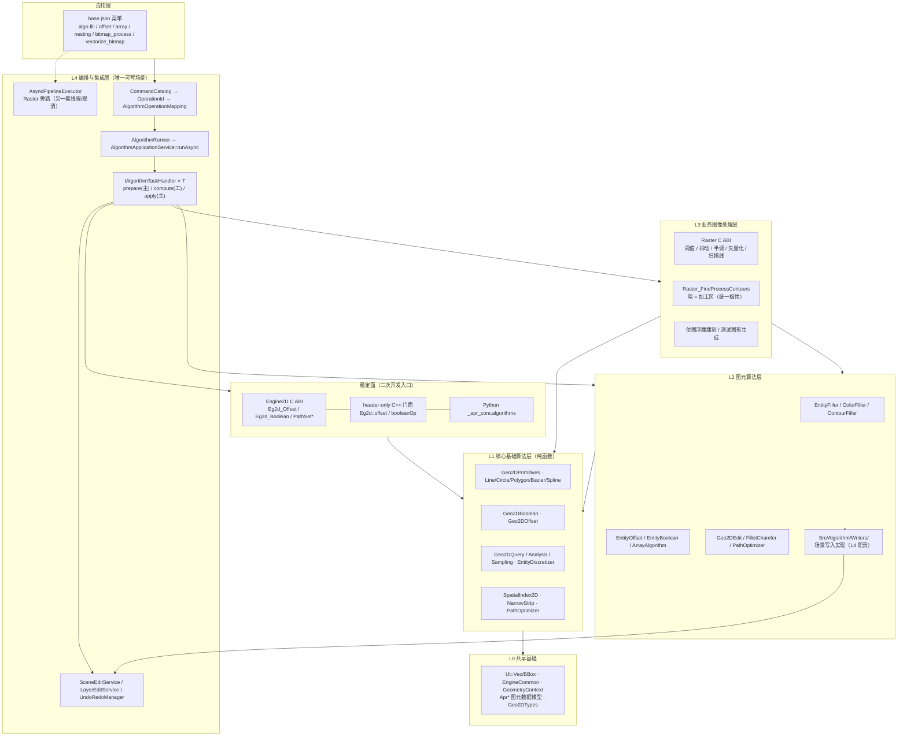
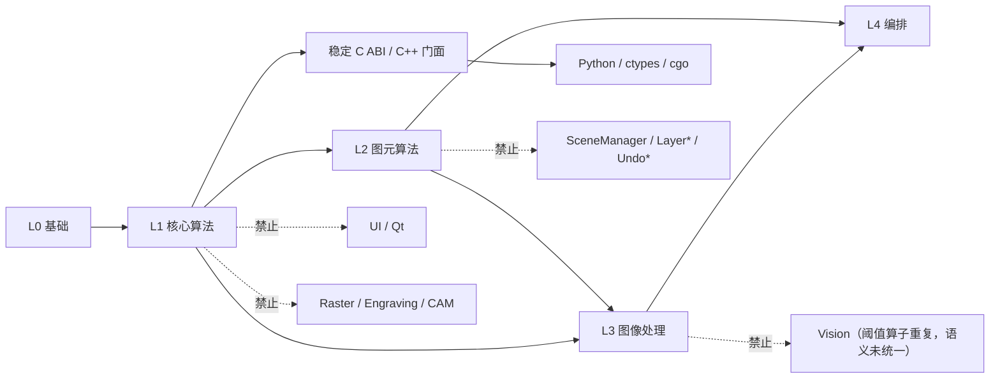
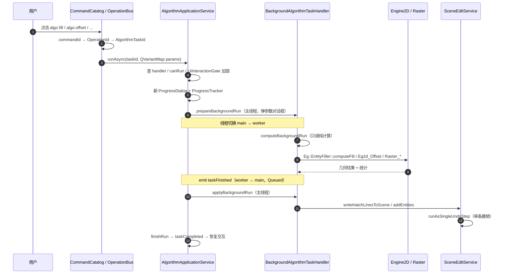
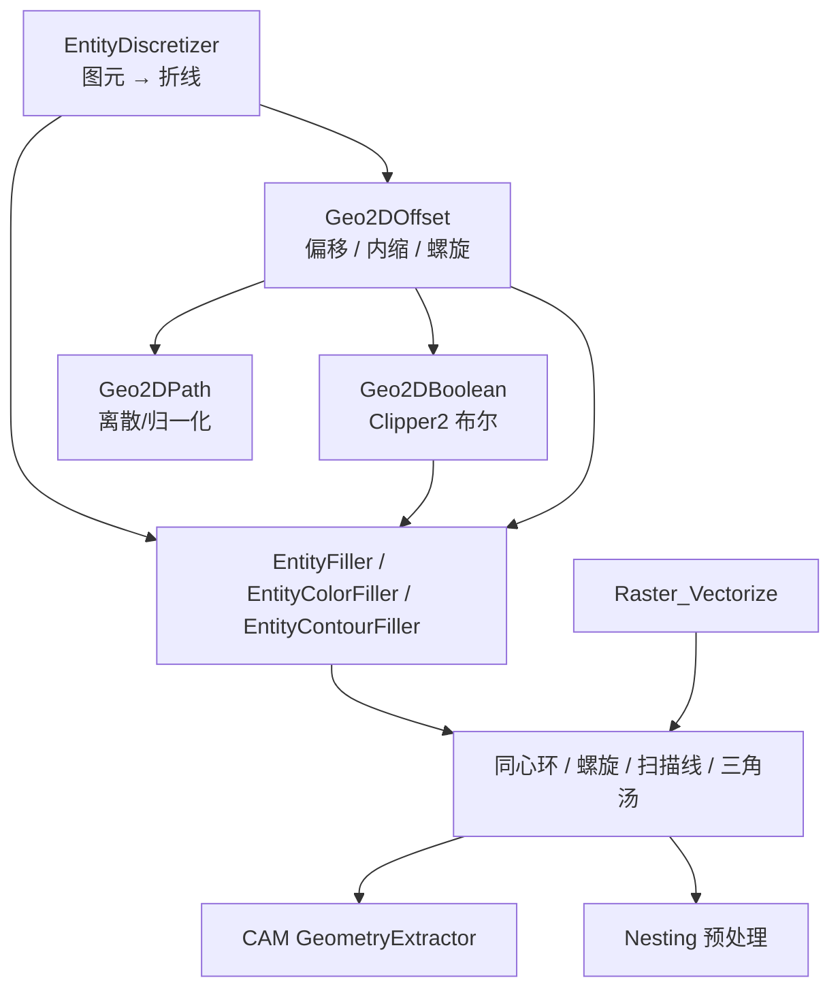
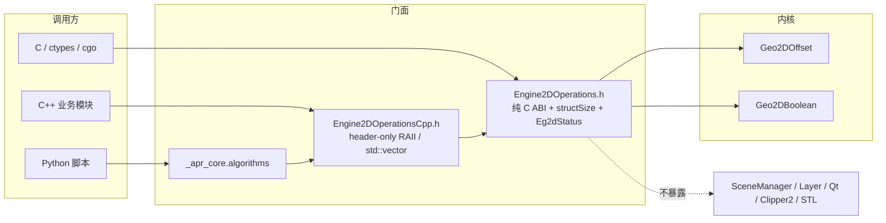
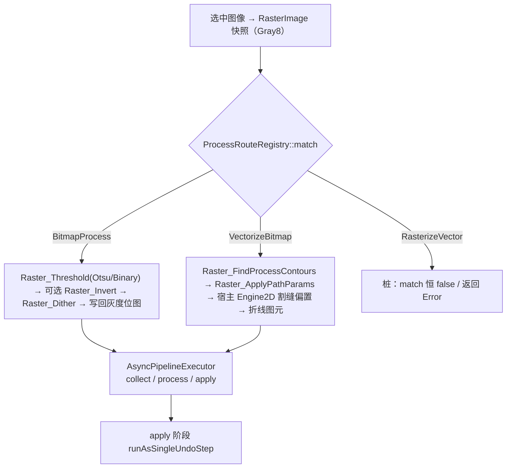
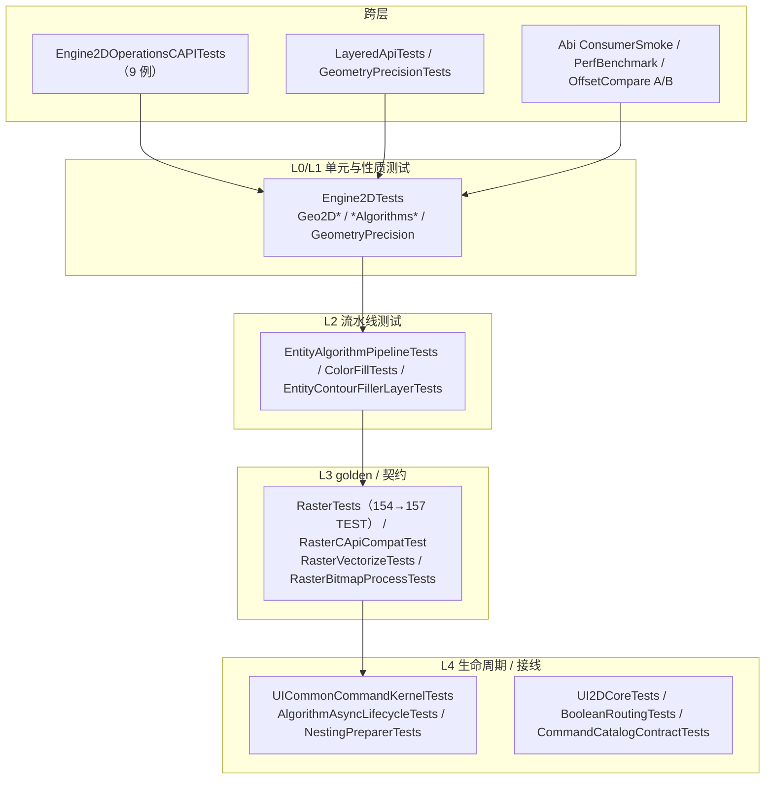
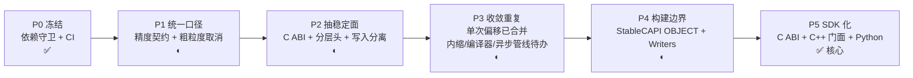
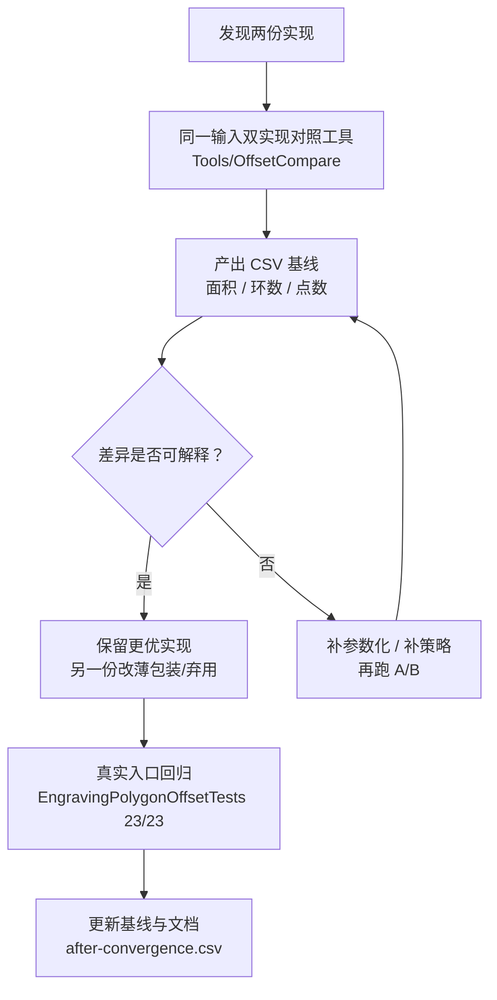

# 2D 算法框架图表集

> 状态说明（2026-11-28）　状态：现行　维护：架构组
>
> 本文只画图与图注，设计论证与事实依据见 [2D 算法框架分层设计](00-算法框架分层设计.md)，
> 数值依据见 [偏移双实现 A/B 基线](10-偏移双实现A-B基线.md)。
> 图中名称与路径均以当前工作区源码为准；历史文档行号可能漂移，按源码阅读。

---

## 1. 分层总览（目标态）

**图注**：实线 = 允许依赖；点线 = 旁路。`Writers/` 虽在 `Algorithm/` 目录下，职责属于 L4，
故意允许依赖场景设施，已被分层守卫显式排除在 L1/L2 检查之外。

---

## 2. 依赖方向与禁止边

**图注**：`-.-x` 表示禁止依赖。守卫脚本 `Tools/check_2d_layer_deps.py` 扫描 L1/L2 的
`#include`，存量违规登记为只减不增的棘轮例外，新增即 configure 失败。

---

## 3. 菜单到结果的完整调用链

**图注**：Raster 的 `bitmap_process` / `vectorize_bitmap` 在 `AlgorithmOperationMapping`
中落 `None`，走 `AsyncPipelineExecutor` 旁路（另一套线程/取消/收尾），不经过上面这条链。

---

## 4. 算法内核依赖图（谁调用谁）

**图注**：源码 `#include` 方向是 `Geo2DOffset → Geo2DBoolean → Geo2DPath`，
与旧审查文档的表述相反；这里以源码为准。`Raster_Vectorize` 的割缝补偿走宿主
Engine2D 几何偏置，不是 `Raster_KerfCompensate`。

---

## 5. 稳定面与二次开发入口

**图注**：`Engraving::offsetPolygons` 也走这条门面（P3 收敛后），
因此「Engine2D L1 内核」成为闭合轮廓单次偏移的唯一实现。

---

## 6. 位图工艺三条 Route

**图注**：Raster 全链路是**像素域**，物理精度由 `mm/px` 标定换算；
`Raster_SetProgressCallback` 当前未被 UI 使用，取消只在阶段之间检查。

---

## 7. 测试分层与覆盖入口

**图注**：全仓统一 GTest + gmock；`Engine2DTests` 1445 例、`RasterTests` 157 例、
`EngravingPolygonOffsetTests` 23 例均全绿。覆盖率统计尚未建立，按设计文档 §5.4 先建基线再设门槛。

---

## 8. P0–P5 落地路线

**图注**：✅ 核心完成，◐ 部分完成。P3 剩余的「逐层内缩合并」必须先让 Engraving
暴露 join/arcTolerance 与残环策略，再用 A/B 工具重跑基线；两套刀路编译与异步管线需另建对照方式。

---

## 9. 收敛决策流程（以偏移为例）

**图注**：这条流程是设计文档 §4「P3 收敛重复」纪律的可视化：
**先数据、后合并**，不允许「看起来差不多就合并」。
