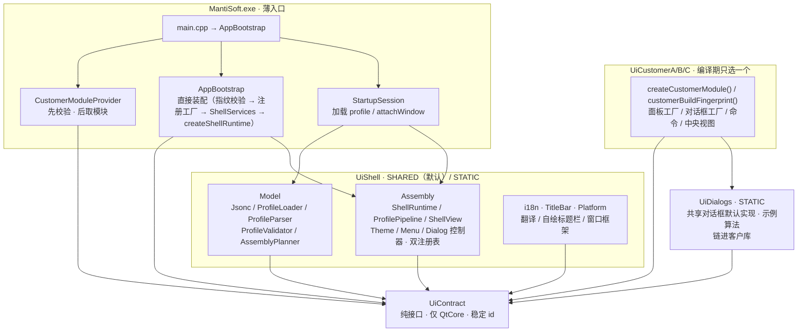
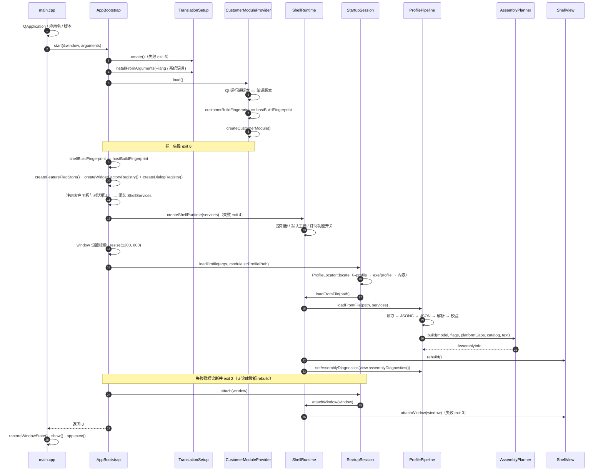
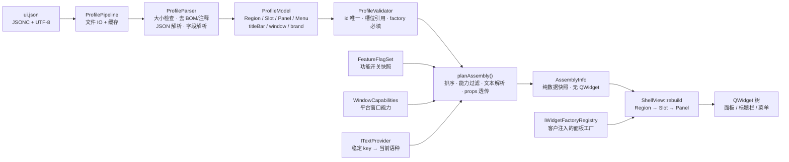
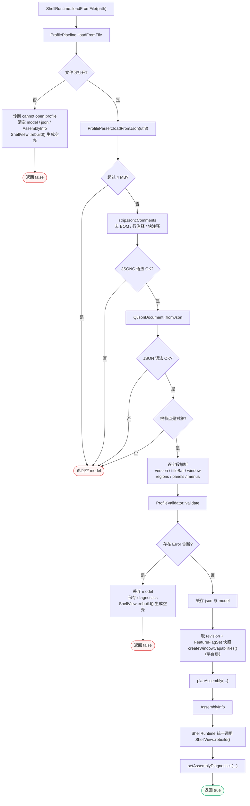

> **本目录已接入 April 根工程（M0）。**
>
> - 一键基线：`bash UiShell/ci/ui-shell-baseline.sh`（`-DUI_CUSTOMER=April -DBUILD_TESTS=ON`，构建 `AprilShell/UiApril/AprilUi/AprilCore/April` 并全量重编）
> - 测试：`ctest --test-dir build -R "UiTst|UiLayerCheck" --output-on-failure`，再跑 `python3 UiShell/ci/ui-shell-smoke.py`
> - 产物：`build/bin_Qt6/shell/<Config>/AprilShell`
> - 迁移计划：见同目录 `MIGRATION.md`
>
> 下文是 SampleFrame 的原始架构文档；其中出现的 `Main/` 对应本目录 `UiShell/`，
> 独立构建的 `configure.cmake` 说明已不适用（现在复用根工程 Qt/vcpkg 配置）。

# MantiSoft：配置驱动 UI 外壳（EXE + shell DLL + 客户 DLL）

`Main/` 是一个可独立构建的 C++17 / Qt UI 框架子工程，面向 **多客户 OEM 产品线**：

- 默认交付形态是 **一个客户一套「宿主 EXE + shell DLL + 客户 DLL」**；
- 客户差异通过 `ui.json` + 客户模块表达，框架代码不写客户分支；
- 需要单 EXE / 简化部署时关闭 `UI_BUILD_SHARED`，退回静态链接；
- Qt 路径优先复用上一级的 `../configure.cmake`；独立检出时由 `CMAKE_PREFIX_PATH` 或系统 Qt 提供。

> 关键事实：CMake 工程名 `MantiSoft`，版本 `1.0.0`，最低 CMake **4.3**，C++17；
> 默认动态链接，默认 MantiSoft，宿主产物为 `MantiSoft.exe`。

## 分层架构

依赖方向自下而上；`UiContract` 只含纯接口、稳定 id 与纯数据，是所有层共享的底座。



分层约束由 `cmake/CheckLayers.cmake` 在 ctest 中自动检查，越界 `#include` 直接失败；
导出面由 `cmake/CheckExports.cmake` 检查（仅 Windows 动态模式）。

## 目录结构

```text
Main/
├─ CMakeLists.txt                 仅做装配：configure → project → 默认值 → 子目录
├─ CMakePresets.json              MantiSoft / TyvokStudio / GoodLaser · build-* / test-*
├─ cmake/
│  ├─ UiPlatform.cmake            Qt 前缀 / vcpkg 开关（project() 之前）
│  ├─ UiProjectDefaults.cmake     C++17、输出目录、客户选择、目标名、Qt find_package
│  ├─ UiBuildInfo.cmake           ABI 版本、构建指纹、构建清单
│  ├─ UiTranslations.cmake        .ts → .qm
│  ├─ UiCustomerProfile.cmake     客户 profile 内嵌 qrc + 部署源目录
│  ├─ UiDeploy.cmake              .qm / profile 复制 + windeployqt + 自检
│  ├─ VerifyDeploy.cmake          导入表自检
│  ├─ UiChecks.cmake              注册分层/导出检查到 ctest
│  ├─ CheckLayers.cmake           分层依赖扫描
│  └─ CheckExports.cmake          导出表扫描
├─ include/UiShell/
│  ├─ Export.h
│  ├─ Contract/                   IApiObject · CustomerModule · WidgetFactory · DialogRegistry
│  │                              Command · CommandTable · FeatureFlag · IShellHost · HostContext · Retranslatable
│  │                              TitleBarSpec · BuildFingerprint · ITextProvider · Diagnostic
│  ├─ Assembly/                   IShellRuntime · ShellServices（含 IShellListener）· IRegionContainer
│  ├─ i18n/                       ITranslationService · IQtTextProvider
│  └─ TitleBar/                   ITitleBarView · ITitleBarMenuHost · ITitleBarHost
├─ src/
│  ├─ Model/                      内部层（静态库 UiShellModel，不导出）
│  │                              Jsonc · ProfileParser · ProfileValidator · ProfileSchema
│  │                              ProfileModel · ProfileLoadResult · WindowSpec · RegionType
│  │                              WindowCapabilities · AssemblyPlanner（planAssembly）· AssemblyInfo
│  ├─ i18n/                       TranslationService · QtTextProvider · TextContext · ProfileTextIds
│  ├─ TitleBar/                   TitleBar
│  ├─ Platform/                   WindowFrame（接口 + createWindowFrame / createWindowCapabilities，不导出）
│  │                              QtWindowFrame · WindowsWindowFrame · WindowFrameFactory · HitTest · ResizeBorderFilter
│  └─ Assembly/
│     ├─ Runtime/                 ShellRuntime · ProfilePipeline · ShellView
│     ├─ Host/                    ThemeController · FeatureFlagStore · BuildFingerprint
│     │                           TitleBarHostAdapter
│     ├─ Menus/                   MenuController
│     ├─ Dialogs/                 DialogController · DialogRegistry
│     └─ Widgets/                 RegionContainer · WidgetFactoryRegistry
├─ main/
│  ├─ main.cpp                    创建 QApplication / MainWindow / AppBootstrap / 事件循环
│  ├─ Window/MainWindow           主窗口：窗口自身行为（保存 / 恢复窗口位置），不含启动逻辑
│  ├─ Customer/CustomerModuleProvider  Qt 运行时 + 构建指纹校验
│  ├─ i18n/TranslationSetup      翻译服务创建与 --lang 安装
│  └─ Launcher/                   AppBootstrap（启动编排与运行期装配）· ProfileLocator（profile 定位）
│                                 · StartupSession（profile 加载与 attachWindow）
├─ dialogs/                       共享对话框库 UiDialogs（静态，链进客户库）
│  ├─ include/UiDialogs/          SampleDialogs（对话框 id · 工厂 · 命令处理）· SampleSolver（示例算法与参数）
│  ├─ src/                        SampleParamsDialog（默认参数对话框）· 实现
│  └─ translations/               UiDialogs_<lang>.ts
├─ customers/                     customerA/B/C（CustomerModule.cpp · ui.json · panels/ · commands/ · dialogs/ · qml/ · assets/）
├─ resources/                     UiShell.qrc · styles/light.qss · styles/dark.qss
├─ translations/                  UiShell/<lang>.ts
└─ tests/                         testHelpers/ · unit/ · Integration/
```

## 目标与产物

| 目标（CMake） | 类型 | 产物 | 说明 |
| --- | --- | --- | --- |
| `UiContract` | INTERFACE | 无 | 公开契约，仅 `include/` + QtCore |
| `UiShell` | SHARED / STATIC | `UiShell.dll` + 导入库 | model / i18n / titlebar / platform / assembly（不含任何具体对话框） |
| `UiShellModel` | STATIC（内部） | `UiShellModel.lib` | profile 解析 / 校验 / 装配规划；私有链接进 UiShell，测试直接链接，不导出 |
| `UiDialogs` | STATIC（内部） | `UiDialogs.lib` | 共享对话框默认实现（关于框、示例参数对话框）与示例算法；私有链接进客户库，不单独部署、不导出。只能被一个运行时模块链接，shell / EXE 也要用时改为动态库 |
| `UiTranslations` | custom target | `<build>/translations/*.qm` | 编译全部 `.ts` |
| `UiCustomerA/B/C` | SHARED / STATIC | `UiCustomerX.dll` + 导入库 | 只编译 `UI_CUSTOMER` 选中的那个 |
| `MantiSoft` | EXE (WIN32) | `MantiSoft.exe` | 入口与运行期装配；一个客户一个 EXE |
| `UiTestHelpers` | SHARED / STATIC | `UiTestHelpers.dll` + 导入库 | 测试替身 |
| `UiTst<短名>` | EXE | `UiTstJsonc.exe` 等 | 测试目标 = 前缀 + 短名 |

输出目录由 `cmake/UiProjectDefaults.cmake` 统一设置：

- 可执行文件与动态库：`<build>/bin/<Config>/`；
- 静态库 / 导入库：`<build>/lib/<Config>/`。

默认动态模式下交付 `MantiSoft.exe` + `UiShell.dll` + `UiCustomerX.dll`（以及 Qt 运行库与翻译文件）。
`-DUI_BUILD_SHARED=OFF` 后 shell、客户模块与测试辅助库变为 `STATIC`，
最终合并进单个 `MantiSoft.exe`。

大小写差异：

- 目录 `include/UiShell/` 是公开头根目录；
- 库目标是 `UiShell`；
- EXE 目标是 `MantiSoft`，产物 `MantiSoft.exe`；
- CMake 选项与宏前缀统一 `UI_`（全大写 + 下划线），不是 `MS_UI_`。

## 构建与运行

```powershell
cd Main
cmake --preset MantiSoft           # 配置 MantiSoft（生成器由本机决定）
cmake --build --preset build-MantiSoft     # Debug
ctest --preset test-MantiSoft
.\build\MantiSoft\bin\Debug\MantiSoft.exe
```

| 预设 | 客户 | 构建目录 |
| --- | --- | --- |
| `MantiSoft` / `build-MantiSoft` / `test-MantiSoft` | MantiSoft | `Main/build/MantiSoft` |
| `TyvokStudio` / `build-TyvokStudio` / `test-TyvokStudio` | TyvokStudio | `Main/build/TyvokStudio` |
| `GoodLaser` / `build-GoodLaser` / `test-GoodLaser` | GoodLaser | `Main/build/GoodLaser` |

预设统一打开 `Enable_TEST`、`UI_BUILD_SHARED`、`UI_DEPLOY_QT`。
`CMakePresets.json` 不指定 generator / architecture；本机相关路径写在 `../configure.cmake`，
或用 `CMakeUserPresets.json`（不要提交本机副本）。

不用预设时：

```powershell
cmake -S Main -B Main/build/manual-a -G "Visual Studio 17 2022" -A x64 -DUI_CUSTOMER=A -DEnable_TEST=ON
cmake --build Main/build/manual-a --config Debug
ctest --test-dir Main/build/manual-a -C Debug --output-on-failure
```

静态单 EXE 需要单独建目录，不要和动态构建混用：

```powershell
cmake -S Main -B Main/build/static-a -G "Visual Studio 17 2022" -A x64 `
  -DUI_CUSTOMER=A -DEnable_TEST=ON -DUI_BUILD_SHARED=OFF
cmake --build Main/build/static-a --config Debug
ctest --test-dir Main/build/static-a -C Debug --output-on-failure
```

不要给 Visual Studio 生成器追加 `-j`（会透传给 MSBuild 并报 `MSB1001`）。

### 关键 CMake 选项

| 选项 | 缺省 | 作用 |
| --- | --- | --- |
| `UI_CUSTOMER` | `A` | `A` / `B` / `C`，只编译对应客户目录 |
| `UI_BUILD_SHARED` | `ON` | `ON` 动态库；`OFF` 静态链接（单 EXE） |
| `UI_DEPLOY_QT` | `ON` | POST_BUILD 是否跑 windeployqt |
| `UI_USE_VCPKG` | `OFF` | 本工程不用 vcpkg 包，默认不挂 toolchain |
| `UI_VS_FOLDERS` | `ON` | Visual Studio 解决方案虚拟文件夹 |
| `Enable_TEST` | 未定义 | 定义为 `ON` 时才 `enable_testing()` 并加入 `tests/` |
| `QT_VERSION_MAJOR` | 独立构建时 `6` | 由 `../configure.cmake` 覆盖时可能是 `5` |
| `UI_BUILD_ID` | 自动 | 写入构建指纹的发行标识；CI / 打包可覆盖 |

主目标平台是 **Windows x64**；Qt5.15 与 Qt6 都支持，但两者的二进制与构建目录不能混用。

### 运行参数

```powershell
MantiSoft.exe                    # 跟随系统语言，不支持时回退 en_US
MantiSoft.exe --lang zh_CN
MantiSoft.exe --profile D:\cfg\ui.json   # 指定 profile；文件不存在直接报错，不回退
```

`--lang` 必须在客户模块加载前生效：客户 `displayName` 在 `createCustomerModule()`
阶段就完成翻译；之后在运行期切换语言时，宿主调用 `displayNameFn()` 按新语言重算显示名并刷新窗口标题，不重新创建客户模块。

profile 查找顺序（`main/Launcher/ProfileLocator`）：

1. `--profile <path>` / `--profile=<path>`：相对路径按当前工作目录解析；文件不存在直接失败（退出码 2），不回退；
2. `<exe 目录>/profile/ui.json`：构建时由 `UiDeployProfile()` 从 `customers/customerX/` 复制（含 `assets/`），现场可直接修改；
3. 客户库内嵌资源 `:/UiCustomerX/profile/ui.json`：由 `UiCustomerProfile()` 生成 qrc 编入，单 EXE 或漏拷文件时仍能启动。

对话框 params 里的 `xxxPath`（如关于框的 `logoPath`）相对路径按选中 profile 所在目录解析，外置与内嵌两份都带上了 `assets/`。
启动日志会打印 `App: ui profile = <路径> (argument|appDir|embedded)`。

## 启动流程

`main.cpp` 创建应用、主窗口 `MainWindow`（只放窗口自身行为，见「主窗口」一节）与 `AppBootstrap`；启动编排在 `AppBootstrap::start()`，它只按 `QMainWindow*` 接管窗口。启动成功后 `main.cpp` 调用 `window.restoreWindowState()` 恢复上次的窗口位置，再 `show()`。
`AppBootstrap` 在窗口之后构造、之前析构，保证持有窗口指针的运行期先于窗口释放。



### 阶段与退出码

| 阶段 | 入口 | 主要动作 | 失败处理 |
| --- | --- | --- | --- |
| 1. 进程启动 | `main.cpp` | Qt<6.5 设 HighDPI 属性 → `QApplication` → 设置应用名/版本 → 构造 `MainWindow` 与 `AppBootstrap` → `start(&window, args)` | 返回非 0 直接作为退出码 |
| 2. 翻译初始化 | `TranslationSetup` | `create()` 创建翻译服务与文本提供者；`installFromArguments()` 解析 `--lang` 或系统语言并安装 `.qm` | 创建失败 **5**；装载失败回退 `en_US`，不阻断 |
| 3. 客户模块加载 | `CustomerModuleProvider` | Qt 运行期版本检查 → `customerBuildFingerprint` 与宿主一致 → `createCustomerModule()` | 任一失败 **6** |
| 4. 运行期装配 | `AppBootstrap` | `shellBuildFingerprint` 与宿主一致 → 创建 Widget/Dialog 注册表并批量注册 → 组装 `ShellServices` → `createShellRuntime()` | 指纹不一致 / 创建失败 **4** |
| 5. Runtime 初始化 | `ShellRuntime` 构造 | 初始化资源、`DialogController`、`MenuController`、`ShellView`；应用 `ShellServices::strThemeId`（为空用 `light`）；以观察者订阅 `IFeatureFlagStore` | 样式缺失回退 `light` 并记录 `lastMessage` |
| 6. Profile 加载 | `StartupSession` → `ShellRuntime` | `ProfileLocator` 定位 → `loadFromFile` → `ProfilePipeline`（`ProfileParser` + `ProfileValidator`） → `planAssembly()` → `ShellView::rebuild`；全部诊断（含 Warning）逐条写 stderr | 失败弹 `QMessageBox::critical`（第一条错误）并 **2**；`rebuild()` 照常执行（空壳），但不会 attach / show |
| 7. 窗口接管 | `StartupSession::attach` | `ShellView::attachWindow` 接管窗口/标题栏/窗口框架，挂载 shell 容器 | 失败 **3**；必须在 `show()` 前完成 |
| 8. 显示运行 | `main.cpp` | `window.restoreWindowState()`（恢复上次位置 / 大小 / 最大化）→ `window.show()` → `app.exec()` | 没有保存过时保持默认尺寸 |

| 退出码 | 含义 |
| --- | --- |
| `0` | 正常进入事件循环 |
| `2` | profile 加载失败（已弹出诊断） |
| `3` | `attachWindow` 失败 |
| `4` | shell 构建指纹不一致 / runtime 创建失败 |
| `5` | 翻译服务创建失败 |
| `6` | 客户模块 Qt 运行时版本 / 构建指纹校验失败 |
| `1` | 当前未使用 |

## ABI 与构建指纹

动态模式下 EXE、shell DLL、客户 DLL 是三份独立编译产物。本工程**不支持跨构建混装**：
三者必须来自同一次构建，二进制兼容完全由构建指纹保证，运行期不做结构体版本 / 大小协商。

### ABI 版本

- `kUiApiVersion = 3`（2 起 `CustomerModule` 带 `owner`；3 起 `CommandView` 带快捷键 / 提示 / checkable，新增 `ICommandState`，`IShellHost` 增加 `invokeWithArgs` / `commandAction` / `refreshCommands`），定义在 `include/UiShell/Contract/IApiObject.h`，只作为构建指纹里的 `api=` 字段；
- 改动跨 DLL 的结构体（`CustomerModule`、`ShellServices`、`TitleBarSpec`、`HostContext` 等）布局或接口虚函数表时提升它，便于从指纹与构建清单看出契约代际；
- 跨 DLL 的结构体不带版本 / 大小头，`createShellRuntime()` / `createTitleBar()` 也不做这类校验：指纹一致即双方用同一份头文件编译；
- 跨 DLL 传递的对象继承 `IApiObject`，由 `ApiPtr` 调用 `destroy()` 释放，避免跨 CRT `delete`；接口析构函数是 protected，直接 `delete` 编译不过（见下节「跨模块规则」）；
- 若将来需要单独升级客户 DLL，应改为运行期加载 + 稳定 C 接口的插件方案，届时再引入版本协商。

### 跨模块规则

完整规则写在 `include/UiShell/Export.h` 顶部，要点：

| 规则 | 做法 | 由谁保证 |
| --- | --- | --- |
| 只导出自由函数 | `createXxx()` / `xxxBuildFingerprint()`；不写 `class UI_SHELL_API` | `CheckExports`（禁止具体类出现在导出表） |
| 不跨模块传标准库对象 | 参数 / 返回值 / 结构体成员只用基本类型、裸指针、纯虚接口与 Qt 值类型（`QString`、`QList`、`QJsonObject` 等，内存由 Qt6Core 统一分配）；回调用接口 `IFeatureFlagObserver` / `IShellListener`，不用 `std::function` | `CheckLayers`：公开头不得出现 `std::` 类型（`Retranslatable.h`、`CommandTable.h` 例外：只在客户模块内实例化，shell 只经纯虚接口调用） |
| 谁创建谁释放 | shell 创建的对象继承 `IApiObject`，经 `destroy()` / `ApiPtr` 在 shell 内释放；析构函数 protected | `tstApiPtr` 里的 `static_assert(!std::is_destructible<...>)` |
| 借用的对象不释放 | `IShellHost`、`IRegionContainer`、观察者、监听者的析构函数 protected，调用方无法 `delete` | 同上 |
| QWidget 跨模块 | 交给 Qt 父对象销毁：虚析构经对象自身模块的 deleting destructor 释放，不跨堆 | Qt 父子关系 |
| 异常不跨模块 | 接口实现（命令、对话框、面板工厂）不得让异常逃出虚函数调用 | 约定 |
| 同一次构建 | 指纹比较 api / Qt / 编译器 / 位数 / CRT / Debug·Release / 源码版本 | 启动时两次指纹比较（见下） |

### 构建指纹

`cmake/UiBuildInfo.cmake` 生成 `UiBuildInfo.h`，指纹由以下事实拼成：

```text
msui|api=<ABI>|version=<项目版本>|qt=<Qt 编译版本>|compiler=<编译器与版本>
    |arch=<指针位数>|customer=<A/B/C>|shared=<ON/OFF>|crt=<运行库>
    |build=<build id>|config=<Debug/Release>
```

- `build id` 优先取 git HEAD；工作区不干净或没有 git 时回退为源码内容哈希；
- 指纹不含源码路径与时间戳，同一提交 + 同一工具链可复现；
- 启动时做两次比较（都只经 `const char*` 返回，在任何结构体跨 DLL 边界之前完成）：
  - `CustomerModuleProvider`：`customerBuildFingerprint()` vs `hostBuildFingerprint()`，不一致退出 **6**；
  - `AppBootstrap`：`shellBuildFingerprint()` vs `hostBuildFingerprint()`，不一致退出 **4**；
- 构建产物旁生成 `bin/<Config>/customer-build-manifest.json`，现场可直接核对加载的是哪次构建。

## Profile 加载流水线

运行期只消费「解析后的模型」与「纯数据装配信息」，不直接读 JSON。
JSON → `ProfileModel` → `AssemblyInfo` 的全过程不创建控件，因此可以脱离 GUI 单测。



### 品牌元数据（可选）

`ui.json` 顶层可加 `brand`，全部字段可选；缺省时沿用客户模块与命令行设置：

```json
{
  "brand": {
    "product": "Site CAD",
    "organization": "Site Technology",
    "icon": "assets/logo.png",
    "theme": "dark",
    "language": "zh_CN"
  }
}
```

- `product` 覆盖窗口标题（没有 `brand` 时退回 `titleBar.title`）；`organization` 写入
  `QCoreApplication::setOrganizationName()`；`icon` 设置顶层窗口图标。
- `icon` 与 `titleBar.icon` 的相对路径按 `ui.json` 所在目录解析，`:/...` 与绝对路径原样保留。
- `theme` 在加载后覆盖客户默认皮肤；显式 `--lang` 优先于 `language`，未指定时按 `language`
  重新装载译文（可读取 `<profileDir>/translations/`）。
- 非法 `brand` 类型会产生解析错误；未知子字段被忽略。旧 profile 不加这个段即可保持原行为。

### 加载与失败分支



关键行为：

- 只有 **文件大小超限、JSONC 错误、JSON 语法错误、根节点不是对象** 四类问题会让解析器提前返回；
- `version` 不匹配、字段类型错误等会继续收集诊断，校验器仍会运行；
- 只要存在任意 `Error`，`ProfileLoadResult.profileModel` 就为空，不会带着半成品模型装配；
- `ShellRuntime::loadFromJson/loadFromFile` **无论成功失败都会调用 `ShellView::rebuild()`**，
  保证界面与错误状态一致，不残留上一次装配结果；
- `ProfilePipeline` 把诊断分三段保存并按序合并：解析期（加载时替换）→ 规划期（`AssemblyInfo.warnings` 转成 `Warning`，每次规划后替换）→ 装配期（重建时替换），重复规划 / 重建不会累积；
- 启动时 `StartupSession` 把 `diagnostics()` 全部写到 stderr（`App: <文件>: <严重度>: <strJsonPath>: <strMsg>`），弹框只显示第一条错误。

### 诊断与限制

- `Diagnostic { severity, strJsonPath, strMsg, nLine, nColumn }`；
- `strJsonPath` 使用点分 + 下标形式，如 `$.regions[0].slots[1]`（不是 RFC 6901 JSON Pointer）；
- `nLine` / `nColumn` 为 1 基，`0` 表示未知；JSON 语法错误会带行列号；
- 三种严重度：`Info` / `Warning` / `Error`；`Warning` 不阻断加载；
- 未知顶层字段只告警不失败，便于发现 `dialogBinding` 这类拼写错误。

`ProfileLimits`（`src/Model/Profile/ProfileSchema.h`）：

| 限制 | 值 |
| --- | --- |
| `maxProfileBytes` | 4 MB |
| `maxRegions` | 64 |
| `maxPaneAreasPerRegion` | 64 |
| `maxPanels` | 512 |
| `maxMenuDepth` | 16 |
| `maxMenuNodes` | 1024 |
| `maxTopLevelMenus` | 64 |

超限行为：菜单节点总数只报一次 `Error`，后续节点返回空且不展开子项；
顶层菜单条目超过上限时截断并报错；未声明槽位的区域自动生成 `<regionId>.main`，
若该 id 与已有槽位冲突则报错且不追加。

### 常用默认值

| 项 | 默认 / 范围 |
| --- | --- |
| `version` | 必须等于 `2`（当前 `kProfileVersion=2`；冒烟用的最小 profile 也是 `version: 2`） |
| 窗口最小尺寸 | `800 × 600`；`0` 回退默认，宽度夹到 `320..10000`，高度夹到 `240..10000` |
| 初始窗口尺寸 | `1200 × 800`（`AppBootstrap::start()` 中 `resize`）；保存过窗口状态时由 `MainWindow::restoreWindowState()` 覆盖 |
| `titleBar.height` | `36`；`<=0` 回退默认，最终夹到 `24..96` |
| `titleBar.buttons` | 未声明 = `minimize/maximize/close`；显式 `[]` = 无按钮；未知 id 告警并过滤，重复项去重 |
| `titleBar.enabled` | `true` |
| 面板 `order` / 槽位 `order` | `100`，升序；相同 order 按 id 稳定排序 |
| `panel.defaultVisible` | `true` |
| `requiredCapabilities`（JSON） | 解析为 `requiredFeatures`，语义是“全部满足” |

## 装配与布局

区域类型固定为 7 类，客户只能配置顺序、可见性、槽位和面板归属：

```text
Top 组      TitleBar / MenuBar / TopBar      垂直堆叠；组内槽位横向
Middle 组   LeftDock / CenterView / RightDock 水平排列；只有 CenterView stretch = 1
Bottom 组   StatusBar                        垂直堆叠；组内槽位横向
```

装配规则：

- 区域按 `order` 升序，相同 order 按 id；
- 槽位按 `order` 升序，相同 order 按 id；
- 面板按 `order` 升序，相同 order 按 id；
- 面板只声明 `slot`，不直接声明区域；槽位通过反向索引确定所属区域；
- 区域不可见时，其下所有面板都不参与装配；
- 面板的 `requiredFeatures` 未全部满足时静默跳过（正常的授权裁剪，不产生 warning）；
- 面板引用未知槽位时只告警，不中止整个界面装配；
- `props` 由 loader 原样保存、planner 原样透传，最终进入 `PanelCreateRequest.props`；
- `PanelCreateRequest` 字段：`strPanelId` / `strFactoryId` / `props` / `context` / `host` / `parent`；
- 工厂的 `validateProps()` 返回 `PropsValidation { bValid, strMsg }`；
- `host` 是运行期内部的窄转发对象，只提供 `invoke` / `invokeWithArgs` / `commandAction` / `refreshCommands` / `activatePanel` / `showMessage` / `openDialog`（`showMessage` 推给实现 `IStatusMessageView` 的控件，通常是状态栏面板，同时记入 `lastMessage()`），不是 `IShellRuntime` 本身，面板无法向下转型拿到切语言、换皮肤、重载 profile 等能力；
- 工厂未注册时写入装配诊断 `no factory '<id>' registered for panel '<panelId>'`；
- 工厂 `validateProps()` 失败时不创建控件，错误进入诊断与 `lastMessage`。

`CenterView` 是特殊区域：若客户注入了 `ICenterViewProvider`，直接调用
`createCenterView(parent)` 生成中央控件，不走面板工厂注册表。

## 运行期刷新

三条路径互不复用「整壳重建」：

| 触发 | 是否重读文件 | 是否重建面板 | 实际动作 |
| --- | --- | --- | --- |
| 切换语言 | 否，复用缓存 `ProfileModel` | 通常否 | `install(lang)` → 有 model 时 `replan()` + `refreshShell()`；仅有缓存 json 时 `loadFromJson()`；否则 `rebuild()`；最后 `retranslate()` |
| 切换皮肤 | 否 | 否 | `ThemeController::apply()` → `refreshShell()` → `notifyHostContext()` |
| 功能开关变化 | 否 | 视结构变化 | `replan()` → 比较 `structureKey()` → `refreshShell()` 或 `rebuild()` |

```mermaid
sequenceDiagram
    participant U as 用户
    participant R as ShellRuntime
    participant P as ProfilePipeline
    participant V as ShellView
    participant W as QWidget 树

    U->>R: switchLanguage(lang)
    R->>R: TranslationService::install(lang)
    alt 已有 model
        R->>P: replan(services)
        R->>V: refreshShell()
    else 上次加载失败但有缓存 json
        R->>R: loadFromJson(cached json)
    else 无任何缓存
        R->>V: rebuild()
    end
    R->>V: retranslate()
    V->>V: notifyHostContext()
    V->>W: IRetranslatable::retranslate()
    Note over W: 面板实例与用户状态保留

    U->>R: switchTheme(themeId)
    R->>R: normalize + ThemeController::apply(id)
    alt 样式加载失败
        R-->>U: 直接返回，不改变当前主题
    else 成功
        R->>V: refreshShell()
        R->>V: notifyHostContext()
        Note over W: QSS 挂在 QApplication，其余控件自动重绘
    end

    U->>R: IFeatureFlagStore::enable/disable
    R->>P: before = structureKey(); replan()
    alt before == after
        R->>V: refreshShell() + notifyHostContext()
    else 结构变化
        R->>V: rebuild()
    end
```

`structureKey()` 只覆盖决定控件树形状的字段：区域、槽位、面板（id/factory/slot/order/visible）、
标题栏是否存在、是否原生。菜单不在其中，因为菜单总是由 `refreshShell()` 整条重建。

补充：

- 语言切换失败时 `TranslationService` 已回退 `en_US`，原因通过 `lastError()` 暴露；
- 皮肤切换只接受 `light` / `dark`；应用样式优先查客户 qrc
  `:<customPrefix>/styles/<id>.qss`，找不到才回退 `:/UiShell/styles/<id>.qss`；
- `retranslate()` 内部先 `notifyHostContext()` 再遍历 `IRetranslatable`；
- 功能开关变化若只影响菜单置灰 / 命令 enabled，则保留面板实例。

## 菜单 / 对话框 / 命令

### 菜单

`MenuController` 内部构建菜单树（`buildMenuBar()`）并统一绑定信号；
`ShellRuntime` 只做转发。默认构建行为：

- 顶层节点强制按 `Submenu` 处理；
- 命令节点标题优先用 `title`，回退 `titleKey`，再回退 `commandId`；
- `title` / `titleKey` / `iconKey` 的补全与未知命令过滤在 `AssemblyPlanner` 完成：
  catalog 存在但找不到命令时跳过该节点并写入 `AssemblyInfo.warnings`；
- 命令的 `CommandView::listRequiredFeatures` 全部满足才 `setEnabled(true)`（由命令动作池统一计算）；
- `checkable` + `groupKey` 生成互斥 `QActionGroup`；
- 语言 / 皮肤子菜单由 profile 用 `builtin` 节点声明，放在哪个菜单、什么位置都由 profile 决定，shell 不按菜单 id 自动插入：
  `{ "type": "builtin", "id": "language" }`、`{ "type": "builtin", "id": "theme" }`；其他 id 是 profile 错误；
- 语言列表来自 `ITranslationService::builtinLanguages()`，显示名用 `QLocale::nativeLanguageName()`；
  没有注入翻译服务时 `language` 节点不生成子菜单（无法切换语言，不显示点了没反应的项）；
- 命令图标：`iconKey` 先按图标主题名查找（`QIcon::fromTheme`），找不到时当作资源 / 文件路径（如 `:/UiMantiSoft/icons/new.png`）。

稳定 `objectName` 约定：

- 菜单栏：`msui.menubar`
- 子菜单：`msui.menu.<id>`
- 命令：`msui.action.<commandId>`
- 语言子菜单：`msui.menu.language`
- 主题子菜单：`msui.menu.theme`
- 语言项：`msui.action.language.<langId>`
- 主题项：`msui.action.theme.<themeId>`

### 命令：菜单、工具栏、面板按钮、快捷键共用一个功能

一个功能 = 一个命令 id。所有入口只引用命令 id，最终都走同一条路径：

```text
菜单项（profile menus）──────────┐
工具栏按钮（profile msui.toolbar）┤   同一个 QAction（shell 的命令动作池，每个命令一个）
面板按钮（setDefaultAction）─────┤   标题 / 图标 / 快捷键 / 提示 / 可用 / 勾选 只算一次，所有入口一起变
快捷键（动作挂在 shell 上）───────┘
                                    ▼  triggered
面板 IShellHost::invoke(id) ──► ShellRuntime::invoke(id)
                                    ├─ 客户代码绑定表命中 → 打开对话框 → Accepted → invokeWithArgs(id, 对话框数据)
                                    └─ 没有绑定 → ICommandInvoker::invoke(id)
面板 IShellHost::invokeWithArgs(id, args) ──► ICommandInvoker::invokeWithArgs(id, args)   （已有参数：不弹对话框）
                                    ▼
客户命令表（CommandTable）：查表找到处理函数 → 调用与界面无关的算法函数
                                    ▼
执行完自动刷新所有命令状态（ICommandState）；状态在命令之外变化时调用 IShellHost::refreshCommands()
```

- **元数据只在一处**：`CommandView { strId, strTitleKey, strIconKey, strToolTipKey, strShortcut, bCheckable, listRequiredFeatures }` 由客户的
  `ICommandCatalog` 提供；菜单与工具栏里只写 id（菜单节点上的 `checkable` / `groupKey` 仍可用）；
- **共享动作**：`CommandActions`（`src/Assembly/Commands/`）为每个命令建一个 `QAction`，挂在当前 shell 下并加入 shell 的
  `actions()`，快捷键因此在整个窗口生效；切语言 / 切皮肤只刷新文字与状态，动作不重建；profile 重新加载或功能开关增删面板时
  随 shell 一起重建；
- **状态**：可用 = 功能开关（`listRequiredFeatures`）× `ICommandState`；勾选由 `ICommandState` 提供，不提供时 shell 记住用户的勾选；
- **面板**：`IShellHost::commandAction(id)` 拿共享动作放到自己的按钮上（`QToolButton::setDefaultAction`）；
  `invokeWithArgs(id, args)` 用面板自己控件里的参数直接执行；
- **执行顺序**：客户代码绑定表（`CustomerModule::listDialogBind`）命中 → `ICommandInvoker` → 仅记录提示；shell 没有内置绑定（`help.about` 也要由客户代码绑定），没有任何命令在 shell 里被写死截走；
- 绑定命中且对话框返回 `Accepted` 时，shell 调用 `invokeWithArgs(commandId, result.data)`；`continuePolicy`：
  `OnAccepted`（默认）只有 `Accepted` 才继续执行命令，`Never` 打开对话框后不再执行命令。

#### 工具栏：在 profile 里像菜单一样声明

shell 自带通用工具栏面板 `msui.toolbar`（与菜单一样是 shell 的通用界面，不是某个功能的特例；`msui.` 前缀留给 shell，
客户以同一 id 注册自己的工厂即可替换），放进任意槽位：

```jsonc
{ "id": "toolbar", "factory": "msui.toolbar", "slot": "top.toolbar",
  "props": { "commands": [ "file.new", "file.open", "file.save", "|", "sample.run" ],
             "style": "auto",     // auto（有图标只显示图标，否则显示文字）/ icon / text / textBesideIcon / textUnderIcon
             "iconSize": 20 } }   // 可选，8..128
```

`commands` 必填（`"|"` 是分隔符）；命令目录里没有的命令跳过并告警；props 写错进入装配期诊断。

#### 客户命令类：用命令表，不写 if 链

`UiShell/Contract/CommandTable.h` 同时实现 `ICommandCatalog` / `ICommandInvoker` / `ICommandState`，客户命令类继承它，
在构造函数里登记全部命令，`CustomerModule` 的 `cmdCatalog` / `cmdInvoker` / `cmdState` 指向同一个对象：
`ICommandState::queryState()` 收到的 `CommandStatus { bEnabled, bChecked }` 是 shell 当前值，只改登记了条件的字段。

```cpp
Commands::Commands()
{
    add("machining.start", [this](const QJsonObject&) { m_running = true; m_paused = false; })
        .shortcut("F5")
        .enabledWhen([this]() { return !m_running || m_paused; });
    add("machining.pause", [this](const QJsonObject&) { m_paused = !m_paused; })
        .shortcut("F6")
        .enabledWhen([this]() { return m_running; })
        .checkedWhen([this]() { return m_paused; });       // 开关类命令
    add("sample.run", runSample);                            // 算法：只接收参数，与窗口无关
    add("help.about");                                       // 只打开关于框，没有处理函数
}
```

`strTitleKey` 默认 `command.<id>`；`title()` / `icon()` / `toolTip()` / `shortcut()` / `needsFeatures()` / `enabledWhen()` /
`checkedWhen()` 作用于最近一次 `add()` 的命令。`CommandTable.h` 与 `Retranslatable.h` 一样是公开头标准库检查的例外：
`std::function` 留在客户库里，shell 只经纯虚接口调用。

三个客户的示例：A 的工具栏（新建 / 打开 / 保存 / 撤销 / 重做 / 示例算法）与菜单共用动作，「保存」在新建之后才可用，
工具面板里有一个共用 `sample.run` 动作的按钮和一个带参数直接执行的「快速运行」；B 原来手写的顶部按钮改成 profile 工具栏，
「开始 / 暂停」的置灰与勾选在菜单和工具栏同时变化；C 只登记快捷键。

命令与对话框的绑定写在客户代码里（`CustomerModule::listDialogBind`），不再写进 profile：

```cpp
// CustomerModule.cpp：createCustomerModule()
module.listDialogBind.append({ QStringLiteral("algo.smooth"),
                               QStringLiteral("dialog.smooth"),
                               QJsonObject{ { QStringLiteral("radius"), 3 } } });
```

`DialogCmdBinding::params` 是打开对话框时的初始参数（客户间的默认值 / 范围差异写在这里），它不会自动并入 `args`；
需要时由对话框自己写回 `result.data`。`continuePolicy` 缺省为 `OnAccepted`。

### 对话框注册表

两种扩展点都按 id 批量注入、运行期查找：

| 注册表 | 接口 | 查找方式 | 典型 id |
| --- | --- | --- | --- |
| `IWidgetFactoryRegistry` | `IWidgetFactory` | `find(factoryId)` | `mantisoft.panel` |
| `IDialogFactoryRegistry` | `IDialogFactory` | `find(dialogId)` | `dialog.about` |

客户模块字段：

```cpp
struct CustomerModule
{
    QString strId;
    QString strDisplayName;
    QString (*displayNameFn)() = nullptr;     // 按当前语言重算显示名
    QString strProfilePath;
    QString strStyleSeries;                   // 皮肤品牌系列（见「皮肤」）

    ICenterViewProvider* centerView = nullptr;
    ITitleBarFactory* titleBar = nullptr;
    const ICommandCatalog* cmdCatalog = nullptr;
    ICommandInvoker* cmdInvoker = nullptr;
    const ICommandState* cmdState = nullptr;

    QList<WidgetFactoryBinding> listWidgetFactoriesBind;    // 面板工厂
    QList<DlgFactoryBinding> listDlgFactoriesBind;    // 对话框工厂
    QList<DialogCmdBinding> listDialogBind;           // 命令→对话框绑定
    IApiObject* owner = nullptr;                      // 部件持有者：上面的指针都指向它的成员
};

struct WidgetFactoryBinding
{
    QString strFactoryId;
    IWidgetFactory* factory = nullptr;
};

struct DlgFactoryBinding
{
    QString strDialogId;
    IDialogFactory* factory = nullptr;
};

struct DialogCmdBinding
{
    QString strCmd;                                           // 触发的命令 id
    QString strDlgId;                                         // 打开的对话框 id
    QJsonObject params;                                       // 初始参数（经 resolveParams 解析）
    DialogContinuePolicy continuePolicy = DialogContinuePolicy::OnAccepted;
};
```

注册写法：`module.listDlgFactoriesBind.append({ QString::fromLatin1(about::kAboutDlgId), &parts->aboutDialog });`，
其中 `parts` 是本客户的部件持有者（见「客户模块的部件持有者」）。
工厂打开对话框统一用 `UiShell/Contract/ModalDialog.h` 的 `runModalDialog()`：对话框在堆上创建，
`exec()` 期间父窗口被销毁时按 `Rejected` 返回，不会重复释放。
所有对话框都实现 `IDialogFactory`，注册表只按 id 查找，不做类型擦除（没有 `void*` / 类型键）。

绑定由客户代码提供（`CustomerModule::listDialogBind`，结构 `DialogCmdBinding`：`strCmd` / `strDlgId` / `params` / `continuePolicy`），
`AppBootstrap` 在启动时把它拷进 `ShellServices::dialogBindings`，profile 里不再有对话框绑定。

shell 不认识任何具体对话框：没有内置对话框、没有内置命令绑定。所有对话框（包括关于框）走同一条链路：
客户代码绑定把命令绑到对话框 id → `DialogController::openResult()` 在注册表里按 id 找工厂
（找不到返回 `Cancelled`）→ 按通用规则处理 params → `IDialogFactory::openDialog()`。
`ShellRuntime::invoke` 与 `DialogController` 里不按任何命令或对话框 id 写分支，新增对话框 shell 不需要任何改动；
菜单入口（命令绑定）与宿主入口（`IShellHost::openDialog`）行为完全一致。

params 的通用规则（`DialogRegistry.h` 的 `DialogParam`，对所有对话框生效）：

| 规则 | 例子 | 结果 |
| --- | --- | --- |
| `<name>Key`：文本 id，按当前语言翻译后写到 `<name>`；缺译时保留 `<name>` 的字面值 | `"productKey": "about.a.product"` | `product` = 译文 |
| `<name>Path`：相对路径按 profile 所在目录解析；绝对路径与 `:/...` 不变 | `"logoPath": "assets/logo_a.png"` | 绝对路径 |
| 补宿主上下文（已有同名键时不覆盖） | `theme` / `language` / `appName` / `appVersion` | 当前皮肤、语言、应用名与版本 |

QML 等不走 QSS 的对话框据此配色（GoodLaser 的 QML 关于框就是这样跟随皮肤的）。

面板等宿主侧代码可调用 `IShellHost::openDialog(dialogId, parent, params)` 直接打开已注册的对话框，返回同一个 `DialogResult`（状态 + `QJsonObject` 数据）。状态含义：`Accepted` 用户确认、`Rejected` 用户取消或关闭、`Cancelled` 对话框没有打开（找不到工厂，原因写入 `lastMessage()`）。

### 关于对话框：客户定制对话框的参考示例

关于框在 shell 里没有任何特例，它和示例参数对话框一样是 `UiDialogs` 里的普通对话框：

- id `about::kAboutDlgId`（`"dialog.about"`），命令 `about::kAboutCmdId`（`"help.about"`），键名 `about::Param::*`、
  显示数据 `about::AboutDlgData`，都在 `dialogs/include/UiDialogs/AboutDialogs.h`；
- 默认实现 `about::AboutDialogFactory`（Widgets，`dialogs/src/AboutDialog*`）；需要它的客户自己注册；
- 显示内容由工厂自翻译：客户工厂用 `QCoreApplication::translate("about", "about.<x>.product")` 生成默认 `AboutDlgData`，
  再用 `applyParams(params)` 让绑定 params 覆盖个别字段（例如 `logoPath`）。`version` 没写时用 shell 补进的 `appVersion`：

```cpp
// 客户 AboutDialogFactory：工厂自翻译默认数据
RD::about::AboutDlgData makeAboutData()
{
    RD::about::AboutDlgData data;
    data.product = QCoreApplication::translate("about", "about.a.product");
    data.version = QStringLiteral("1.4.2");
    data.company = QCoreApplication::translate("about", "about.a.company");
    return data;
}

RD::DialogResult AboutDialogFactory::openDialog(QWidget* parent, const QJsonObject& params)
{
    RD::about::AboutDlgData info = makeAboutData();
    info.applyParams(params);   // 绑定 params 覆盖默认值（如 logoPath）
    return RD::runModalDialog(RD::markDialog(new AboutDialog(info, parent), params));
}
```

```text
客户代码绑定（help.about → dialog.about, params）
  ──► DialogController::resolveParams()          通用规则：xxxKey 翻译、xxxPath 解析、补 theme / appVersion …
  ──► IDialogFactoryRegistry::find("dialog.about") 客户模块注册的工厂（共享默认或自己的界面）
  ──► IDialogFactory::openDialog(parent, params)
        工厂自翻译默认值 + applyParams 覆盖        工厂：params → 显示数据（AboutDlgData）
        new <界面>(数据, parent)                     视图：只负责显示
        runModalDialog(dialog)                       统一的模态运行与释放
  ──► DialogResult（Rejected，无数据；continuePolicy: Never，不再执行命令）
```

| 客户 | 界面 | 写在哪 | 注册 |
| --- | --- | --- | --- |
| MantiSoft | 自己的 Widgets 界面（覆盖共享默认） | `customers/MantiSoft/widgets/Dialogs/AboutDialog*` | `MS::AboutDialogFactory aboutDialog;` |
| TyvokStudio | 自己的 Widgets 界面 | `customers/TyvokStudio/dialogs/AboutDialog*` | `TS::AboutDialogFactory aboutDialog;` |
| GoodLaser | QDialog + QQuickWidget + QML | `customers/GoodLaser/dialogs/AboutDialog*`、`qml/AboutDialog.qml` | `GL::AboutDialogFactory aboutDialog;` |

三个客户都是 `module.listDlgFactoriesBind.append({ QString::fromLatin1(about::kAboutDlgId), &parts->aboutDialog });`。
新增任何客户定制的对话框（设置、反馈……）照此三步：在 `UiDialogs` 或客户目录写「工厂 + 视图」，工厂里用 `runModalDialog` 打开；
把工厂放进客户的 `ModuleParts` 并按 id 注册；在 `CustomerModule::listDialogBind` 里绑定命令、写 params。shell 不需要任何改动。

### 示例：参数对话框 → 命令 → 算法

`dialogs/`（静态库 `UiDialogs`）演示新增算法对话框的完整写法，三个客户各用一种定制方式：

| 客户 | 定制方式 | 写在哪 |
| --- | --- | --- |
| MantiSoft | 共享默认界面 + 默认参数 | `CustomerModule::listDialogBind`（`sample.run` 的 `params`） |
| TyvokStudio | 共享默认界面，换默认值并只开放二分法（`"methods": ["bisection"]`） | `CustomerModule::listDialogBind`（`sample.run` 的 `params`） |
| GoodLaser | 自己的界面（滑块、只开放牛顿法），以同一 dialogId 注册覆盖共享实现 | `customers/GoodLaser/dialogs/GoodLaserSampleDialog` |

链路：

1. 客户代码绑定：`module.listDialogBind.append({ "sample.run", "dialog.sample.params", params });`
2. 对话框：读 `params` 作初值，确定后把 `SampleParams::toJson()` 放进 `DialogResult.data`；
   三个客户的界面不同，但返回的数据键相同（`target` / `maxIterations` / `tolerance` / `method`）；
3. 命令：客户命令类的 `invokeWithArgs` 调用 `samples::runSampleCommand(commandId, args)`，
   它用 `SampleParams::fromJson(args)` 取参数、调用纯函数 `solveSquareRoot()`，再弹框显示结果。

新增算法对话框照此编写：算法与参数结构放 `include/UiDialogs/`，默认界面放 `src/`，
客户在 `createCustomerModule()` 注册共享工厂、在命令类里转发，差异尽量写进 `listDialogBind` 的 `params`，
界面差别大时再在客户 DLL 里以同一 id 注册自己的 `IDialogFactory`。

## 主窗口（MainWindow）

`main/Window/MainWindow` 继承 `QMainWindow`，只放窗口自身的行为；启动编排在 `AppBootstrap`，界面内容由 profile 装配。

内置行为：保存 / 恢复窗口位置。

- `MainWindow(settingsGroup)`：`main.cpp` 传 `"MainWindow/<客户>"`，不同客户的 EXE 互不覆盖；
- `restoreWindowState()`：在 `start()` 成功之后、`show()` 之前调用，覆盖默认尺寸，最大化状态在显示时生效，并开启关闭时自动保存；
- `closeEvent` 自动 `saveWindowState()`；启动失败的窗口不保存，不会覆盖上次的状态；
- 存放位置由 `QSettings` 决定（`main.cpp` 设置组织名与应用名都为 `MantiSoft`）：Windows 上是 `HKCU\Software\MantiSoft\MantiSoft`，键 `MainWindow/<客户>/geometry`。

适合放进 `MainWindow`：关闭前确认（`closeEvent` 里 `event->ignore()`）、窗口图标、拖放打开文件、全局快捷键（`QShortcut`）、`changeEvent` 等窗口状态响应。需要调用命令或开关功能时，在 `start()` 成功后把 `bootstrap.runtime()` / `featureFlags()` 传给窗口。

不要在 `MainWindow` 里做（运行期在 `attachWindow` 时接管了这些）：

| 不要做 | 原因 |
| --- | --- |
| `setCentralWidget()` | 中央控件是 shell 容器，替换后界面消失 |
| `setMenuBar()` / `menuBar()` | 菜单由 profile 生成，自绘标题栏模式下嵌入标题栏 |
| `setWindowFlags()` | 自绘模式已设无边框并创建原生窗口，再改会重建窗口，标题栏 / 缩放 / 贴边失效 |
| 重写 `nativeEvent` 处理 `WM_NCHITTEST` / `WM_NCCALCSIZE` | Windows 窗口框架已用全局原生事件过滤器处理 |
| `setWindowTitle()` | 标题由 `AppBootstrap` 设置，切换语言时会被覆盖 |
| `addDockWidget()` / `addToolBar()` 加控件 | 绕开 profile：客户差异、语言切换与功能开关都刷新不到；应走 `ui.json` + 客户面板工厂 / 命令 |

## 标题栏

**策略：自绘标题栏只存在于 Windows；Linux/macOS 始终使用系统原生标题栏。**

| 平台 | 支持自绘 | 未配置 `nativeTitleBar` 时 |
| --- | --- | --- |
| Windows | 是 | 自绘（菜单内嵌到标题栏） |
| Linux / macOS | 否 | 原生（菜单独立一行） |

`window.nativeTitleBar` 是可选布尔值：

- `false`：自绘；平台不支持时降级原生并在 `AssemblyInfo.warnings` 记录；
- `true`：原生标题栏，菜单栏独立一行；
- 省略：使用 `WindowCapabilities::bNativeTitleBar`。

再叠加一条硬约束：`nativeTitleBar = nativeTitleBar || !bTitleBarRegion`（`AssemblyPlanner` 中 `bTitleBarRegion` 表示 profile 声明了 TitleBar 区域）。
没有 `TitleBar` 区域或 `titleBar.enabled=false` 时一定走原生。

平台能力以纯数据注入：`WindowCapabilities { bNativeTitleBar, bCustomTitleBar }`，
契约层与模型层不写平台宏。

### 菜单栏形态

`window.nativeMenuBar` 是可选布尔值（缺省 `false`）：

| 取值 | 表现 |
| --- | --- |
| `false`（默认） | 菜单栏是窗口内控件（标题栏下方独立一行）：菜单项图标可见，菜单外观可用 QSS 皮肤控制 |
| `true` | 交给系统原生菜单栏：macOS 上位于屏幕顶部，符合 macOS 习惯；但原生菜单不画 `QAction` 图标（Qt 的 Cocoa 集成不设置 `NSMenuItem.image`），菜单项只有文字，图标只保留在工具栏上 |

只有 macOS 区分这两种形态；Windows / Linux 始终是窗口内菜单栏。

窗口接管在 `ShellView::attachWindow`：

- 原生模式：不创建窗口框架，只 `setMinimumSize` 并保留系统标题栏/边框；
- 自绘模式：`createWindowFrame()`（shell 内部，`src/Platform/WindowFrame.h`）→ `attach(window)` → `setMinimumSize` →
  创建带边距的容器 → `setCentralWidget` → `setResizeBorderWidget` → 绑定标题栏；
- 菜单内嵌只看标题栏控件是否实现 `ITitleBarMenuHost`，与客户是否注入工厂无关；
- Windows 原生消息里只做边缘命中测试（`hitTestZone`），客户区一律返回 `HTCLIENT` 交给 Qt
  分发，因此标题栏按钮、菜单的点击无需平台层扫描控件；

## 多语言

- 文件命名：`<模块名>_<语言>.qm`，例如 `UiShell_zh_CN.qm`、`MantiSoft_de_DE.qm`；
- 构建期 `UiTranslations` 把 `translations/UiShell/*.ts`、`dialogs/translations/*.ts` 与 `customers/*/translations/*.ts`
  编译到 `<build>/translations/`，部署时复制到 `<exe>/translations/`；
- 只有宿主 `TranslationService` 安装/卸载 `QTranslator`；它按目录扫描 `*_<语言>.qm`，
  新增客户 DLL 只要放入同名语言包即可生效；
- 内置语言：`en_US`、`zh_CN`、`ja_JP`、`ko_KR`、`ru_RU`、`de_DE`；
  `en-GB` / `zh-TW` 等按语言前缀归并，未知语言回退 `en_US`，缺失文件不阻断启动；
- profile 文本只写稳定 key（如 `mantisoft.title`），`.ts` 的 `<source>` 就是 key；
- 上下文规则由 shell 内部的 `src/i18n/TextContext.h`（`textContextForKey`）实现：profile 文本取 key 第一个 `.`
  之前的部分；控件使用固定上下文名（`TitleBar`、`LanguageMenu`、`ThemeMenu`、`QmlPanel`、`AboutDialog` 等）。
  共享对话框（`AboutDialog`、`SampleDialogs`）的译文在 `dialogs/translations/UiDialogs_<lang>.ts`。

新增 key 需在 `src/i18n/ProfileTextIds.cpp` 用 `QT_TRANSLATE_NOOP` 登记后跑 lupdate：

```powershell
C:\Qt\5.15.2\msvc2019_64\bin\lupdate.exe Main -recursive -extensions cpp,h `
  -ts Main/translations/UiShell/UiShell_zh_CN.ts
```

## 皮肤

- 两套 QSS：`resources/styles/light.qss`、`dark.qss`，随 `resources/UiShell.qrc` 编进 shell；
- `ShellRuntime` 构造时调用 `Q_INIT_RESOURCE(UiShell)` 显式保留资源（静态链接下必需）；
- 当前皮肤只保存在 `ShellServices::strThemeId`（宿主可给初值，为空用 `light`），构造时 `ThemeController::apply()`；样式缺失回退 `light`，`IShellRuntime::theme()` 读同一个值；
- 主题 id 只用稳定字符串 `light` / `dark`，不导出枚举；
- `ThemeController::apply()` 先 `QApplication::setPalette()`（`paletteFor(themeId)`）再 `setStyleSheet()`；
  皮肤分两层：框架默认 `:/UiShell/styles/<id>.qss` 打底（提供 `msuiRole` / `msuiSeries` 角色契约），
  客户 qrc 前缀 `:<prefix>/styles/<id>.qss` 叠加在上面（只写差异规则，同特异性的写法由客户覆盖）；
  外置 profile 的 `<profileDir>/styles/<id>.qss` 再叠加在最后一层，站点换皮肤无需重编；
- 控件不使用内联 `setStyleSheet`，靠稳定 `objectName` / 动态属性选择器命中；
- 需要感知皮肤/语言的控件实现 `IHostContextAware`，由宿主在创建后与切换后调用 `setHostContext()`。

皮肤挂在 `QApplication` 上，对话框、工具栏和面板一样跟随切换。两套 QSS 覆盖同一组控件与角色：

| 范围 | 选择器 | 说明 |
| --- | --- | --- |
| 通用控件 | `QPushButton` `QComboBox` `QSpinBox` `QDoubleSpinBox` `QLineEdit` `QSlider` `QTextEdit` `QPlainTextEdit` `QListWidget` `QToolTip` | 所有界面（含以后新增的对话框）默认就有样式；数值框只设外框，上下箭头仍由平台样式绘制 |
| 工具栏 | `QToolBar[msuiRole="toolbar"]`、`QToolBar QToolButton` | shell 的 `msui.toolbar`；勾选态（开关类命令）有单独配色 |
| 面板 | `QFrame[msuiRole="panel"][msuiSeries="a/b/c"]` 及其中的 `QPushButton` / `QToolButton` | 客户品牌色，系列由面板工厂用 `markPanel()` 标记 |
| 对话框 | `QDialog[msuiRole="dialog"][msuiSeries="a/b/c"]` | 默认按钮、焦点边框、滑块套用客户品牌色 |

对话框的品牌系列只在一处声明：`CustomerModule::strStyleSeries`（如 `"b"`）→ `ShellServices::strStyleSeries` →
shell 打开任何对话框时补进 `params["series"]`（`DialogParam::Series`）→ 工厂在打开前调用 `markDialog(dialog, params)`
（`UiShell/Contract/ModalDialog.h`）。共享库里的默认对话框（关于框、示例参数对话框）不知道自己属于哪个客户，
客户自己的对话框也这样写，因此同一个对话框在三个客户里各自显示品牌色：

```cpp
return runModalDialog(markDialog(new MyDialog(info, parent), params));
```

QML 对话框（GoodLaser 的关于框）的内容按 `params["theme"]` 自己配色，外层 QDialog 同样经 `markDialog` 标记。
新增控件类型或角色时，两份 QSS 都要补规则；`Interaction` 测试 `skinCoversSharedWidgets` 检查两套皮肤都包含这些选择器。

## QML 面板（GoodLaser）

- `customers/GoodLaser/qml/QmlPanelWidget.*` 用 `QQuickWidget` 承载 `qml/QmlPanel.qml`；
- 资源路径是 `qrc:/GoodLaser/QmlPanel.qml`、`qrc:/GoodLaser/AboutDialog.qml`：`qml.qrc` 的前缀是 `/GoodLaser`，
  文件名相对 qrc 所在目录，路径里没有 `qml/` 这一级；加载失败时把 QML 错误写进日志（`GoodLaserQmlPanel` 测试锁住路径）；
- qrc 编进客户目标；`createCustomerModule()` 调用 `Q_INIT_RESOURCE(qml)` 与
  `Q_INIT_RESOURCE(GoodLaser)` 保留资源（静态链接下必需）；
- 工厂只把 `PanelCreateRequest::{props, context, host}` 交给面板，不读全局状态；
- 面板实现 `IHostContextAware` 与 `IRetranslatable`，通过 `QQmlContext` 注入主题、语言与已翻译文字；
- profile 中以 `"factory": "goodlaser.qml"` 注册，与 widget 面板共用槽位与工厂注册表；
- GoodLaser 目标设置 `UI_QML_DIR` 属性，部署时才会把 `--qmldir` 传给 windeployqt。

## 功能开关

```cpp
class IFeatureFlagObserver
{
public:
    virtual void onFeatureFlagsChanged() = 0;
protected:
    virtual ~IFeatureFlagObserver() = default;
};

class IFeatureFlagStore : public IApiObject
{
public:
    virtual FeatureFlagSet snapshot() const = 0;
    virtual quint64 revision() const = 0;
    virtual quint64 subscribe(IFeatureFlagObserver* observer) = 0;  // 不持有；销毁前 unsubscribe
    virtual void unsubscribe(quint64 subscriptionId) = 0;
    virtual void enable(const QString& key) = 0;
    virtual void disable(const QString& key) = 0;
protected:
    ~IFeatureFlagStore() override = default;  // 只能 destroy()
};

UI_SHELL_API IFeatureFlagStore* createFeatureFlagStore();
```

- `AppBootstrap` 用 `createFeatureFlagStore()` 创建并以 `ApiPtr` 持有，经 `featureFlags()` 提供给业务侧；成员声明在运行期之前，运行期先析构、先退订；与其他跨 DLL 对象一样由 `destroy()` 释放；
- 变化只在状态实际改变时产生新 revision 并通知订阅者；
- 订阅回调派发回 store 所属线程执行（默认 GUI 线程）；回调用观察者接口而不是 `std::function`（不跨 DLL 传标准库对象）；
  派发时每次回调前重新查表，回调里退订的观察者本轮不会再被调用；
- `ShellRuntime` 订阅后执行「重规划 → 比较 `structureKey()`」，不是简单刷新菜单；
- 开关 key 是业务层约定字符串，框架不解释含义。

## 部署

`cmake/UiDeploy.cmake` 的 `UiDeployRuntime(<target> [BINARIES <lib-target>...] [QML_DIR <dir>])`：

1. 把 `.qm` 复制到 `<exe>/translations/`；
2. 动态模式把 shell / 客户库放进 `BINARIES`，让 windeployqt 一并分析它们的导入表；
   静态模式只扫描宿主 EXE，QML 目录由调用方显式传入；
3. 每个二进制分别跑一次 windeployqt（客户 DLL 才是 QML 持有者，宿主 EXE 不是）；
4. 跑 `VerifyDeploy.cmake`：用 dumpbin 读导入表，任一 Qt 模块缺失、或需要 QML 时
   qml 模块目录不存在，**构建直接失败**。

`UI_DEPLOY_QT=OFF` 时跳过 windeployqt（`.qm` 复制仍执行）。

`UiDeployProfile(<exe> <customer-target>)` 另把客户 `ui.json` 与 `assets/` 复制到 `<exe>/profile/`；
客户目录若自带 `styles/`、`translations/` 也一并复制，同样不受 `UI_DEPLOY_QT` 影响。
Debug/Release 各自部署对应版本，自检按导入表里的确切文件名比对。

### Qt5 与 Qt6 的差异

| 项 | Qt5 | Qt6 |
| --- | --- | --- |
| 翻译工具 | `qt5_add_translation` | `qt_add_translation` |
| qml 模块目录 | `<exe>/QtQuick.2` | `<exe>/QtQuick` |
| QML 扫描 | 需导入 QtQml 且传 `--qmldir` | 同样支持 `--qmldir` |
| 二进制兼容 | Qt5 与 Qt6 不兼容 | 同左 |

windeployqt 必须取自当前构建的 Qt 版本（由 `UI_QT_BIN_DIR` 推导），
否则 Qt6 工具检查 Qt5 二进制会报 `does not seem to be a Qt executable`。

## 导出面与 ABI 约束（仅动态模式）

动态模式下以下约束默认生效；静态链接时整个程序合并为一个构建单元，不存在跨 DLL 边界。

允许导出（工厂函数）：

```text
createTranslationService   createQtTextProvider
createTitleBar
createShellRuntime         createWidgetFactoryRegistry
createDialogRegistry       createFeatureFlagStore
shellBuildFingerprint
```

客户 DLL 必须导出：

```text
createCustomerModule       customerBuildFingerprint
```

禁止导出具体实现类（节选）：

```text
ShellRuntime / ShellView / ProfilePipeline / RegionContainer
ProfileParser / ProfileValidator
AssemblyPlanner / TranslationService / QtTextProvider
TitleBar
WidgetFactoryRegistry / DialogRegistry / FeatureFlagStore
TitleBarHostAdapter / Jsonc
createWindowFrame / createWindowCapabilities / textContextForKey（shell 内部函数）
```

Model 层（`ProfileParser`、`planAssembly()`，以及 `ProfileModel`、`AssemblyInfo`、`WindowSpec`、`RegionType`、`WindowCapabilities` 等结构体）是 shell 内部实现：编成内部静态库 `UiShellModel` 后私有链接进 UiShell，头文件只在 `src/Model/`。`IShellRuntime` 只对外提供 `diagnostics()`（`Contract/Diagnostic.h`），不暴露装配计划。

`cmake/CheckExports.cmake` 作为 ctest（`UiExportCheck` / `UiCustomerExportCheck`，
仅 Windows 且 `UI_BUILD_SHARED=ON` 注册）扫描 DLL 导出表：
必需工厂缺失、具体类或内部函数被导出都判失败。检查只做名字级匹配，用 `@ClassName@` 特征串，
不会误伤接口名或 `createXxx`。

## 分层检查

`cmake/CheckLayers.cmake`（ctest `UiLayerCheck`）扫描 `#include`、`parentWidget()->` 与公开头里的标准库类型：

| 范围 | 禁止 |
| --- | --- |
| `include/UiShell/Contract/*.h` | Model / Assembly / TitleBar / Platform / i18n、Qt Widgets、Win32 |
| `src/Model/`（内部层） | Assembly / TitleBar / Platform、Qt Widgets、Win32 |
| `include/UiShell/**/*.h`（全部公开头） | Model（内部层不得出现在公开头里） |
| `TitleBar/`（公开头 + src） | Model / Assembly / Platform、`QMainWindow`、`ShellRuntime`、`AssemblyPlanner`、Win32 |
| `TitleBar/` 的 Contract 引用 | 只允许 `TitleBarSpec.h`、`IApiObject.h` |
| `src/Platform/WindowFrame.h`（平台接口头） | 任何 Win32 类型、`QAbstractNativeEventFilter` |
| `Platform/WindowFrameFactory.cpp`、`QtWindowFrame.cpp` | `windows.h` / `windowsx.h` / `HWND` |
| `Assembly/`（公开头 + src） | Win32；公共头不得依赖 TitleBar / Platform / i18n |
| `i18n/`（公开头 + src） | Model / Assembly / TitleBar / Platform、Qt Widgets、Win32 |
| `dialogs/**`（共享对话框库，含默认关于框） | Model / Assembly / TitleBar / Platform / i18n、`QMainWindow`、`ShellRuntime`、Win32 |
| `src/**`、`include/UiShell/**`（shell 与公开头） | `UiDialogs/`（shell 不认识任何具体对话框） |
| `customers/*/CustomerModule.cpp` | Model / Assembly / TitleBar / Platform、`QMainWindow`、Win32、`parentWidget()->` |
| `main/*.cpp`、`main/*/*.cpp` | Model / TitleBar / Platform 内部、Win32 |
| `include/UiShell/**/*.h`（除 `Retranslatable.h`、`CommandTable.h`） | `std::` 类型与 `<string>` `<vector>` `<functional>` `<memory>` 等标准库头（注释行不算） |

每个扫描范围至少命中一个文件，目录改名或大小写错误会直接报配置错误，避免检查空转。

## 测试

```powershell
bash UiShell/ci/ui-shell-baseline.sh   # CI：ui-shell-baseline.yml，ubuntu/macos + Qt 6.11.2 + Ninja
```

`UI_CUSTOMER=April` 基线下 24 个 `UiTst*` 目标（23 个单元测试，含 `UiTstAprilMenuCatalog`、`UiTstProfileCommands`，+ `UiTstInteraction`），加 `UiLayerCheck` 共 25/25 通过；找不到 Qt Quick 时少 `GoodLaserAboutDialog`、`GoodLaserQmlPanel` 两个目标（23/23）。再加上源码级检查：

- 模型层 4：`Jsonc`、`ProfileLoader`、`AssemblyPlanner`、`CustomerProfile`（直接链接内部静态库 `UiShellModel`；`CustomerProfile` 还检查三个客户都绑定了 `help.about`）；
- 入口 2：`ProfileLocator`（`--profile` / exe 旁 / 内嵌资源的优先级与报错）、`MainWindow`（窗口状态保存 / 恢复，写临时 ini，不碰注册表）；
- i18n 1：`Translation`（`TextContext.cpp` 直接编进测试）；
- 界面 8：`AboutDialog`（`UiDialogs` 的默认关于框，含 `appVersion` 回退）、`GoodLaserQmlPanel`（GoodLaser 的 QML 面板：qrc 资源路径、皮肤跟随）、`TyvokStudioAboutDialog`（TyvokStudio 的 Widgets 关于框：字段、链接白名单、纯文本、logo 缩放、复制信息、工厂）、`GoodLaserAboutDialog`（GoodLaser 的 QML 关于框：数据进 QML、closeRequested / Esc、链接拦截、皮肤、logo URL；Qt Quick 软件渲染）、`WindowFrame`（平台源文件直接编进测试，不链接 UiShell）、`ResizeBorderFilter`、`Retranslatable`、`TitleBar`；
- 契约/运行期 5：`CommandTable`（命令表：默认 strTitleKey、链式设置作用于最近一条、带参执行、未知命令忽略、状态只改登记了条件的字段）、`ModalDialog`（`runModalDialog` 的确定 / 取消 / 没打开 / 打开期间父窗口被销毁；`markDialog` 打上角色与品牌系列）、`DialogRegistry`（按 id 注册 / 覆盖 / 忽略无效项）、`FeatureFlagStore`（观察者订阅、派发中退订）、`ApiPtr`（含跨模块接口不可 `delete` 的编译期断言）；
- 共享对话框 1：`SampleDialogs`（示例算法、参数 JSON 往返、默认参数对话框收集参数 / 限制方法 / 取消）；
- 交互 1：`Interaction`（菜单展开与命令触发 / 对话框 params 带品牌系列 / 两套皮肤覆盖同一组控件与角色 / 菜单与 profile 工具栏共用一个动作（只执行一次、快捷键、未知命令跳过）/ 命令状态在所有入口同步（执行后自动刷新、`refreshCommands`）/ 切皮肤后菜单仍引用同一动作 / 面板 `invokeWithArgs` 不弹绑定对话框 / 工具栏 props 校验 / 关于对话框（注册默认实现后经 `help.about` 绑定打开、params 通用规则、没有绑定时交给命令调用器、每个客户都注册 `dialog.about`）/ 面板可见性与激活 / 语言切换刷新 / 客户 QSS / 构建指纹一致 / `IShellHost::openDialog` 结果 / 对话框参数传给命令 / 面板窄宿主 / `showMessage` 推到状态栏 / 语言与皮肤子菜单由 profile 声明 / 客户显示名重算 / 客户对话框绑定有效 / 示例对话框注册）；
- 源码级检查：`UiLayerCheck` 全平台；`UiExportCheck`、`UiCustomerExportCheck` 仅 Windows 动态模式。

`UiTstRuntime` 当前在 `tests/CMakeLists.txt` 中注释停用（`tests/unit/Assembly/tstRuntime.cpp` 损坏后已缺失，可用 `git log --all -- tests/unit/Assembly/tstRuntime.cpp` 从历史找回后恢复），不计入上面的数量。
GUI 测试统一 `QT_QPA_PLATFORM=offscreen`，并注入 Qt 插件路径。

## 客户模块的部件持有者

客户代码不使用全局变量。每个客户在 `CustomerModule.cpp` 里定义一个 `ModuleParts : IApiObject`，
把面板工厂、中央视图、命令、对话框工厂都作为成员；`createCustomerModule()` 里 `new` 一个，
把 `CustomerModule` 的各个指针指向它的成员，再赋给 `module.owner`：

```cpp
namespace customerX
{
    namespace
    {
        class ModuleParts final : public RD::IApiObject
        {
        public:
            CustomerXPanelFactory panels;
            CustomerXCommands commands;
            AboutDialogFactory aboutDialog;
            void destroy() override { delete this; }  // 在客户库内释放
        };
    }
}
```

- 宿主（`CustomerModuleProvider`）接管 `owner` 并清空该字段；`AppBootstrap` 里客户模块最后析构，
  因此运行期与注册表先销毁，工厂指针不会悬空；
- 客户实现都放在自己的顶级命名空间 `MS`（MantiSoft）/ `GL`（GoodLaser）/ `TS`（TyvokStudio），
  静态构建（`UI_BUILD_SHARED=OFF`）时与共享库同名类（如 `RD::about::AboutDialog`）不冲突；
  `createCustomerModule()` / `customerBuildFingerprint()` 仍在 `RD`；
- `Q_INIT_RESOURCE` 必须在全局命名空间调用，资源初始化函数因此留在命名空间外；
- `cmake/CheckExports.cmake` 按命名空间（`@customerA@` 等）禁止客户 DLL 导出实现类。

## 新增客户

1. 在 `customers/` 下新增 `customerX/`：

```text
customers/customerX/
├─ CustomerModule.cpp       只写 createCustomerModule() 注册逻辑
├─ CMakeLists.txt           只依赖 UiContract + Qt Widgets（按需加 Qml/QuickWidgets）
├─ ui.json                  AssemblyPlanner 消费的 profile
├─ panels/                  CustomerXPanelFactory.h/cpp（IWidgetFactory + ICenterViewProvider）
├─ commands/                CustomerXCommands.h/cpp（继承 CommandTable：目录 + 执行 + 状态）
├─ dialogs/                 按需：对话框工厂
├─ qml/                     按需：QML 面板
├─ resources/               按需：品牌资源 qrc
└─ assets/                  按需：图片等
```

2. 准备 `ui.json`（JSONC，UTF-8）与资源；
3. 在 `cmake/UiProjectDefaults.cmake` 的客户白名单中加入 `X`
   （当前校验正则 `^(A|B|C)$`），用 `-DUI_CUSTOMER=X` 配置；
4. 如需翻译，在 `customers/customerX/translations/` 放入 `UiCustomerX_<lang>.ts`；
5. `CMakeLists.txt` 在 `add_library` 后调用 `UiCustomerProfile(${UI_CUSTOMER_TARGET})`，
   `CustomerModule.cpp` 里 `Q_INIT_RESOURCE(UiCustomerXProfile)` 并设置
   `module.strProfilePath = QString::fromUtf8(UI_CUSTOMER_PROFILE)`（内嵌资源路径），并设置 `module.strStyleSeries`（皮肤品牌系列）；
6. 显示名写成文件内静态函数 `customerDisplayName()`（内部 `QCoreApplication::translate("CustomerX", ...)`），
   设置 `module.strDisplayName = customerDisplayName()` 与 `module.displayNameFn = &customerDisplayName`，
   语言切换后宿主据此刷新窗口标题；
7. 需要共享对话框时，`CMakeLists.txt` 里 `target_link_libraries(${UI_CUSTOMER_TARGET} PRIVATE ${UI_DIALOGS_TARGET})`，
   在部件持有者里放一个共享工厂成员（如 `samples::SampleParamsDialogFactory sampleParams;`）并注册，
   命令表里登记对应命令（如 `sample.run`），处理函数里调用算法（如 `samples::runSampleCommand`）。
   命令目录必须与 `ui.json` 菜单里的命令一致：找不到的命令会被规划器跳过并告警（启动日志里能看到）；
8. 需要语言 / 皮肤切换时，在 `ui.json` 的某个菜单里写 `{ "type": "builtin", "id": "language" }` / `{ "type": "builtin", "id": "theme" }`；
   状态栏面板要显示 `IShellHost::showMessage()` 的消息时实现 `IStatusMessageView`（三个客户的 `StatusLabel` 是示例）。

客户模块在配置阶段由 `UI_CUSTOMER` 选中，默认编译成 `UiCustomerX` 动态库并在链接期绑定；
`-DUI_BUILD_SHARED=OFF` 时改为静态库并合并进 EXE。一个 EXE 只对应一个客户，
不支持运行期按名称切换。

## 命名约定

- 目录一律小写：`src/`、`include/`、`cmake/`、`customers/customerA`、`translations/UiShell`；
- 源文件与类名大驼峰（`QmlPanelWidget.cpp`、`TranslationService.cpp`），测试文件 `tstXxx.cpp`；
- 契约层数据结构体（`include/UiShell/**` 里的 `CustomerModule`、`ShellServices`、`CommandView`、`CommandStatus`、
  `PanelCreateRequest`、`PropsValidation`、`HostContext`、`TitleBarSpec`、`Diagnostic`、`WidgetFactoryBinding`、`DlgFactoryBinding`）
  的值类型字段带类型前缀：

  | 类型 | 前缀 | 例子 |
  | --- | --- | --- |
  | `QString` | `str` | `strId`、`strProfilePath`、`strThemeId`、`strJsonPath`、`strMsg` |
  | `bool` | `b` | `bCheckable`、`bEnabled`、`bVisible` |
  | `int` / `quint64` | `n` | `nHeight`、`nLine`、`nFeatureRevision` |
  | `QStringList` / `QList` | `list` | `listButtons`、`listRequiredFeatures`、`listDlgFactoriesBind` |

  指针、对象与枚举不加前缀：服务指针用简写（`cmdCatalog`、`cmdInvoker`、`dlgReg`、`widgetReg`、`transService`、`shellListener`），
  其余保持原名（`owner`、`host`、`parent`、`text`、`featureFlags`、`props`（`QJsonObject`）、`context`（`HostContext`）、
  `DialogResult::status` / `data`、`Diagnostic::severity`）；
- Model 内部结构（`RegionSpec`、`PanelInfo`、`MenuNodeInfo`、`ProfileModel` 等）字段同其他结构一样带前缀（`strId`、`nOrder`、`strProfileId`）；类的私有成员统一 `m_` 前缀；
- 信号 `sig*`、槽 `slot*`（QtTest 用例函数不参与连线，不套该前缀）；
- 运行期标识（`module.strId = "mantisoft"`、工厂 id、文本 key）保持原样，不是文件路径；
- 代码标识符用英文，注释用中文。

## 已知限制

1. 默认动态链接：必须随 EXE 分发 shell / 客户 DLL，且保持版本匹配；
   需要单 EXE 时使用 `-DUI_BUILD_SHARED=OFF` 并接受静态升级成本。
2. 区域分组的顶/中/底位置固定，组内可配；运行期不能拖拽重排。
3. 一个客户一个 EXE：切换客户需改 `UI_CUSTOMER` 后重新配置构建。
4. 真实鼠标拖动 / 贴边吸附 / 双击最大化属于人工验收项，自动化只覆盖原生命中码与最大化尺寸。
5. 主目标平台是 Windows x64；Qt6 / macOS / Linux 为兼容构建，
   导出表检查与部署自检需在 Windows 上覆盖。
6. GoodLaser 额外依赖 Qt Qml / QuickWidgets；MantiSoft / TyvokStudio 只需要 Widgets。
7. 部分终端安全软件会把构建产物移入回收站，导致链接或部署出现“文件消失”类报错；
   构建失败时先检查回收站。
8. `brand` 只影响 UiShell 外壳；旧 `April` 可执行文件仍读 `brand.json`，其品牌硬编码待 M6 清理。
   UiShell 框架目前只有 `light` / `dark` 两套 QSS，外置 `styles/` 只能覆盖已有主题 id。

## 相关文档

- [framework-atlas.html](framework-atlas.html)：分层、启动、装配、刷新、ABI 与部署的图示总览；
- [json-pipeline.html](json-pipeline.html)：`ui.json` 从文件到 `AssemblyInfo` 的解析、校验与诊断细节。
